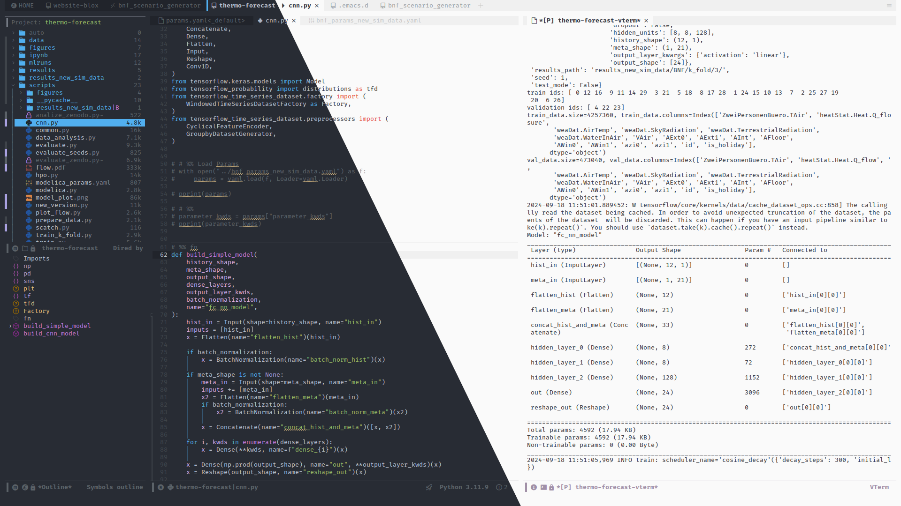

#+TITLE: Emacs Literate Configuration
#+AUTHOR: Marcel Arpogaus
#+STARTUP: show3levels indent
#+auto_tangle: t
#+PROPERTY: header-args :mkdirp yes :comments org :results none
#+EXCLUDE_TAGS: noexport



This Emacs configuration prioritizes speed and a distraction-free writing and coding experience, drawing inspiration from projects like [[https://github.com/doomemacs/doomemacs][DOOM Emacs]], [[https://github.com/SystemCrafters/crafted-emacs][crafted-emacs]], and [[#references][others]]. It leverages a literate programming approach using Org mode, enabling clear documentation and easy configuration management.
Here are some notable features:

- *Literate Configuration:* The entire configuration is written in Org mode, making it self-documenting and easy to navigate. This file, =emacs.org=, is the single source of truth for all settings. The Org mode source code blocks are tangled to generate the actual Emacs Lisp files loaded by Emacs, for enhanced usability and easier debugging, as suggested by [[https://protesilaos.com/emacs/dotemacs][Protesilaos]].

- *Optimized Startup:* Various techniques are employed to minimize startup time, including deferring package loading with [[https://github.com/jwiegley/use-package][use-package]], optimized garbage collection settings, and disabling non-essential services during initialization.

- *Elpaca for Package Management:* [[https://github.com/progfolio/elpaca][Elpaca]] is used for package management, offering a more modern and robust alternative to the built-in package.el.

- *Minimal UI:* The interface is streamlined by default, hiding the menu bar, tool bar, and scroll bar to maximize screen efficiency. Additional packages like [[https://github.com/LionyxML/auto-dark-emacs.git][auto-dark]], [[https://github.com/doomemacs/themes][doom-themes]], [[https://gitlab.com/jessieh/mood-line.git][mood-line]], [[https://github.com/rainstormstudio/nerd-icons.el.git][nerd-icons]] and [[https://github.com/emacs-straight/spacious-padding.git][spacious-padding]] are used to ensure a distraction free and consistent, yet modern design.

- *Optimized UX:* Several built-in packages like =autorevert=, =delsel=, =elec-pair=, =hideshow=, =outline=, =saveplace= and =savehist= are enabled and configured for optimal user experience. The window layout is managed by [[https://github.com/MArpogaus/auto-side-windows.git][auto-side-windows]], which puts a buffer on the side it belongs to, and [[https://github.com/MArpogaus/window-box][window-box]], which draws those sides as panels, while [[https://github.com/magnars/multiple-cursors.el.git][multiple-cursors]] and [[https://github.com/mhayashi1120/Emacs-wgrep.git][wgrep]] enhance the editing experience across multiple lines or files.

- *Extensive Completion Framework:* A powerful completion framework is provided using [[https://github.com/minad/corfu][Corfu]], [[https://github.com/minad/cape][Cape]], [[https://github.com/oantolin/orderless][Orderless]], and [[https://github.com/minad/vertico][Vertico]], offering intelligent and context-aware completion suggestions. This framework is enhanced with [[https://github.com/minad/marginalia][Marginalia]] to provide additional context in the minibuffer, [[https://github.com/oantolin/embark][Embark]] for actions on completion candidates, and [[https://github.com/minad/consult][Consult]] for enhanced minibuffer completion commands.

- *Project and Workspace Management:*  [[https://www.gnu.org/software/emacs/manual/html_node/emacs/Projects.html][Project.el]] (built-in), [[https://github.com/MArpogaus/auto-tab-groups][auto-tab-groups]], and [[https://www.gnu.org/software/emacs/manual/html_node/emacs/Tab-Bars.html][tab-bar]] (built-in) are used for seamless project and workspace management, allowing for efficient organization and navigation between projects. These features are further enhanced by [[https://github.com/karthink/project-x][Project-x]], which provides additional enhancements to project management.

- *Integrated Development Environment (IDE) Features:* The configuration includes powerful IDE-like features such as [[https://github.com/joaotavora/eglot][Eglot]] for Language Server Protocol integration, boosted by [[https://github.com/jdtsmith/eglot-booster][Eglot-booster]] for improved performance. [[https://github.com/svaante/dape][Dape]] is used for debugging, and [[https://www.gnu.org/software/emacs/manual/html_node/flymake/index.html][Flymake]] (built-in) provides on-the-fly syntax checking.

- *Org Mode Power User Setup:* A comprehensive Org mode setup is provided, including features for task management, note-taking, literate programming, presentations, and more.  [[https://github.com/minad/org-modern][Org-modern]] provides a visually appealing modern theme, while [[https://github.com/awth13/org-appear][Org-appear]] enhances the visibility of hidden elements.  [[https://github.com/emacsorphanage/ox-pandoc][Ox-pandoc]] enables exporting Org documents using Pandoc, and [[https://github.com/org-noter/org-noter][Org-noter]] provides document annotation capabilities.

- *Modal Editing with Meow:* [[https://github.com/meow-edit/meow][Meow]] introduces modal editing to Emacs, similar to Vim, for efficient text manipulation and navigation. The modal experience is further enhanced by [[https://github.com/justbur/emacs-which-key][which-key]], providing a helpful popup of available keybindings.

* Table of Contents :TOC_3_gh:noexport:
- [[#installation][Installation]]
- [[#references][References]]
- [[#notes][Notes]]
  - [[#add-git-url-to-pkg-headlines][Add git url to pkg headlines]]
- [[#configuration][Configuration]]
  - [[#common-header-for-emacs-libraries][Common Header for Emacs Libraries]]
  - [[#early-emacs-initialization][Early Emacs Initialization]]
    - [[#01-conventional-library-header][01 Conventional Library Header]]
    - [[#configuration-directory][Configuration Directory]]
    - [[#configure-byte-compile][Configure Byte Compile]]
    - [[#doom-runtime-optimizations][DOOM runtime optimizations]]
    - [[#hide-initial-frame-until-all-packages-are-loaded][Hide initial frame until all packages are loaded]]
    - [[#install-elpaca][Install Elpaca]]
    - [[#minimal-ui][Minimal UI]]
    - [[#optimize-startup-time][Optimize Startup Time]]
    - [[#set-default-frame-size-and-font][Set default frame size and font]]
    - [[#zz-conventional-library-footer][ZZ Conventional Library Footer]]
  - [[#emacs-initialization][Emacs Initialization]]
    - [[#01-conventional-header][01 Conventional Header]]
    - [[#better-defaults][Better Defaults]]
    - [[#configure-elpaca][Configure Elpaca]]
    - [[#configure-use-package][Configure use-package]]
    - [[#keymaps][Keymaps]]
    - [[#no-littering][no-littering]]
    - [[#shared-lisp-functions-and-variables][Shared Lisp Functions and Variables]]
  - [[#configure-packages][Configure Packages]]
    - [[#org][Org]]
    - [[#ui][UI]]
    - [[#ux][UX]]
    - [[#denote][Denote]]
    - [[#tools][Tools]]
    - [[#ai][AI]]
    - [[#completion][Completion]]
    - [[#version-control][Version Control]]
    - [[#project-management][Project Management]]
    - [[#programming][Programming]]
    - [[#keybindings][Keybindings]]
  - [[#conventional-library-footer-for-initel][Conventional Library Footer for =init.el=]]

* Installation

1. /Prerequisites:/
- *Nerd Fonts:* The configuration uses Nerd Fonts for icons. You can download and install a Nerd Font patched version of your preferred font from [[https://www.nerdfonts.com/][nerd fonts]].
- *Command Line Utilities:* Ensure you have the following command line utilities installed:
  - [[https://pandoc.org/][pandoc]] for exporting Org mode files
  - [[https://abiword.github.io/enchant/][enchant-2]] or [[http://hunspell.github.io/][hunspell]] for spell checking
  - [[http://ctags.sourceforge.net/][ctags]] or a [[https://microsoft.github.io/language-server-protocol/][Language Server Protocol (LSP)]] server for symbol indexing
  - [[https://direnv.net/][direnv]] for managing project-specific environments (optional)

2. /Clone the Repository:/

   #+begin_src bash
     git clone https://github.com/MArpogaus/emacs.d ~/.emacs.d
   #+end_src

3. /Install Packages:/

   Start Emacs and it will automatically install the required packages.

4. /Configure Emacs:/

   - Open the =emacs.org= file in Emacs.
   - Customize any settings in the source code blocks as needed.
   - After making changes, press =C-c C-v t= to tangle the Org mode file and generate the Emacs Lisp files.

5. /Enjoy!/

* References
:PROPERTIES:
:ID:       f3a10440-c05c-4829-83bd-4c57ffcadfca
:END:
This Emacs literate configuration has been inspired by the following projects:

- [[https://idiomdrottning.org/bad-emacs-defaults][Bad Emacs defaults]]
- [[https://gist.github.com/axyz/76871b404df376271b521212fba8a621][.emacs.d · GitHub]]
- [[https://github.com/gilbertw1/emacs-literate-starter/blob/master/emacs.org][emacs-literate-starter/emacs.org at master · gilbertw1/emacs-literate-starter...]]
- [[https://github.com/doomemacs/doomemacs][GitHub - doomemacs/doomemacs: An Emacs framework for the stubborn martian hacker]]
- [[https://github.com/rougier/dotemacs][GitHub - rougier/dotemacs: Litterate configuration for GNU Emacs]]
- [[https://github.com/SystemCrafters/crafted-emacs][GitHub - SystemCrafters/crafted-emacs: A sensible base Emacs configuration.]]
- [[https://github.com/terlar/emacs-config][GitHub - terlar/emacs-config: Emacs configuration]]
- [[https://github.com/zoliky/dotemacs][GitHub - zoliky/dotemacs: My GNU Emacs configuration.]]
- [[https://protesilaos.com/emacs/dotemacs][GNU Emacs configuration | Protesilaos Stavrou]]
- [[https://codeberg.org/joe-adams/hydrogen][joe-adams/hydrogen: Hydrogen is a very small framework that aims to make Emac...]]
- [[https://github.com/jamescherti/minimal-emacs.d/blob/main/early-init.el][minimal-emacs.d/early-init.el at main · jamescherti/minimal-emacs.d · GitHub]]
- [[https://panadestein.github.io/emacsd][Pandenstein - Emacs literate configuration]]
- [[https://emacsredux.com/blog/2026/04/07/stealing-from-the-best-emacs-configs/][Stealing from the Best Emacs Configs | Emacs Redux]]
- [[https://systemcrafters.net/emacs-from-scratch/the-best-default-settings/][The 6 Emacs Settings Every User Should Consider - System Crafters]]

* Notes
** Add git url to pkg headlines
#+begin_src bash :results none
  for p in $(grep -P '^\*\*\*\* ([a-z\-])*$' emacs.org | cut -d ' ' -f 2); do
      url=$(git -C ~/.emacs.d/elpaca/sources/$p* remote get-url origin)
      if [ $? -eq 0 ]; then
          sed "s|\*\*\*\* $p|**** [[$url][$p]]|" -i emacs.org
      fi;
  done
#+end_src

* Configuration
** Common Header for Emacs Libraries
[[https://www.gnu.org/software/emacs/manual/html_node/elisp/Library-Headers.html][Library Headers (GNU Emacs Lisp Reference Manual)]]
#+NAME: header
#+begin_src emacs-lisp :var file_name="init.el" :results value :noweb-ref yes
  (format ";;; %s --- Emacs configuration file  -*- no-byte-compile: t; no-native-compile: t; lexical-binding: t; -*-
  ;; Copyright (C) 2023-%s %s

  ;; Author: %s
  ;; Created: %s
  ;; Keywords: configuration
  ;; Homepage: https://github.com/MArpogaus/emacs.d/

  ;; This file is not part of GNU Emacs.

  ;;; Commentary:

  ;; This file has been generated from emacs.org file.  DO NOT EDIT.

  ;;; Code:" file_name
             (format-time-string "%Y")
             user-full-name user-full-name
             (format-time-string "%Y-%m-%d"))
#+end_src

** Early Emacs Initialization
:PROPERTIES:
:header-args+: :tangle early-init.el
:END:
This file serves as the initial configuration file for Emacs and aims to establish fundamental settings before Emacs generates the initial frame.
It should only consist of code that is independent of any package.
*** 01 Conventional Library Header
#+begin_src emacs-lisp :noweb yes :comments no
  <<header(file_name="early-init.el")>>
#+end_src
*** Configuration Directory
=no-littering= points =user-emacs-directory= at =~/.cache/emacs/=, so this keeps the directory the configuration lives in.
It must be set here: the =:init= block of =no-littering= runs after =init.el= has loaded, and =init.el= needs this value to find the =lisp/= modules.
#+begin_src emacs-lisp
  (defvar emacs-config-directory user-emacs-directory
    "Directory this configuration lives in, unaffected by `no-littering'.")
#+end_src
*** Configure Byte Compile
#+begin_src emacs-lisp
  ;; Load the newer of the .el and .elc files.
  (setq load-prefer-newer t)

  ;; Disable certain byte compiler warnings to cut down on the noise.
  (setq byte-compile-warnings '(not unresolved noruntime lexical make-local))

  ;; Ensure that quitting only occurs once Emacs finishes native compiling,
  ;; preventing incomplete or leftover compilation files in `/tmp`.
  (setq native-comp-async-query-on-exit t)
#+end_src
*** DOOM runtime optimizations
These optimizations come from [[https://github.com/doomemacs/doomemacs/blob/da3d0687c5008edbbe5575ac1077798553549a6a/lisp/doom-start.el#L30][here]].
#+begin_src emacs-lisp
  ;; PERF: A second, case-insensitive pass over `auto-mode-alist' is time wasted.
  (setq auto-mode-case-fold nil)

  ;; PERF: no bidirectional text scanning.
  (setq-default bidi-paragraph-direction 'left-to-right)

  ;; PERF: faster redisplay, bidi text in brackets may reorder wrongly.
  (setq bidi-inhibit-bpa t)  ; Emacs 27+ only

  ;; Reduce rendering/line scan work for Emacs by not rendering cursors or regions
  ;; in non-focused windows.
  (setq-default cursor-in-non-selected-windows nil)

  ;; Don't ping things that look like domain names.
  (setq ffap-machine-p-known 'reject)

  ;; Font compacting is expensive for icon fonts; this costs memory.
  (setq inhibit-compacting-font-caches t)

  ;; PGTK: a lower timeout makes child frames snappier (lsp-ui#613).
  (when (boundp 'pgtk-wait-for-event-timeout)
    (setq pgtk-wait-for-event-timeout 0.001))

  ;; Skip fontification while input is pending, for faster scrolling.
  (setq redisplay-skip-fontification-on-input t)
#+end_src
*** Hide initial frame until all packages are loaded
#+begin_src emacs-lisp
  (add-to-list 'initial-frame-alist (cons 'visibility init-file-debug))
  (add-to-list 'initial-frame-alist '(fullscreen . maximized))
  (add-hook 'elpaca-after-init-hook #'make-frame-visible 98)
  ;; Show the frame after a while, even if init failed.
  (add-hook 'after-init-hook
            (lambda ()
              (run-at-time 15 nil (lambda ()
                                    (when (display-graphic-p)
                                      (make-frame-visible))))))
#+end_src
*** Install Elpaca
This clones =Elpaca= into the =elpaca= subdirectory of =user-emacs-directory=, then builds and activates it.
#+begin_src emacs-lisp
  (defvar elpaca-installer-version 0.12)
  (defvar elpaca-directory (expand-file-name "elpaca/" user-emacs-directory))
  (defvar elpaca-builds-directory (expand-file-name "builds/" elpaca-directory))
  (defvar elpaca-sources-directory (expand-file-name "sources/" elpaca-directory))
  (defvar elpaca-order '(elpaca :repo "https://github.com/progfolio/elpaca.git"
                                :ref nil :depth 1 :inherit ignore
                                :files (:defaults "elpaca-test.el" (:exclude "extensions"))
                                :build (:not elpaca-activate)))
  (let* ((repo  (expand-file-name "elpaca/" elpaca-sources-directory))
         (build (expand-file-name "elpaca/" elpaca-builds-directory))
         (order (cdr elpaca-order))
         (default-directory repo))
    (add-to-list 'load-path (if (file-exists-p build) build repo))
    (unless (file-exists-p repo)
      (make-directory repo t)
      (when (<= emacs-major-version 28) (require 'subr-x))
      (condition-case-unless-debug err
          (if-let* ((buffer (pop-to-buffer-same-window "*elpaca-bootstrap*"))
                    ((zerop (apply #'call-process `("git" nil ,buffer t "clone"
                                                    ,@(when-let* ((depth (plist-get order :depth)))
                                                        (list (format "--depth=%d" depth) "--no-single-branch"))
                                                    ,(plist-get order :repo) ,repo))))
                    ((zerop (call-process "git" nil buffer t "checkout"
                                          (or (plist-get order :ref) "--"))))
                    (emacs (concat invocation-directory invocation-name))
                    ((zerop (call-process emacs nil buffer nil "-Q" "-L" "." "--batch"
                                          "--eval" "(byte-recompile-directory \".\" 0 'force)")))
                    ((require 'elpaca))
                    ((elpaca-generate-autoloads "elpaca" repo)))
              (progn (message "%s" (buffer-string)) (kill-buffer buffer))
            (error "%s" (with-current-buffer buffer (buffer-string))))
        ((error) (warn "%s" err) (delete-directory repo 'recursive))))
    (unless (require 'elpaca-autoloads nil t)
      (require 'elpaca)
      (elpaca-generate-autoloads "elpaca" repo)
      (let ((load-source-file-function nil)) (load "./elpaca-autoloads"))))
  (add-hook 'after-init-hook #'elpaca-process-queues)
  (elpaca `(,@elpaca-order))
#+end_src
*** Minimal UI
Disable menu, tool and scroll bars.
#+begin_src emacs-lisp
  (menu-bar-mode -1)
  (tool-bar-mode -1)
  (scroll-bar-mode -1)
#+end_src
*** Optimize Startup Time

The following optimizations have been inspired by:

- https://gist.github.com/axyz/76871b404df376271b521212fba8a621
- https://github.com/alexluigit/dirvish/blob/main/docs/.emacs.d.example/early-init.el
- https://github.com/jamescherti/minimal-emacs.d/blob/main/early-init.el
- https://github.com/mnewt/dotemacs/blob/master/early-init.el
- https://github.com/nilcons/emacs-use-package-fast#a-trick-less-gc-during-startup

#+begin_src emacs-lisp
  ;; No garbage collection during startup.
  (setq gc-cons-threshold most-positive-fixnum
        gc-cons-percentage 0.6)

  ;; Restore normal GC thresholds after startup.
  (add-hook 'elpaca-after-init-hook
            (lambda ()
              (setq gc-cons-threshold (* 16 1024 1024)
                    gc-cons-percentage 0.1)) 97)

  ;; Profile emacs startup
  (defun my/count-modes-and-commands ()
    "Count major modes, minor modes, and commands available in the current Emacs session."
    (let ((major-modes 0)
          (minor-modes 0)
          (commands 0))
      (mapatoms
       (lambda (s)
         (when (commandp s)
           (setq commands (1+ commands))
           (when (string-match-p ".+-mode$" (symbol-name s))
             (if (boundp s)
                 (setq minor-modes (1+ minor-modes))
               (setq major-modes (1+ major-modes)))))))
      (message "📊 Emacs loaded with %d major modes, %d minor modes, %d commands and %d features."
               major-modes minor-modes commands (length features))))
  (add-hook 'elpaca-after-init-hook
            (lambda ()
              (when init-file-debug
                (my/count-modes-and-commands))
              (message "🚀 Emacs loaded in %.2f seconds with %d garbage collections."
                       (float-time (time-subtract elpaca-after-init-time before-init-time))
                       gcs-done)) 99)

  ;; Halves startup time with fonts larger than the system default.
  (setq frame-inhibit-implied-resize t)

  ;; X resources would conflict with this configuration.
  (advice-add #'x-apply-session-resources :override #'ignore)

  ;; Remove the "For information about GNU Emacs..." startup message.
  (advice-add #'display-startup-echo-area-message :override #'ignore)

  ;; `inhibit-startup-screen' alone still initializes the startup screen.
  (advice-add #'display-startup-screen :override #'ignore)

  ;; Never show the hello file.
  (defalias #'view-hello-file #'ignore)

  ;; Disable warnings from the legacy advice API. They aren't useful.
  (setq ad-redefinition-action 'accept)

  ;; Ignore warnings about "existing variables being aliased".
  (setq warning-suppress-types '((defvaralias)))

  ;; No file handler is needed during startup.
  (defvar file-name-handler-alist-old file-name-handler-alist)
  (setq file-name-handler-alist nil)
  (add-hook 'emacs-startup-hook
            (lambda ()
              ;; Keep the handlers registered during startup (tramp).
              (setq file-name-handler-alist
                    (delete-dups (append file-name-handler-alist
                                         file-name-handler-alist-old)))))

#+end_src
*** Set default frame size and font
:PROPERTIES:
:ID:       5eb92f35-9f4c-436f-864f-c270dc2f1f29
:END:
The font is set on =window-setup-hook=, after the display can tell whether the font exists: a missing family in =default-frame-alist= makes frame creation fail and kills Emacs at startup.
A terminal frame has no font to set; =server-after-make-frame-hook= sets the font for the first graphic frame of the daemon.
#+begin_src emacs-lisp
  (add-to-list 'default-frame-alist '(width . 100))
  (add-to-list 'default-frame-alist '(height . 25))

  (defun my/set-my-frame-font ()
    "Use FiraCode Nerd Font in this frame and in new frames.
  Do nothing in a terminal.  Warn if a graphic display lacks the font."
    (when (and (display-graphic-p)
               ;; Asked once per session.
               (not (assq 'font default-frame-alist)))
      (let ((family "FiraCode Nerd Font"))
        (if (find-font (font-spec :family family))
            (progn
              (add-to-list 'default-frame-alist (cons 'font family))
              (set-frame-font family nil t)
              ;; Material Design icons also in fonts without them.
              (set-fontset-font t '(#xf0001 . #xf1af0) "Symbols Nerd Font" nil 'append))
          (warn "Font `%s' is not installed, frames keep the default font"
                family)))))

  (add-hook 'window-setup-hook #'my/set-my-frame-font)
  (add-hook 'server-after-make-frame-hook #'my/set-my-frame-font)
#+end_src

=my/glyph= picks the first icon a display can draw.
A graphic frame is asked per character; a terminal cannot be asked, so =my/terminal-glyphs= tells it.
#+begin_src emacs-lisp
  (defvar my/terminal-glyphs t
    "Whether this terminal draws the glyphs a graphic frame draws.
  Emacs cannot ask a terminal font what it holds, and
  `char-displayable-p' checks only the coding system.")

  (defun my/glyph (&rest candidates)
    "Return the first of CANDIDATES this display can draw.
  A graphic frame checks every character of a candidate.  A terminal
  checks only if `my/terminal-glyphs' is non-nil; else the last
  candidate wins, so make it plain text."
    (or (and (or (display-graphic-p) my/terminal-glyphs)
             (seq-find (lambda (candidate)
                         (seq-every-p (if (display-graphic-p)
                                          (lambda (ch)
                                            (internal-char-font nil ch))
                                        #'char-displayable-p)
                                      candidate))
                       candidates))
        (car (last candidates))))
#+end_src
*** ZZ Conventional Library Footer
#+begin_src emacs-lisp
  (provide 'early-init)
  ;;; early-init.el ends here
#+end_src

** Emacs Initialization
:PROPERTIES:
:header-args+: :tangle init.el
:END:
The main initialization file, =init.el=, is responsible for defining essential configurations and variables used in submodules.
*** 01 Conventional Header
#+begin_src emacs-lisp :noweb yes :comments no
  <<header(file_name="init.el")>>
#+end_src
*** Better Defaults
#+begin_src emacs-lisp
  (use-package emacs
    :ensure nil
    :custom
    ;; Startup
    ;; Emacs does a lot of things at startup and here, we disable pretty much everything.
    (inhibit-startup-buffer-menu t)                    ; Disable display of buffer list when more than 2 files are loaded
    (inhibit-startup-screen t)                         ; Disable start-up screen
    (initial-scratch-message "")                       ; Empty the initial *scratch* buffer

    ;; Recover files when emacs crashes
    (auto-save-timeout 10)                             ; Number of seconds between auto-save
    (auto-save-interval 200)                           ; Number of keystrokes between auto-saves
    (kill-buffer-delete-auto-save-files t)             ; Drop the auto-save file when its buffer is killed

    ;; Auto save file buffers
    (auto-save-visited-mode t)                         ; enable auto save for all file buffers
    (auto-save-visited-interval 1)                     ; save every second

    ;; Backups
    (backup-by-copying t)                              ; Back up by copying, not renaming

    ;; Dialogs
    (use-dialog-box nil)                               ; Don't pop up UI dialogs when prompting
    (use-file-dialog nil)                              ; Don't use UI dialogs for file search
    (use-short-answers t)                              ; Replace yes/no prompts with y/n
    (confirm-nonexistent-file-or-buffer nil)           ; Ok to visit non existent files

    ;; Regions
    (delete-active-region 'kill)                       ; Make single-char deletion commands kill an active region
    (use-empty-active-region t)                        ; Region-aware commands act on empty regions

    ;; Mouse
    (context-menu-mode t)                              ; Enable context menu on right click
    (mouse-yank-at-point t)                            ; Yank at point rather than pointer
    (save-interprogram-paste-before-kill t)            ; save existing clipboard text into kill ring before replacing it
    (kill-do-not-save-duplicates t)                    ; No duplicates in the kill ring
    (browse-url-browser-function #'browse-url-xdg-open) ; pgtk's GTK launcher opens nothing in a distrobox
    (xterm-mouse-mode (not (display-graphic-p)))       ; Mouse active in tty mode

    ;; Smoother scrolling
    (scroll-conservatively 101)                        ; Avoid recentering when scrolling far
    (scroll-preserve-screen-position t)                ; Don't move point when scrolling
    (fast-but-imprecise-scrolling t)                   ; More performant rapid scrolling over unfontified regions
    (auto-hscroll-mode nil)                            ; disable automatic horizontal scrolling
    (mouse-wheel-tilt-scroll t)                        ; Enable horizontal scrolling with touchpad
    (scroll-error-top-bottom t)                        ; Page to the buffer edge instead of signalling an error

    ;; Cursor
    (cursor-type '(hbar . 2))                          ; Underline-shaped cursor
    (blink-cursor-mode nil)                            ; Still cursor

    ;; Typography
    (fill-column 80)                                   ; Default line width
    (truncate-lines t)                                 ; Give each line of text just one screen line
    (sentence-end-double-space nil)                    ; Use a single space after dots
    (truncate-string-ellipsis "…")                     ; Nicer ellipsis

    ;; Default mode
    (initial-major-mode 'fundamental-mode)             ; Initial mode is fundamental

    ;; Tabulations
    (indent-tabs-mode nil)                             ; Stop using tabs to indent

    ;; Search
    (isearch-repeat-on-direction-change t)             ; Better isearch movement
    (isearch-lazy-count t)                             ; Enable search match counting
    (lazy-count-prefix-format nil)                     ; Display Count at the end
    (lazy-count-suffix-format " [%s/%s]")              ; of the search prompt

    ;; Performance
    ;; https://github.com/alexluigit/dirvish/blob/main/docs/.emacs.d.example/early-init                                 . el
    (read-process-output-max (* 4 1024 1024))          ; Read more process output per chunk
    (select-active-regions 'only)                      ; Emacs hangs when large selections contain mixed line endings
    (vc-handled-backends '(Git SVN))                   ; Remove unused VC backend

    ;; Miscellaneous
    (comment-auto-fill-only-comments t)                ; Use auto fill mode only in comments
    (compilation-scroll-output 'first-error)           ; Stop scrolling at the first error
    (custom-buffer-done-kill t)                        ; Kill custom buffer when done
    (fringes-outside-margins t)                        ; DOOM: add some space between fringe and buffer
    (help-window-select t)                             ; Select help windows when they open
    (native-comp-async-report-warnings-errors 'silent) ; disable native compiler warnings
    (shell-command-prompt-show-cwd t)                  ; Show current path when executing shell commands
    (windmove-mode nil)                                ; Disable windmove mode
    (set-mark-command-repeat-pop t)                    ; Enable repeat for mark commands

    ;; Enable window dividers
    (window-divider-default-bottom-width 2)
    (window-divider-default-places t)
    (window-divider-default-right-width 2)
    (window-divider-mode t)
    :config
    ;; We tell emacs to use UTF-8 encoding as much as possible.
    ;; UTF-8 everywhere; a later "English" would reset the file defaults.
    (set-language-environment "UTF-8")
    :preface
    (defun my/whitespace-cleanup-unless-idle ()
      "Run `whitespace-cleanup' unless Emacs is idle.
  An idle save comes from `auto-save-visited-mode', not from a command."
      (unless (current-idle-time)
        (whitespace-cleanup)))
    :hook
    ;; Enable word wrapping in prose modes
    (((org-mode markdown-mode text-mode message-mode) . visual-line-mode)
     ;; Enable automatic line breaks before `fill-column' is exceeded, in
     ;; comments only: prose above is soft-wrapped instead
     ((prog-mode conf-mode) . auto-fill-mode)
     (before-save . my/whitespace-cleanup-unless-idle)))
#+end_src
*** Configure Elpaca
#+begin_src emacs-lisp
  ;; Use elpaca lockfile
  (setq elpaca-lock-file (expand-file-name "elpaca.lock" user-emacs-directory))

  ;; Allow automatic upgrade of built-in transient
  ;; https://github.com/progfolio/elpaca/issues/272#issuecomment-2298727726
  (setq elpaca-ignored-dependencies
        (delq 'transient elpaca-ignored-dependencies))

  ;; Enable use-package integration
  (elpaca elpaca-use-package
    ;; Enable use-package :ensure support for Elpaca.
    (elpaca-use-package-mode))
#+end_src
*** Configure use-package
Every package loads lazily. A =use-package= block follows these rules:

1. A global mode starts with =:hook elpaca-after-init=, or =(elpaca-after-init . MODE)= when MODE is not named after the package. A hook with a depth uses =add-hook= in =:init=.
2. A mode for some buffers starts from the hook of their mode.
3. An add-on that must be active with package X: =:after X :demand t=, its mode in =:config=.
4. =:after= only with =:demand t=: alone, it also holds back the keys and hooks of the block.
5. A package with only commands needs no =:after=: its autoloads load it.
6. A block with =:config= needs a trigger: =:hook=, =:bind=, =:mode=, =:commands=, =:demand=, or a load by Emacs or another package.
7. A setting and a key go into the block of the package that owns the variable or the keymap. Window rules all stay in the auto-side-windows block.
8. Advice goes into =:config=, or into =:init= when it must work before the package loads.
9. A block without keywords only installs the package.
10. No =require= and no =with-eval-after-load= in a block.

#+begin_src emacs-lisp
  ;; Enable lazy loading per default
  (setq use-package-always-defer t
        use-package-always-ensure t)

  ;; Make use-package more verbose when `--debug-init' is passed
  ;; https://www.gnu.org/software/emacs/manual/html_node/use-package/Troubleshooting.html
  (when init-file-debug
    (setq use-package-verbose t
          use-package-compute-statistics t
          byte-compile-warnings t
          byte-compile-verbose t
          debug-on-error t))
#+end_src
*** Keymaps

We define some keymaps here used by other package declarations and fill the leader keymap with the most important bindings for basic commands.
Package specific keymap definitions are kept in preface of the respective package declaration.

#+begin_src emacs-lisp
  ;; setup keymaps
  (use-package emacs
    :ensure nil
    :preface
    (defvar my/leader-map (make-sparse-keymap) "key-map for leader key")
    (defvar my/ai-map (make-sparse-keymap) "key-map for ai key")
    (defvar my/buffer-map (make-sparse-keymap) "key-map for buffer commands")
    (defvar my/denote-map (make-sparse-keymap) "key-map for denote commands")
    (defvar my/file-map (make-sparse-keymap) "key-map for file commands")
    (defvar my/open-map (make-sparse-keymap) "key-map for open commands")
    (defvar my/toggle-map (make-sparse-keymap) "key-map for toggle commands")
    (defvar my/version-control-map (make-sparse-keymap) "key-map for version control commands")
    ;; Bound from other modules, so they exist before any module loads.
    (defvar my/window-map (make-sparse-keymap) "key-map for window commands")
    (defvar my/workspace-map (make-sparse-keymap) "key-map for workspace commands")
    ;;ref: https://protesilaos.com/codelog/2024-11-28-basic-emacs-configuration/
    (defun prot/keyboard-quit-dwim ()
      "Do-What-I-Mean behaviour for a general `keyboard-quit'.

  The generic `keyboard-quit' does not do the expected thing when
  the minibuffer is open.  Whereas we want it to close the
  minibuffer, even without explicitly focusing it.

  The DWIM behaviour of this command is as follows:

  - When the region is active, disable it.
  - When a minibuffer is open, but not focused, close the minibuffer.
  - When the Completions buffer is selected, close it.
  - In every other case use the regular `keyboard-quit'."
      (interactive)
      (cond
       ((region-active-p)
        (keyboard-quit))
       ((derived-mode-p 'completion-list-mode)
        (delete-completion-window))
       ((> (minibuffer-depth) 0)
        (abort-recursive-edit))
       (t
        (keyboard-quit))))
    :config
    ;; leader keymap
    (define-key my/leader-map (kbd "a") (cons "ai" my/ai-map))
    (define-key my/leader-map (kbd "b") (cons "buffer" my/buffer-map))
    (define-key my/leader-map (kbd "f") (cons "file" my/file-map))
    (define-key my/leader-map (kbd "g") (cons "goto" goto-map))
    (define-key my/leader-map (kbd "h") (cons "help" help-map))
    (define-key my/leader-map (kbd "n") (cons "denote" my/denote-map))
    (define-key my/leader-map (kbd "o") (cons "open" my/open-map))
    (define-key my/leader-map (kbd "s") (cons "search" search-map))
    (define-key my/leader-map (kbd "t") (cons "toggle" my/toggle-map))
    (define-key my/leader-map (kbd "v") (cons "version-control" my/version-control-map))

    ;; Remove binding to view-echo-area-messages when clicking on inactive minibuffer
    (define-key minibuffer-inactive-mode-map (kbd "<mouse-1>") nil)

    ;; remove keybind for suspend-frame
    (global-unset-key (kbd "C-z"))

    ;; Don't kill windows when clicking on the mode line
    (global-unset-key [mode-line mouse-2])
    (global-unset-key [mode-line mouse-3])
    :bind
    ;;ESC Cancels All
    (("<escape>"            . keyboard-escape-quit)
     ([remap keyboard-quit] . prot/keyboard-quit-dwim)
     ("S-<down-mouse-1>"    . mouse-save-then-kill)
     :map my/leader-map
     ("q"                   . save-buffers-kill-terminal)
     :map my/buffer-map
     ("K"                   . kill-buffer)
     ("b"                   . switch-to-buffer)
     ("c"                   . clone-buffer)
     ("e"                   . eval-buffer)
     ("f"                   . switch-to-buffer-other-frame)
     ("k"                   . kill-current-buffer)
     ("r"                   . revert-buffer)
     ("s"                   . save-buffer)
     ("t"                   . switch-to-buffer-other-tab)
     ("w"                   . switch-to-buffer-other-window)
     :map my/file-map
     ("D"                   . delete-file)
     ("F"                   . find-file-other-window)
     ("c"                   . copy-file)
     ("d"                   . find-dired)
     ("f"                   . find-file)
     ("r"                   . rename-file)
     ("w"                   . write-file)
     :map goto-map
     ("g"                   . goto-line)
     :map my/open-map
     ("F"                   . make-frame)
     ("e"                   . eshell)
     ("i"                   . ielm)
     ("s"                   . scratch-buffer)
     ("t"                   . term)
     :map my/toggle-map
     ("M"                   . my/minimal-ui-mode)
     ("v"                   . visual-line-mode)))
#+end_src

*** no-littering
Use no-littering to automatically set common paths to the new user-emacs-directory =~/.cache/emacs=.
#+begin_src emacs-lisp
  (use-package no-littering
    :demand t
    :init
    ;; `emacs-config-directory' is captured in early-init.el.
    (setq
     ;; Since init.el will be generated from this file, we save customization in a dedicated file.
     custom-file (expand-file-name "custom.el" user-emacs-directory)
     ;; Change the user-emacs-directory to keep unwanted things out of ~/.emacs.d
     user-emacs-directory (expand-file-name "~/.cache/emacs/"))
    :config
    ;; store backup and auto-save files in =no-littering-var-directory=
    (no-littering-theme-backups)
    ;; Load customization File
    (add-hook 'elpaca-after-init-hook (lambda () (load custom-file 'noerror 'nomessage)) -99))
#+end_src
*** Shared Lisp Functions and Variables
In this section, I define some custom Lisp functions.
#+BEGIN_SRC emacs-lisp
  (use-package emacs
    :ensure nil
    :preface
    (setq my/modeline-height 30)
    (setq my/tabline-height 25)
    (defvar citar-bibliography)
    (defun my/bib-note-template ()
      "Return the body of a bibliography note, for citar and citar-denote."
      (concat "#+cite_export: biblatex ieee\n"
              "#+bibliography: " (car citar-bibliography) "\n\n"
              "* Notes\n"
              ":PROPERTIES:\n"
              ":NOTER_DOCUMENT: ${file} \n"
              ":END:\n\n"
              "* Summary :childless:showchildren:export:\n"
              "This is a summary of [cite/t:@${=key=}].\n"
              "** Bibliography\n"))
    (defun my/extract-username-repo ()
      "Extract the username and repository name from a GitHub repository link at point."
      (interactive)
      (save-excursion
        (org-back-to-heading)
        (let* ((element (org-element-at-point))
               (headline (org-element-property :raw-value element))
               (url (save-match-data
                      (and (string-match org-link-bracket-re headline)
                           (match-string 1 headline)))))
          ;; With or without the `.git': both spellings are in this file.
          (if (and url (string-match "github\\.com/\\([[:alnum:]._-]+\\)/\\([[:alnum:]._-]+?\\)\\(?:\\.git\\)?/?\\'" url))
              (list (match-string 1 url) (match-string 2 url))
            (error "No GitHub link found at point")))))
    (defun my/insert-github-repo-description ()
      "Retrieve and insert the short description of a GitHub repository at point."
      (interactive)
      (let* ((repo-info (my/extract-username-repo))
             (username (car repo-info))
             (repo (cadr repo-info)))
        (message (format "Inserting description for GitHub Repository. User: %s, Repo: %s" username repo))
        (let* ((url (format "https://api.github.com/repos/%s/%s" username repo))
               (response (with-current-buffer (url-retrieve-synchronously url)
                           (prog1 (buffer-substring-no-properties (point-min) (point-max))
                             (kill-buffer)))))
          (string-match "\r?\n\r?\n" response)
          (setq response (substring response (match-end 0)))
          (let* ((json (json-read-from-string response))
                 (description (cdr (assoc 'description json))))
            (if description
                (progn
                  (setq description (string-trim description))
                  (setq description (concat (capitalize (substring description 0 1))
                                            (substring description 1)))
                  (unless (string-suffix-p "." description)
                    (setq description (concat description ".")))
                  (insert description))
              (error "No description, website, or topics provided"))))))

    ;; Thanks doom-modeline: https://github.com/seagle0128/doom-modeline/blob/ec6bc00ac035e75ad10b52e516ea5d95cc9e0bd9/doom-modeline-core.el#L1454C8-L1454C39
    (defun my/get-bar-image (height width color)
      "Get a rectangular bar image with specified height, width and color."
      (if (and (image-type-available-p 'pbm) (display-graphic-p))
          (propertize
           " " 'display
           (create-image
            (concat (format "P1\n%i %i\n" width height) (make-string (* width height) ?1) "\n")
            'pbm t :foreground color :ascent 'center :scale 1))
        (propertize "|" 'face (list :foreground color
                                    :background color))))
    (define-minor-mode my/minimal-ui-mode
      "Hide the tab bar, the tab line, the mode line, the padding and the fringes."
      :global t
      :group 'frames
      (if my/minimal-ui-mode
          (progn
            (setq tab-bar-show nil)
            (tab-bar-mode -1)
            (global-tab-line-mode -1)
            (my/global-mode-line-invisible-mode 1)
            ;; Order matters: disabling spacious-padding resets the
            ;; fringes it widened, so zero them afterwards.
            (spacious-padding-mode -1)
            (set-fringe-style 0))
        (progn
          (setq tab-bar-show t)
          (tab-bar-mode 1)
          (global-tab-line-mode 1)
          (my/global-mode-line-invisible-mode -1)
          (spacious-padding-mode 1)
          (set-fringe-style nil)))))
#+end_src
** Configure Packages
The package declarations below are tangled into separate files in the =lisp/= directory.
This directory is added to the =load-path=.
#+begin_src emacs-lisp :tangle init.el
  (add-to-list 'load-path (expand-file-name "lisp/" emacs-config-directory))
#+end_src
*** Org
:PROPERTIES:
:header-args+: :tangle lisp/my-org.el
:END:
#+begin_src emacs-lisp :tangle init.el
  (require 'my-org)
#+end_src
**** 01 Conventional Header
#+begin_src emacs-lisp :noweb yes :comments no
  <<header(file_name="my-org.el")>>
#+end_src
**** ob :build_in:
#+begin_src emacs-lisp
  (use-package ob
    :ensure nil
    :after org
    :demand t
    :custom
    (org-babel-load-languages
     '((emacs-lisp . t)
       (latex . t)
       (plantuml . t)
       (python . t)
       (shell . t)))
    :preface
    ;; https://scripter.co/splitting-an-org-block-into-two/
    (defun my/org-split-block ()
      "Sensibly split the current Org block at point."
      (interactive)
      (if (org-in-src-block-p)
          (save-match-data
            (save-restriction
              (widen)
              (let ((case-fold-search t)
                    (at-bol (bolp))
                    block-start
                    block-end)
                (save-excursion
                  (re-search-backward "^\\(?1:[[:blank:]]*#\\+begin_.+?\\)\\(?: .*\\)*$" nil nil 1)
                  (setq block-start (match-string-no-properties 0))
                  (setq block-end (replace-regexp-in-string
                                   "begin_" "end_" ;Replaces "begin_" with "end_", "BEGIN_" with "END_"
                                   (match-string-no-properties 1))))
                ;; Go to the end of current line, if not at the BOL
                (unless at-bol
                  (end-of-line 1))
                (insert (concat (if at-bol "" "\n")
                                block-end
                                "\n\n"
                                block-start
                                (if at-bol "\n" "")))
                ;; Go to the line before the inserted "#+begin_ .." line
                (beginning-of-line (if at-bol -1 0)))))
        (message "Point is not in an Org block")))

    (defun my/org-babel-execute-and-goto-next-src nil
      "Execute the current block or babel call, then go to the next src block."
      (interactive)
      (let ((org-confirm-babel-evaluate nil))
        (when (org-babel-execute-maybe)
          (org-babel-next-src-block))))

    (defun my/org-metareturn-src-block ()
      "In a src block, execute it and go to the next one."
      (when (and (not current-prefix-arg) (org-in-src-block-p))
        (my/org-babel-execute-and-goto-next-src)
        t))
    :bind
    (:map org-mode-map
          ("M-_" . my/org-split-block))
    :hook
    (org-metareturn . my/org-metareturn-src-block))
#+end_src
**** [[https://git.savannah.gnu.org/git/emacs/org-mode.git][org]]
Agenda view and task management follow https://github.com/rougier/emacs-gtd

#+begin_src emacs-lisp
  (use-package org
    :preface
    (defun my/org-agenda-big-headers ()
      "Show the block headers of the agenda large and in variable pitch.
  A remap, because the theme sets `org-agenda-structure'."
      (face-remap-add-relative 'org-agenda-structure
                               '(:inherit variable-pitch :height 1.2 :weight bold)))
    (defface my/org-todo-onhold-face '((t :inherit (bold warning org-todo)))
      "Face for todo keywords of paused or blocked tasks.")
    (defface my/org-todo-project-face '((t :inherit (bold font-lock-doc-face org-todo)))
      "Face for the PROJ todo keyword.")
    (defun my/org-capture-inbox ()
      "Capture a task into the inbox."
      (interactive)
      (org-capture nil "i"))
    (defun my/org-capture-note ()
      "Capture a new Denote note."
      (interactive)
      (org-capture nil "n"))
    :init
    (setopt org-directory (expand-file-name "Notes/" (getenv "HOME"))
            org-cite-global-bibliography (list (expand-file-name "denote/bib/references.bib" org-directory)))
    :custom
    (org-ellipsis "…")
    (org-fontify-quote-and-verse-blocks t)
    ;; Return or left-click with mouse follows link
    (org-return-follows-link t)
    (org-mouse-1-follows-link t)

    ;; Todo
    (org-todo-keywords
     '((sequence
        "PROJ(p)"   ; A project, which contains other tasks
        "TODO(t)"   ; A task that needs doing
        "NEXT(n!)"  ; The next task to work on; the switch is logged
        "WAIT(w)"   ; Something holds the task up
        "|"
        "DONE(d)"
        "KILL(k)"))) ; Cancelled or no longer applicable
    (org-todo-keyword-faces
     '(("WAIT" . my/org-todo-onhold-face)
       ("PROJ" . my/org-todo-project-face)))

    ;; Add timestamp to items when done
    (org-log-done 'time)
    (org-log-into-drawer t)

    ;; org capture
    (org-capture-templates
     '(("i" "Inbox" entry (file "agenda/inbox.org")
        "* TODO %?\n")
       ("n" "New note (with Denote)" plain
        (file denote-last-path)
        #'denote-org-capture
        :no-save t
        :immediate-finish nil
        :kill-buffer t
        :jump-to-captured t)))

    ;; org-agenda
    ;; A directory, so Org also finds files created after startup
    (org-agenda-files (list (expand-file-name "agenda/" org-directory)))
    ;; auto-side-windows places the agenda; quit only kills the buffer and
    ;; deletes no window, which fails beside side windows.
    (org-agenda-window-setup 'current-window)

    ;; Refile and Archive
    (org-refile-use-outline-path 'file)
    (org-outline-path-complete-in-steps nil)
    (org-refile-targets '((org-agenda-files :maxlevel . 3)))
    (org-agenda-custom-commands
     '(("g" "Get Things Done (GTD)"
        ((agenda "" ((org-agenda-overriding-header "󱨰  Heute")
                     (org-agenda-entry-types '(:timestamp :sexp))
                     (org-agenda-sorting-strategy '(time-up priority-down))
                     (org-agenda-prefix-format "  %?-12t% s")))
         (agenda "" ((org-agenda-overriding-header "\n󰗎  Deadlines")
                     (org-agenda-entry-types '(:deadline))
                     (org-deadline-warning-days 14)
                     (org-agenda-time-grid nil)
                     (org-agenda-format-date "")))
         (agenda "" ((org-agenda-overriding-header "\n󱛡  Geplant")
                     (org-agenda-entry-types '(:scheduled))
                     (org-agenda-time-grid nil)
                     (org-agenda-format-date "")))
         (tags-todo "inbox" ((org-agenda-overriding-header "\n󱉰  Inbox")))
         (todo "NEXT" ((org-agenda-overriding-header "\n󰳠  Next")
                       (org-agenda-todo-ignore-deadlines 'near)
                       (org-agenda-todo-ignore-scheduled 'all)))
         (todo "WAIT" ((org-agenda-overriding-header "\n󰚭  Waiting"))))
        ((org-agenda-span 'day)
         (org-agenda-tag-filter-preset '("-literature"))
         (org-agenda-sorting-strategy '(priority-down category-keep effort-up))
         (org-agenda-prefix-format "  %i %s")))
       ("l" "Literature" tags-todo "literature"
        ((org-agenda-sorting-strategy '(priority-down category-keep effort-up))
         (org-agenda-prefix-format "  %i %-12:c ")))))

    ;; Use SVGs for latex previews -> No blur when scaling
    (org-preview-latex-default-process 'dvisvgm)
    :hook
    ((org-mode . reveal-mode)
     (org-agenda-mode . my/org-agenda-big-headers))
    :bind
    (:map my/leader-map
          ("i" . my/org-capture-inbox)
          ("I" . my/org-capture-note)
          :map my/open-map
          ("a" . org-agenda)
          :map org-mode-map
          ("C-c P" . org-present)))
#+end_src
**** [[https://github.com/awth13/org-appear.git][org-appear]]
Toggle visibility of hidden Org mode element parts upon entering and leaving an element.

#+begin_src emacs-lisp
  (use-package org-appear
    :hook (org-mode . org-appear-mode))
#+end_src
**** [[https://github.com/yilkalargaw/org-auto-tangle.git][org-auto-tangle]]
Tangle Org files on save.
#+begin_src emacs-lisp
  (use-package org-auto-tangle
    :hook (org-mode . org-auto-tangle-mode))
#+end_src
**** [[https://github.com/rexim/org-cliplink.git][org-cliplink]]
Insert an Org link to the URL in the clipboard, with the page title as description.
#+begin_src emacs-lisp
  (use-package org-cliplink)
#+end_src
**** [[https://github.com/tarsius/orglink.git][orglink]]
Use Org Mode links in other modes.
#+begin_src emacs-lisp
  (use-package orglink
    :hook
    (prog-mode . orglink-mode))
#+end_src
**** [[https://github.com/minad/org-modern.git][org-modern]]
Give Org headlines, keywords, tables and source blocks a modern style.
#+begin_src emacs-lisp
  (use-package org-modern
    :custom-face
    ;; set basic title font
    (org-level-8 ((t (:weight bold :inherit variable-pitch))))
    ;; Low levels are unimportant => no scaling
    (org-level-7 ((t (:inherit org-level-8))))
    (org-level-6 ((t (:inherit org-level-8))))
    (org-level-5 ((t (:inherit org-level-8))))
    (org-level-4 ((t (:inherit org-level-8))))
    ;; Top ones get scaled the same as in LaTeX (\large, \Large, \LARGE)
    (org-level-3 ((t (:inherit org-level-8 :height 1.2)))) ;\large))
    (org-level-2 ((t (:inherit org-level-8 :height 1.44)))) ;\Large))
    (org-level-1 ((t (:inherit org-level-8 :height 1.728)))) ;\LARGE))
    ;; Document Title, (\huge)
    (org-document-title ((t (:height 2.074 :foreground unspecified :inherit org-level-8))))
    ;; Ensure org modern labels use fixed pitch font
    (org-modern-label ((t (:height 1.0 :inherit fixed-pitch))))
    (org-modern-todo ((t (:inherit (org-modern-label org-todo org-level-8)))))
    (org-modern-priority ((t (:inherit (org-priority org-modern-label org-level-8)))))
    (org-modern-tag ((t (:inherit (secondary-selection org-modern-label org-level-8)))))
    ;; Fix indentation when variable pitch fonts are used
    (org-hide ((t (:inherit fixed-pitch))))
    :custom
    (org-cycle-level-faces nil)
    (org-n-level-faces 4)
    ;; org-modern draws todo keywords itself and ignores
    ;; `org-todo-keyword-faces'; mirror them here, keeping the label look.
    (org-modern-todo-faces
     '(("WAIT" :inherit (my/org-todo-onhold-face org-modern-todo))
       ("PROJ" :inherit (my/org-todo-project-face org-modern-todo))))
    (org-modern-fold-stars '(("⯈" . "⯆") ("▸" . "▾")))
    (org-modern-block-name
     '((t . t)
       ("src" "" "")
       ("example" "»" "«")
       ("quote" "❝" "❞")
       ("export" "" "")))

    (org-modern-keyword
     '((t . t)
       ;; Metadata
       ("title" . "𝙏")
       ("subtitle" . "𝙩")
       ("author" . "𝘼")
       ("email" . "@")
       ("date" . "𝘿")
       ("description" . "󰋽")
       ("keywords" . "󱋷")

       ;; Configuration & Settings
       ("options" . "")
       ("property" . "")
       ("columns" . "")
       ("language" . "")
       ("filetags" . "󱋷")
       ("tags" . "󰓹")
       ("setupfile" . "󰒓")
       ("include" . "󰌹")
       ("bind" . "󰌷")
       ("startup" . "⏻")
       ("identifier" . "󰰅")
       ("exclude_tags" . "󰤐")
       ("auto_tangle" . "")

       ;; Macros & Bibliography
       ("macro" . "𝑴")
       ("bibliography" . "")
       ("print_bibliography" . "󰌱")
       ("cite_export" . "󱚃")

       ;; LaTeX (using superscript modifiers for clean differentiation)
       ("latex" . "𝑳")
       ("latex_class" . "𝑳ᶜ")
       ("latex_class_options" . "𝑳ᵒ")
       ("latex_header" . "𝑳ʰ")
       ("latex_header_extra" . "𝑳⁺")
       ("latex_compiler" . "𝑳")

       ;; Beamer (superscripts)
       ("beamer" . "𝑩")
       ("beamer_header" . "𝑩ʰ")
       ("beamer_theme" . "𝑩ᵗ")
       ("beamer_color_theme" . "𝑩ᶜ")
       ("beamer_font_theme" . "𝑩ᶠ")

       ;; HTML
       ("html_head" . "𝑯ʰ")
       ("html_head_extra" . "𝑯⁺")

       ;; Attributes
       ("attr_html" . "𝑯ᵃ")
       ("attr_latex" . "𝑳ᵃ")
       ("attr_beamer" . "𝑩ᵃ")

       ;; Elements & Code Blocks
       ("name" . "𝙉")
       ("header-args" . "")
       ("caption" . "☰")
       ("results" . "󱞩")
       ("call" . "󰆍")
       ("toc" . "")))

    ;; Edit settings
    (org-auto-align-tags nil)
    (org-tags-column 0)
    (org-catch-invisible-edits 'show-and-error)
    (org-special-ctrl-a/e t)
    (org-insert-heading-respect-content t)

    ;; Org styling, hide markup etc.
    (org-hide-emphasis-markers t)
    (org-pretty-entities t)

    ;; Agenda styling
    (org-agenda-tags-column 0)
    (org-agenda-remove-tags t)
    (org-agenda-skip-deadline-if-done t)
    (org-agenda-skip-scheduled-if-done t)
    (org-agenda-deadline-leaders '("Heute     " "in %2d T.  " "%2d T. über "))
    (org-agenda-scheduled-leaders '("Heute     " "seit %2d T."))
    (org-agenda-category-icon-alist
     `(("TIDIT" (,(nerd-icons-mdicon "nf-md-briefcase_outline")))
       ("EMACS" (,(nerd-icons-sucicon "nf-custom-emacs")))
       ("CHORA" (,(nerd-icons-mdicon "nf-md-home_outline")))
       ("VIBE CODING" (,(nerd-icons-mdicon "nf-md-robot_outline")))
       (".*" (,(nerd-icons-mdicon "nf-md-checkbox_blank_circle_outline")))))
    (org-agenda-block-separator nil)
    (org-agenda-time-grid
     '((daily today require-timed)
       (800 1000 1200 1400 1600 1800 2000)
       " ┄┄┄┄┄ " "┄┄┄┄┄┄┄┄┄┄┄┄┄┄┄"))
    (org-agenda-current-time-string
     "◀── jetzt")
    :hook ((org-mode . org-modern-mode)
           (org-agenda-finalize . org-modern-agenda)))
#+end_src
**** [[https://github.com/jdtsmith/org-modern-indent.git][org-modern-indent]]
Modern block styling with org-indent.
#+begin_src emacs-lisp
  (use-package org-modern-indent
    :ensure (:host github :repo "jdtsmith/org-modern-indent")
    :hook
    (org-indent-mode . org-modern-indent-mode))
#+end_src
**** [[https://github.com/org-noter/org-noter.git][org-noter]]
Emacs document annotator, using Org-mode.
#+begin_src emacs-lisp
  (use-package org-noter
    :custom
    ;; The WM can handle splits
    ;; org-noter-notes-window-location 'other-frame
    ;; Please stop opening frames
    (org-noter-always-create-frame nil)
    ;; I want to see the whole file
    (org-noter-hide-other nil)
    ;; Everything is relative to the main notes file
    ;; org-noter-notes-search-path (list bibtex-completion-notes-path)
    (org-noter-highlight-selected-text t)
    :hook
    ;; Give each note heading an ID
    (org-noter-insert-heading . org-id-get-create))
#+end_src
**** [[https://github.com/rlister/org-present.git][org-present]]
Ultra-minimalist presentation minor-mode for Emacs org-mode.
Inspired by: https://systemcrafters.net/emacs-tips/presentations-with-org-present/
#+begin_src emacs-lisp
  (use-package org-present
    :preface
    (defun my/org-present-start ()
      (org-present-read-only)
      (org-link-preview-region)

      ;; Hide Property drawers
      (org-tidy-mode 1)

      ;; Tweak font sizes
      (setq-local face-remapping-alist '((header-line (:height 4.0) variable-pitch)
                                         (org-document-title (:inherit variable-pitch :height 2.0) org-document-title)
                                         (org-level-1 (:inherit variable-pitch :height 1.5) org-level-1)
                                         (org-level-2 (:inherit variable-pitch :height 1.3) org-level-2)
                                         (org-level-3 (:inherit variable-pitch :height 1.2) org-level-3)
                                         (org-level-4 (:inherit variable-pitch :height 1.1) org-level-4)
                                         (org-level-5 (:inherit variable-pitch :height 1.1) org-level-5)
                                         (org-level-6 (:inherit variable-pitch :height 1.1) org-level-6)
                                         (org-level-7 (:inherit variable-pitch :height 1.1) org-level-7)
                                         (org-level-8 (:inherit variable-pitch :height 1.1) org-level-8)
                                         (org-default (:inherit variable-pitch) org-default)
                                         (org-table (:inherit fixed-pitch) org-table)
                                         (org-code (:inherit fixed-pitch) org-code)
                                         (org-verbatim (:inherit fixed-pitch) org-verbatim)))

      ;; Set a blank header line string to create blank space at the top
      (setq-local header-line-format " ")

      ;; Configure fill width
      (setq-local visual-fill-column-width 160
                  visual-fill-column-center-text t)

      ;; Remove org modern borders from blocks
      (setq-local org-modern-block-fringe nil)

      ;; Center the presentation and wrap lines
      (visual-fill-column-mode 1)

      ;; Switch to minimal ui mode
      (my/minimal-ui-mode 1))
    (defun my/org-present-quit ()
      (org-link-preview-clear)

      ;; Show Property drawers
      (org-tidy-untidy-buffer)
      (org-tidy-mode 0)

      ;; Reset font customizations
      (kill-local-variable 'face-remapping-alist)

      ;; Clear the header line string so that it isn't displayed
      (kill-local-variable 'header-line-format)

      ;; Configure fill width
      (kill-local-variable 'visual-fill-column-width)
      (kill-local-variable 'visual-fill-column-center-text)

      ;; Reset org modern borders from blocks
      (kill-local-variable 'org-modern-block-fringe)

      ;; Stop centering the presentation and wrap lines
      (visual-fill-column-mode 0)

      ;; Disable minimal ui mode
      (my/minimal-ui-mode -1))
    (defun my/org-present-prepare-slide (buffer-name heading)
      ;; Show only top-level headlines
      (org-overview)

      ;; Unfold the current entry
      (org-fold-show-entry)

      ;; Show only direct subheadings of the slide but don't expand them
      (org-fold-show-children))
    :bind
    (:map org-present-mode-keymap
          ("q"         . org-present-quit)
          ("C-<left>"  . org-present-prev)
          ("C-<right>" . org-present-next))
    :config
    (define-key org-present-mode-keymap (kbd "<left>") nil t)
    (define-key org-present-mode-keymap (kbd "<right>") nil t)
    (add-hook 'org-present-after-navigate-functions 'my/org-present-prepare-slide)
    :hook
    ((org-present-mode . my/org-present-start)
     (org-present-mode-quit . my/org-present-quit)))
#+end_src
**** [[https://github.com/karthink/org-preview.git][org-preview]]
#+begin_src emacs-lisp
  (use-package org-preview
    :ensure (:host github :repo "karthink/org-preview")
    :hook
    (org-mode . org-preview-mode))
#+end_src
**** [[https://github.com/jxq0/org-tidy.git][org-tidy]]
An Emacs minor mode to automatically tidy org-mode property drawers.
#+begin_src emacs-lisp
  (use-package org-tidy)
#+end_src
**** ox :build_in:
#+begin_src emacs-lisp
  (use-package ox
    :ensure nil
    :custom
    (org-export-backends '(md beamer odt latex icalendar html ascii)))
#+end_src
**** ox-beamer :build_in:
#+begin_src emacs-lisp

  (use-package ox-beamer
    :ensure nil
    :config
    (add-to-list 'org-beamer-environments-extra
                 '("onlyenv" "O" "\\begin{onlyenv}%a" "\\end{onlyenv}"))
    (add-to-list 'org-beamer-environments-extra
                 '("overprint" "P" "\\begin{overprint}%a" "\\end{overprint}")))
#+end_src
**** [[https://github.com/larstvei/ox-gfm.git][ox-gfm]]
Github Flavored Markdown Back-End for Org Export Engine.
#+begin_src emacs-lisp
  (use-package ox-gfm
    :after ox
    :demand t)
#+end_src
**** ox-latex :build_in:
#+begin_src emacs-lisp
  (use-package ox-latex
    :ensure nil
    :config
    ;; https://orgmode.org/manual/LaTeX-specific-export-settings.html
    (add-to-list 'org-latex-packages-alist
                 '("AUTO" "babel" t ("pdflatex")))
    (add-to-list 'org-latex-packages-alist
                 '("AUTO" "polyglossia" t ("xelatex" "lualatex")))
    (add-to-list 'org-latex-packages-alist '("" "listings"))
    (add-to-list 'org-latex-packages-alist '("" "xcolor"))
    (add-to-list 'org-latex-classes
                 '("koma-article"
                   "\\documentclass{scrartcl}"
                   ("\\section{%s}" . "\\section*{%s}")
                   ("\\subsection{%s}" . "\\subsection*{%s}")
                   ("\\subsubsection{%s}" . "\\subsubsection*{%s}")
                   ("\\paragraph{%s}" . "\\paragraph*{%s}")
                   ("\\subparagraph{%s}" . "\\subparagraph*{%s}")))
    (add-to-list 'org-latex-classes
                 '("koma-letter"
                   "\\documentclass{scrlttr2}"
                   ("\\section{%s}" . "\\section*{%s}")
                   ("\\subsection{%s}" . "\\subsection*{%s}")
                   ("\\subsubsection{%s}" . "\\subsubsection*{%s}")
                   ("\\paragraph{%s}" . "\\paragraph*{%s}")
                   ("\\subparagraph{%s}" . "\\subparagraph*{%s}"))))
#+end_src
**** [[https://github.com/emacsorphanage/ox-pandoc.git][ox-pandoc]]
Export Org files with pandoc.
#+begin_src emacs-lisp
  (use-package ox-pandoc
    :if (executable-find "pandoc")
    :after ox
    :demand t
    :custom
    (org-pandoc-options
     '((standalone . t)
       (mathjax . t)
       (variable . "revealjs-url=https://revealjs.com"))))
#+end_src
**** [[https://github.com/snosov1/toc-org.git][toc-org]]
Keep an up-to-date table of contents in Org files without export, for READMEs on GitHub.

#+begin_src emacs-lisp
  (use-package toc-org
    :hook
    (org-mode . toc-org-enable))
#+end_src
**** ZZ Library Footer
#+begin_src emacs-lisp
  (provide 'my-org)
  ;;; my-org.el ends here
#+end_src
*** UI
:PROPERTIES:
:header-args+: :tangle lisp/my-ui.el
:END:
#+begin_src emacs-lisp :tangle init.el
  (require 'my-ui)
#+end_src
**** 01 Conventional Header
#+begin_src emacs-lisp :noweb yes :comments no
  <<header(file_name="my-ui.el")>>
#+end_src
**** [[https://github.com/LionyxML/auto-dark-emacs.git][auto-dark]]
Switch between a dark and a light theme with the dark mode setting of the system.
#+begin_src emacs-lisp
  (use-package auto-dark
    :custom
    (auto-dark-themes '((doom-one) (doom-one-light)))
    :hook elpaca-after-init)
#+end_src
**** [[https://github.com/joaotavora/breadcrumb][breadcrumb]]
Emacs headerline indication of where you are in a large project.
#+begin_src emacs-lisp
  (use-package breadcrumb
    :demand t
    :custom
    (breadcrumb-imenu-crumb-separator "  "))
#+end_src
**** display-line-numbers :build_in:
Enable line numbers for some modes.
#+begin_src emacs-lisp
  (use-package display-line-numbers
    :ensure nil
    :custom
    ;; Count total number of lines on startup for correct width
    (display-line-numbers-width-start t)
    :hook
    (((prog-mode conf-mode text-mode) . display-line-numbers-mode)
     ;; disable for org mode
     (org-mode . (lambda () (display-line-numbers-mode -1)))))
#+end_src
**** [[https://github.com/doomemacs/themes][doom-themes]]
#+begin_src emacs-lisp
  (use-package doom-themes
    :preface
    (defun my/patch-doom-themes (&rest args)
      "Give the tab bar a readable foreground.
  A doom theme gives `tab-bar' the foreground of its background, which
  hides the clock of `tab-bar-format-global'."
      (ignore args)
      (set-face-foreground 'tab-bar (face-foreground 'tab-bar-tab)))
    :init
    ;; On the hook, not on `load-theme': restored and auto-dark themes
    ;; are only enabled.
    (add-hook 'enable-theme-functions #'my/patch-doom-themes))
#+end_src
**** mode-line-invisible :build_in:
Hide the mode line of a buffer; the globalized mode hides it in all buffers.
#+begin_src emacs-lisp
  (define-globalized-minor-mode my/global-mode-line-invisible-mode
    mode-line-invisible-mode
    (lambda () (mode-line-invisible-mode 1)))

#+end_src
**** hl-line :build_in:

Highlight the current line.

#+begin_src emacs-lisp
  (use-package hl-line
    :ensure nil
    :hook
    ((prog-mode text-mode tabulated-list-mode) . hl-line-mode))
#+end_src
**** [[https://github.com/tarsius/hl-todo.git][hl-todo]]
Highlight TODO keywords.
#+begin_src emacs-lisp
  (use-package hl-todo
    :preface
    (defun my/hl-todo-register-flymake-report-fn ()
      "Report the keywords to flymake in this buffer."
      (add-hook 'flymake-diagnostic-functions #'hl-todo-flymake nil t))
    :hook
    (((prog-mode conf-mode LaTeX-mode yaml-ts-mode) . hl-todo-mode)
     (hl-todo-mode . my/hl-todo-register-flymake-report-fn)))
#+end_src
**** [[https://github.com/jdtsmith/indent-bars.git][indent-bars]]
Fast, configurable indentation guide-bars for Emacs.
#+begin_src emacs-lisp
  (use-package indent-bars
    :ensure (:host github :repo "jdtsmith/indent-bars")
    :custom
    (indent-bars-treesit-support t)
    (indent-bars-treesit-ignore-blank-lines-types '("module"))
    (indent-bars-treesit-wrap '((python
                                 argument_list parameters list list_comprehension dictionary
                                 dictionary_comprehension parenthesized_expression subscript)))
    (indent-bars-treesit-scope '((python
                                  function_definition class_definition for_statement
                                  if_statement with_statement while_statement)))
    (indent-bars-color-by-depth nil)
    (indent-bars-highlight-current-depth '(:face default :blend 0.4))
    (indent-bars-pad-frac 0.1)
    (indent-bars-pattern ".")
    (indent-bars-width-frac 0.2)
    :hook
    ((python-base-mode yaml-ts-mode emacs-lisp-mode) . indent-bars-mode))
#+end_src
**** [[https://github.com/mickeynp/ligature.el.git][ligature]]
Display typographical ligatures in Emacs.

*Note:* Fira Code is loaded [[id:5eb92f35-9f4c-436f-864f-c270dc2f1f29][here.]]
#+begin_src emacs-lisp
  (use-package ligature
    :if (display-graphic-p)
    :preface
    (defun my/setup-ligatures ()
      ;; Enable traditional ligatures in every possible major mode
      (ligature-set-ligatures 't '("www" "Fl"  "Tl" "ff" "fi"  "fj"  "fl"  "ft" "ffi" "ffj" "ffl"))
      ;; Enable all Cascadia and Fira Code ligatures in programming modes
      (ligature-set-ligatures
       '(prog-mode org-mode)
       '(;; == === ==== => =| =>>=>=|=>==>> ==< =/=//=// =~
         ;; =:= =!=
         ("=" (rx (+ (or ">" "<" "|" "/" "~" ":" "!" "="))))
         ;; ;; ;;;
         (";" (rx (+ ";")))
         ;; && &&&
         ("&" (rx (+ "&")))
         ;; !! !!! !. !: !!. != !== !~
         ("!" (rx (+ (or "=" "!" "\." ":" "~"))))
         ;; ?? ??? ?:  ?=  ?.
         ("?" (rx (or ":" "=" "\." (+ "?"))))
         ;; %% %%%
         ("%" (rx (+ "%")))
         ;; |> ||> |||> ||||> |] |} || ||| |-> ||-||
         ;; |->>-||-<<-| |- |== ||=||
         ;; |==>>==<<==<=>==//==/=!==:===>
         ("|" (rx (+ (or ">" "<" "|" "/" ":" "!" "}" "\]"
                         "-" "=" ))))
         ;; \\ \\\ \/
         ("\\" (rx (or "/" (+ "\\"))))
         ;; ++ +++ ++++ +>
         ("+" (rx (or ">" (+ "+"))))
         ;; :: ::: :::: :> :< := :// ::=
         (":" (rx (or ">" "<" "=" "//" ":=" (+ ":"))))
         ;; // /// //// /\ /* /> /===:===!=//===>>==>==/
         ("/" (rx (+ (or ">"  "<" "|" "/" "\\" "\*" ":" "!"
                         "="))))
         ;; .. ... .... .= .- .? ..= ..<
         ("\." (rx (or "=" "-" "\?" "\.=" "\.<" (+ "\."))))
         ;; -- --- ---- -~ -> ->> -| -|->-->>->--<<-|
         ("-" (rx (+ (or ">" "<" "|" "~" "-"))))
         ;; www wwww
         ("w" (rx (+ "w")))
         ;; <> <!-- <|> <: <~ <~> <~~ <+ <* <$ </  <+> <*>
         ;; <$> </> <|  <||  <||| <|||| <- <-| <-<<-|-> <->>
         ;; <<-> <= <=> <<==<<==>=|=>==/==//=!==:=>
         ;; << <<< <<<<
         ("<" (rx (+ (or "\+" "\*" "\$" "<" ">" ":" "~"  "!"
                         "-"  "/" "|" "="))))
         ;; >: >- >>- >--|-> >>-|-> >= >== >>== >=|=:=>>
         ;; >> >>> >>>>
         (">" (rx (+ (or ">" "<" "|" "/" ":" "=" "-"))))
         ;; #: #= #! #( #? #[ #{ #_ #_( ## ### #####
         ("#" (rx (or ":" "=" "!" "(" "\?" "\[" "{" "_(" "_"
                      (+ "#"))))
         ;; ~~ ~~~ ~=  ~-  ~@ ~> ~~>
         ("~" (rx (or ">" "=" "-" "@" "~>" (+ "~"))))
         ;; __ ___ ____ _|_ __|____|_
         ("_" (rx (+ (or "_" "|"))))
         ;; Fira code: 0xFF 0x12
         ("0" (rx (and "x" (+ (in "A-F" "a-f" "0-9")))))
         ;; The few not covered by the regexps.
         "{|"  "[|"  "]#"  "(*"  "}#"  "$>"  "^="))
      ;; Enable star ligatures only for programming modes to fix incompatibility
      ;; with `org-modern'
      (ligature-set-ligatures
       '(prog-mode)
       ;; *> */ *)  ** *** ****
       '(("*" (rx (or ">" "/" ")" (+ "*"))))))
      ;; Enable ligatures in all buffers.
      (global-ligature-mode))
    :hook
    (elpaca-after-init . my/setup-ligatures))
#+end_src
**** [[https://gitlab.com/jessieh/mood-line.git][mood-line]]
#+begin_src emacs-lisp
  (use-package mood-line
    :custom
    ;; Use pretty Fira Code-compatible glyphs
    (mood-line-glyph-alist mood-line-glyphs-fira-code)
    (mood-line-format
     (mood-line-defformat
      :padding ""
      :left
      (((my/get-bar-image my/modeline-height 3 nil)                               . " ")
       ((mood-line-segment-modal)                                                 . " ")
       ((mood-line-segment-multiple-cursors)                                      . " ")
       " "
       ((when (featurep 'breadcrumb) (breadcrumb-imenu-crumbs))                   . " "))
      :right
      (((mood-line-segment-process)                                               . " ")
       ((mood-line-segment-buffer-status)                                         . " ")
       ;; Misc info is shown in the tab bar.
       ((mood-line-segment-major-mode)                                            . " ")
       ((mood-line-segment-vc)                                                    . " ")
       ((mood-line-segment-checker)                                               . " "))))
    (mood-line-segment-modal-meow-state-alist
     `((normal ,(nerd-icons-mdicon "nf-md-alpha_n_circle") . font-lock-variable-name-face)
       (insert ,(nerd-icons-mdicon "nf-md-alpha_i_circle") . font-lock-string-face)
       (keypad ,(nerd-icons-mdicon "nf-md-alpha_k_circle") . font-lock-keyword-face)
       (beacon ,(nerd-icons-mdicon "nf-md-alpha_b_circle") . font-lock-type-face)
       (motion ,(nerd-icons-mdicon "nf-md-alpha_m_circle") . font-lock-constant-face)))
    :hook elpaca-after-init)
#+end_src
**** [[https://github.com/rainstormstudio/nerd-icons.el.git][nerd-icons]]
A library for Nerd Font icons, used by the mode line.
#+begin_src emacs-lisp
  (use-package nerd-icons)
#+end_src
**** [[https://github.com/haji-ali/procress.git][procress]]
Display LaTeX compilation information in the mode line.
#+begin_src emacs-lisp
  (use-package procress
    :ensure (:host github :repo "haji-ali/procress")
    :commands procress-auctex-mode
    :hook
    (LaTeX-mode . procress-auctex-mode)
    :config
    (procress-load-default-svg-images))
#+end_src
**** [[https://github.com/emacs-straight/spacious-padding.git][spacious-padding]]
Increase the padding/spacing of GNU Emacs frames and windows.
#+begin_src emacs-lisp
  (use-package spacious-padding
    :custom
    (spacious-padding-widths '(
                               :internal-border-width 10
                               :header-line-width 0
                               :mode-line-width 4
                               :tab-bar-width 4
                               :tab-line-width 2
                               :tab-width 2
                               :right-divider-width 10
                               :fringe-width 8))
    (spacious-padding-subtle-frame-lines t)
    :hook elpaca-after-init)
#+end_src
**** tab-bar :build_in:
#+begin_src emacs-lisp
  (use-package tab-bar
    :ensure nil
    :custom
    (tab-bar-history-limit 100)
    (tab-bar-close-button-show nil)
    :config
    ;; Prevent accidental tab switches when scrolling the buffer
    (define-key tab-bar-map (kbd "<wheel-down>") nil t)
    (define-key tab-bar-map (kbd "<wheel-up>") nil t)
    (define-key my/leader-map (kbd "W") (cons "workspace" my/workspace-map))
    :bind
    (:map my/toggle-map
     ("t"                 . tab-bar-mode)
     :map my/leader-map
     ("<backtab>"         . tab-switcher)
     :repeat-map my/window-map
     ("u"                 . tab-bar-history-back)
     ("i"                 . tab-bar-history-forward)
     :repeat-map my/workspace-map
     ("N"                 . tab-bar-move-tab)
     ("P"                 . tab-bar-move-tab-backward)
     ("n"                 . tab-next)
     ("p"                 . tab-previous)
     :exit
     ("TAB"               . tab-switcher)
     ("k"                 . tab-close-group))
    :hook
    ((elpaca-after-init . tab-bar-history-mode)
     elpaca-after-init))
#+end_src
**** [[https://github.com/MArpogaus/modern-tab][modern-tab]]
The look of both tab rows: the tab bar with one tab per tab group, and the tab line with one tab per buffer of a window.
#+begin_src emacs-lisp
  (use-package modern-tab
    :ensure (modern-tab :host github :repo "MArpogaus/modern-tab")
    :custom
    ;; Without it, the tab rows use plain glyphs in a terminal.
    (modern-tab-terminal-glyphs my/terminal-glyphs)
    ;; The bar beside a tab group, as high as the mode line.
    (modern-tab-bar-indicator-height my/modeline-height)
    ;; Assign Icons to tab groups
    (modern-tab-bar-icons
     '(("HOME"       . (:style "suc" :icon "custom-emacs"))
       ("dirvish"    . (:style "suc" :icon "custom-folder_oct"))
       ("denote"     . (:style "md"  :icon "notebook_edit"))
       ("GTD"        . (:style "md"  :icon "checkbox_marked_circle_outline"))
       ("customize"  . (:style "cod" :icon "settings"))
       ("^\\[P\\] *" . (:style "oct" :icon "repo"))
       ("^\\[T\\] *" . (:style "cod" :icon "remote"))))
    ;; Remove prefix from project groups
    (modern-tab-bar-group-name-function
     (lambda (group-name)
       (if (string-match "^\\[.\\] *" group-name)
           (substring group-name (match-end 0))
         group-name)))
    ;; The new button makes a group, not a tab.
    (modern-tab-bar-new-command #'auto-tab-groups-new-group)
    ;; Only the colour of inactive indicators differs from the default.
    (modern-tab-line-inactive-indicator-color nil)
    (modern-tab-line-indicator-height my/tabline-height)
    :hook
    ;; Each mode only styles its row; the host modes turn the rows on.
    ((global-tab-line-mode . modern-tab-line-mode)
     (tab-bar-mode . modern-tab-bar-mode)))
#+end_src
**** tab-line :build_in:
Show the buffers of a window as tabs with the built-in =tab-line-mode=.
[[https://github.com/MArpogaus/modern-tab][modern-tab]] above draws the tabs; this block selects which buffers get a tab line.

#+begin_src emacs-lisp
  (use-package tab-line
    :ensure nil
    :custom
    (tab-line-new-tab-choice nil)
    (tab-line-exclude-modes '(completion-list-mode
                              ediff-meta-mode ediff-mode symbols-outline-mode flymake-diagnostics-buffer-mode
                              dirvish-directory-view-mode dirvish-special-preview-mode
                              dape-info-scope-mode dape-info-stack-mode dape-info-watch-mode dape-info-parent-mode
                              dape-info-modules-mode dape-info-sources-mode dape-info-threads-mode dape-info-breakpoints-mode))
    :hook
    (elpaca-after-init . global-tab-line-mode))
#+end_src
**** time :build_in:
#+begin_src emacs-lisp
  (use-package time
    :ensure nil
    :custom
    (display-time-default-load-average nil)
    (display-time-24hr-format t)
    (display-time-day-and-date t)
    :preface
    (defun my/toggle-display-time-mode (&rest args)
      (ignore args)
      (display-time-mode 'toggle))
    :init
    (advice-add 'toggle-frame-fullscreen
                :after #'my/toggle-display-time-mode))
#+end_src
**** ZZ Library Footer
#+begin_src emacs-lisp
  (provide 'my-ui)
  ;;; my-ui.el ends here
#+end_src
*** UX
:PROPERTIES:
:header-args+: :tangle lisp/my-ux.el
:END:
#+begin_src emacs-lisp :tangle init.el
  (require 'my-ux)
#+end_src
**** 01 Conventional Header
#+begin_src emacs-lisp :noweb yes :comments no
  <<header(file_name="my-ux.el")>>
#+end_src
**** [[https://github.com/emacscollective/auto-compile.git][auto-compile]]
Automatically compile outdated Emacs Lisp libraries.
#+begin_src emacs-lisp
  (use-package auto-compile
    :custom
    (auto-compile-display-buffer nil)
    (auto-compile-mode-line-counter t)
    :hook
    ((elpaca-after-init . auto-compile-on-load-mode)
     (emacs-lisp-mode . auto-compile-on-save-mode)))
#+end_src
**** autorevert :build_in:
Revert buffers when the underlying file has changed.
#+begin_src emacs-lisp
  (use-package autorevert
    :ensure nil
    :custom
    ;; Revert Dired and other buffers
    (global-auto-revert-non-file-buffers t)
    ;; Get notified by the system instead of polling.
    (auto-revert-avoid-polling t)
    ;; Only prompts for confirmation when buffer is unsaved.
    (revert-without-query (list "."))
    :hook
    (elpaca-after-init . global-auto-revert-mode))
#+end_src
**** [[https://github.com/MArpogaus/auto-side-windows.git][auto-side-window]]
#+begin_src emacs-lisp
  (use-package auto-side-windows
    :ensure (:host github :repo "MArpogaus/auto-side-windows")
    :preface
    (defun my/get-header-line-icon-for-buffer (buffer)
      (with-current-buffer buffer
        (unless (boundp 'header-line-icon)
          (setq-local header-line-icon
                      (cond
                       ((buffer-match-p (lambda (buffer) (with-current-buffer buffer (or (bound-and-true-p gptel-mode)
                                                                                         (bound-and-true-p agent-shell-ui-mode))))
                                        buffer)
                        '("AI" . mode-line-emphasis))
                       ((buffer-match-p "Warning" buffer)
                        '("WARN" . warning))
                       ((buffer-match-p '(or "^\\*Backtrace\\*$" ".*[Ee]rror.*") buffer)
                        '("ERR" . error))
                       ((buffer-match-p '(or "^COMMIT_EDITMSG$" "^\\*diff-hl\\*$" (derived-mode . magit-mode)) buffer)
                        '("VC" . success))
                       ((buffer-match-p '(derived-mode . dired-mode) buffer)
                        '("DIR" . mode-line-emphasis))
                       ((buffer-match-p "^\\*Org Src.*\\*" buffer)
                        '("SRC" . mode-line-emphasis))
                       ((buffer-match-p "^\\*Python.*\\*" buffer)
                        (cons (my/glyph "󰌠 " "PY")
                              'default))
                       ((buffer-match-p '(or (derived-mode . shell-mode)
                                             (derived-mode . comint-mode)
                                             (derived-mode . term-mode)
                                             (derived-mode . vterm-mode)) buffer)
                        (cons (my/glyph " " "TERM")
                              'default))
                       ((buffer-match-p "^\\*Org Agenda\\*$" buffer)
                        '("AGENDA" . mode-line-emphasis))
                       (t '("?" . mode-line-inactive)))))
        header-line-icon))
    (defvar my/side-window-drag-map
      (let ((map (make-sparse-keymap)))
        (define-key map [header-line down-mouse-1]
                    #'auto-side-windows-drag-slot)
        map)
      "Keymap that turns part of a header line into a drag handle.
  A keymap on the text takes the press before `mouse-drag-header-line'.")
    (defun my/side-window-button (label help command)
      "Return LABEL as a header-line button running COMMAND on mouse-1."
      (propertize label 'mouse-face 'highlight 'help-echo help
                  'local-map (let ((map (make-sparse-keymap)))
                               (define-key map [header-line mouse-1] command)
                               map)))
    (defun my/side-window-minimize (event)
      "Delete the clicked side window; its buffers stay alive."
      (interactive "e")
      (delete-window (posn-window (event-start event))))
    (defun my/side-window-kill (event)
      "Delete the clicked side window and kill the buffers it displayed."
      (interactive "e")
      (let* ((win (posn-window (event-start event)))
             (bufs (delete-dups (cons (window-buffer win)
                                      (mapcar #'car (window-prev-buffers win))))))
        (dolist (buf bufs)
          ;; Keep buffers that are still visible somewhere else.
          (unless (length> (get-buffer-window-list buf nil t) 1)
            (kill-buffer buf)))
        (when (window-valid-p win)
          (delete-window win))))
    (defface my/panel-header-line
      '((t :inherit bold :underline nil))
      "Face of the header row of a side window.
  `my/header-line-format-top' remaps the header line faces to it.  Keep
  it small: its attributes outrank the overline of window-box.")

    (defun my/panel-label ()
      "Return the name a panel header shows for the current buffer.
  A dired buffer shows its directory, relative to the project root if
  any; its own header line stretches to the right edge of the window."
      (if (not (derived-mode-p 'dired-mode))
          (format-mode-line (or header-line-format "%b") nil nil
                            (current-buffer))
        (let* ((here (directory-file-name
                      (abbreviate-file-name default-directory)))
               (project (project-current nil default-directory))
               (root (and project
                          (directory-file-name
                           (abbreviate-file-name (project-root project))))))
          (cond ((null project) here)
                ((equal here root) (project-name project))
                (t (concat (project-name project) "/"
                           (file-relative-name here root)))))))

    (defvar-local my/header-line-faces-overloaded nil
      "Whether this buffer has the header line face remap already.
  A relative remap stacks, and redisplay runs again and again.")

    (defvar my/header-line-format-top
      '(:eval
        (pcase-let* ((`(,prefix . ,icon)
                      (my/get-header-line-icon-for-buffer (current-buffer)))
                     (row (if (mode-line-window-selected-p)
                              'header-line-active
                            'header-line-inactive))
                     (face (list :inherit (list 'my/panel-header-line row)
                                 :background (face-background icon nil 'default)
                                 :foreground (face-foreground icon)))
                     (own (my/panel-label))
                     ;; Padding of an exact width, and the row's height.
                     (pad (and (display-graphic-p)
                               (my/get-bar-image my/tabline-height (/ my/tabline-height 3)
                                                 (face-foreground icon))))
                     (badge (if pad
                                (concat pad prefix pad)
                              prefix))
                     (buttons
                      (propertize
                       (concat (my/side-window-button
                                ;; One hairline family; the plain `✕' is heavier than `─'.
                                (my/glyph "\uEABA" "─" "hide")
                                "Hide this side window"
                                #'my/side-window-minimize)
                               " "
                               (my/side-window-button
                                (my/glyph "\uEA76" "✕" "close")
                                "Close this side window and kill its buffers"
                                #'my/side-window-kill))
                       'face face)))
          ;; The whole row is the panel's, so the faces carry the look.
          (unless my/header-line-faces-overloaded
            (setq-local my/header-line-faces-overloaded t)
            (dolist (name '(header-line header-line-active
                                        header-line-inactive))
              ;; A tty leaves these faces' colors unspecified, and a
              ;; nil attribute in the remap warns on every redisplay.
              (let ((bg (face-background name nil 'default))
                    (fg (face-foreground name nil 'default)))
                (face-remap-add-relative
                 name `( :inherit my/panel-header-line
                         ,@(when bg (list :background bg))
                         ,@(when fg (list :foreground fg)))))))
          (setq-local window-box-color (face-foreground icon))
          ;; Content only: window-box owns the ends of the row.
          (concat
           (propertize badge 'face (append '(:inverse-video t) face)
                       'local-map my/side-window-drag-map
                       'help-echo "Drag to another slot")
           ;; The remap misses a buffer's own header faces (`magit-header-line').
           (propertize (concat " " own) 'face face)
           ;; window-box moves `right' past the buffer's margin.
           (propertize " " 'display `(space :align-to
                                            (- right ,(string-width buttons))))
           buttons))))

    :custom
    ;; If no rule applies, try these strategies to display new buffers
    (display-buffer-base-action '((display-buffer-in-previous-window
                                   display-buffer-reuse-mode-window
                                   display-buffer-use-some-window
                                   display-buffer-pop-up-window)
                                  ;;. ((inhibit-same-window . t))
                                  ))
    ;; Respects display actions when switching buffers
    (switch-to-buffer-obey-display-actions t)

    ;; Xref targets go to an ordinary window, never to a panel.
    (display-buffer-alist
     '(((category . xref-jump)
        (display-buffer-reuse-window display-buffer-use-some-window)
        (some-window . mru))))

    ;; Reuse on the left: dirvish kills the window of the old listing.
    (auto-side-windows-reuse-mode-window '((left . t)))

    ;; Panels: no `other-window', no tab line, no mode line.
    (auto-side-windows-common-window-parameters `((no-other-window . t)
                                                  (tab-line-format . none)
                                                  (mode-line-format . none)
                                                  (header-line-format . ,my/header-line-format-top)))

    ;; A side keeps the size I give it, per tab.
    (auto-side-windows-remember-sizes t)

    ;; How wide the right side starts.
    (auto-side-windows-right-width 80)

    ;; Top side window configurations
    (auto-side-windows-top-height 15)
    (auto-side-windows-top-buffer-names
     '("^CAPTURE-.*\\.org$"
       "^COMMIT_EDITMSG$"
       "^\\*Agenda Commands\\*$"
       "^\\*Async-native-compile-log\\*$"
       "^\\*Backtrace\\*$"
       "^\\*Compile-Log\\*$"
       "^\\*Messages\\*$"
       "^\\*Multiple Choice Help\\*$"
       "^\\*Org Select\\*"
       "^\\*Org-Babel Error Output\\*"
       "^\\*Process List\\*$"
       "^\\*Quick Help\\*$"
       "^\\*TeX Help\\*$"
       "^\\*TeX errors\\*$"
       "^\\*Warnings\\*$"
       "^\\*diff-hl\\*$"
       "^\\*gptel-system\\*$"
       "^\\*jinx module compilation\\*$"
       "^ \\*Install vterm\\* $"))
    (auto-side-windows-top-buffer-modes
     '(compilation-mode
       flymake-diagnostics-buffer-mode
       grep-mode
       locate-mode
       occur-mode
       xref--xref-buffer-mode))

    ;; Bottom side window configurations
    (auto-side-windows-bottom-buffer-names
     '("^\\*eshell\\*"
       "^\\*shell\\*"
       "^\\*term\\*"
       "^\\*.*vterm\\*"))
    (auto-side-windows-bottom-buffer-modes
     '(eshell-mode
       term-mode
       vterm-mode
       comint-mode))

    ;; Left side window configurations
    (auto-side-windows-left-buffer-names
     '("^ \\*SIDE ::"))
    (auto-side-windows-left-buffer-modes
     '(reftex-toc-mode
       symbols-outline-mode))

    ;; Right side window configurations
    (auto-side-windows-right-buffer-names
     '("^\\*Org Agenda\\*$"
       "^\\*Outline .+\.pdf\\*$"
       "^\\*eldoc.*\\*$"
       "^\\*Org Src.*\\*"
       "^\\*Metahelp\\*$"))
    (auto-side-windows-right-buffer-modes
     '(Info-mode
       TeX-output-mode
       pdf-view-mode
       elpaca-info-mode
       elpaca-log-mode
       help-mode
       helpful-mode
       magit-status-mode
       magit-log-mode
       magit-diff-mode
       magit-process-mode
       pdf-outline-buffer-mode
       shortdoc-mode))

    (window-combination-resize t)
    (window-sides-vertical t)
    (window-sides-slots '(2 1 5 2)) ; maximum number of side windows on the left, top, right and bottom
    (window-persistent-parameters
     (append window-persistent-parameters
             '((tab-line-format . t)
               (header-line-format . t)
               (mode-line-format . t))))
    (org-src-window-setup 'plain)
    (magit-display-buffer-function #'display-buffer)
    (magit-commit-diff-inhibit-same-window t)
    (transient-display-buffer-action
     '(auto-side-windows--display-buffer
       (auto-side-windows-side . top)))
    (transient-mode-line-format nil)
    (gptel-display-buffer-action
     '(auto-side-windows--display-buffer
       (auto-side-windows-side . right)
       (body-function . select-window)))
    (agent-shell-display-action
     '((auto-side-windows--display-buffer)
       .
       ((auto-side-windows-side . right)
        (body-function . select-window))))
    :bind
    (:map my/toggle-map
          ("w" .  window-toggle-side-windows)
          ("W" .  auto-side-windows-toggle-side-window)
          :map my/window-map
          ("s" . auto-side-windows-display-buffer-on-side)
          :map my/buffer-map
          ("B"  . auto-side-windows-switch-to-buffer)
          :repeat-map my/window-map
          ("N" . auto-side-windows-move-to-next-slot)
          ("P" . auto-side-windows-move-to-previous-slot))
    :hook elpaca-after-init)
#+end_src
**** bookmark :build_in:
#+begin_src emacs-lisp
  (use-package bookmark
    :ensure nil
    :custom
    (bookmark-save-flag 1))
#+end_src
**** [[https://github.com/emacs-straight/comint-mime.git][comint-mime]]
Display graphics and other special content in REPLs (comint buffers).
#+begin_src emacs-lisp
  (use-package comint-mime
    :hook
    (inferior-python-mode . comint-mime-setup))
#+end_src
**** delsel :build_in:
Replace selected text when typing.
#+begin_src emacs-lisp
  (use-package delsel
    :ensure nil
    :hook
    ((prog-mode conf-mode text-mode) . delete-selection-local-mode))
#+end_src
**** elec-pair :build_in:
Automatically add closing parentheses, quotes, etc.
#+begin_src emacs-lisp
  (use-package elec-pair
    :ensure nil
    :hook
    ((prog-mode conf-mode) . electric-pair-local-mode))
#+end_src
**** face-remap :build_in:
Keybindings and optimizations for text-scale-mode.
https://github.com/karthink/.emacs.d/blob/4ab4829fde086cb665cba00ee5c6a42d167e14eb/init.el#L4278C1-L4303C64
https://karthinks.com/software/scaling-latex-previews-in-emacs/
#+begin_src emacs-lisp
  (use-package face-remap
    :ensure nil
    :preface
    (defvar my/buffer-scale-map (make-sparse-keymap) "key-map for buffer text scale commands")

    (defun my/text-scale-adjust-latex-previews ()
      "Scale the LaTeX previews of the buffer with its text scale."
      (pcase major-mode
        ((guard (derived-mode-p 'LaTeX-mode))
         (dolist (ov (overlays-in (point-min) (point-max)))
           (if (eq (overlay-get ov 'category)
                   'preview-overlay)
               (my/zoom-latex-preview ov))))
        ('org-mode
         (dolist (ov (overlays-in (point-min) (point-max)))
           (if (eq (overlay-get ov 'org-overlay-type)
                   'org-latex-overlay)
               (my/zoom-latex-preview ov))))))

    (defun my/zoom-latex-preview (ov)
      (overlay-put
       ov 'display
       (cons 'image
             (plist-put
              (cdr (overlay-get ov 'display))
              :scale (+ 1.0 (* 0.25 text-scale-mode-amount))))))
    :init
    (define-key my/buffer-map (kbd "z") (cons "scale" my/buffer-scale-map))
    :bind
    (:repeat-map my/buffer-scale-map
                 ("+" . text-scale-increase)
                 ("-" . text-scale-decrease)
                 ("=" . text-scale-adjust))
    :hook
    (text-scale-mode . my/text-scale-adjust-latex-previews))
#+end_src
**** [[https://github.com/dengste/minimap.git][minimap]]
Sidebar showing a "mini-map" of a buffer.
#+begin_src emacs-lisp
  (use-package minimap
    :custom
    (minimap-window-location 'right)
    (minimap-hide-fringes t)
    (minimap-minimum-width 25)
    (minimap-width-fraction 0)
    (minimap-major-modes '(prog-mode conf-mode))
    :bind
    (:map my/toggle-map
          ("m" . minimap-mode)))
#+end_src
**** [[https://github.com/magnars/multiple-cursors.el.git][multiple-cursors]]
#+begin_src emacs-lisp
  (use-package multiple-cursors
    :preface
    (defvar my/mc-map (make-sparse-keymap) "key-map for multiple cursor commands")
    :init
    (define-key my/leader-map (kbd "m") (cons "mc" my/mc-map))
    :bind
    (("C-S-<mouse-1>" . mc/add-cursor-on-click)
     :map mc/keymap
     ("<escape>" . mc/keyboard-quit)
     :repeat-map my/mc-map
     ("n" . mc/mark-next-like-this)
     ("p" . mc/mark-previous-like-this)
     :exit
     ("a" . mc/mark-all-like-this)
     ("m" . mc/edit-lines))
    :config
    (advice-add 'mouse-set-point :after (lambda (&rest _) (mc/disable-multiple-cursors-mode))))
#+end_src
**** outline :build_in:
Fold and transform headings. Org mode uses outline for its headlines.
#+begin_src emacs-lisp
  (use-package outline
    :ensure nil
    :autoload outline-minor-mode-cycle--bind
    :preface
    (defvar my/outline-repeat-map (make-sparse-keymap) "key-map for outline-mode commands")
    (define-minor-mode my/outline-minor-mode
      "Customize `outline-minor-mode' for non-org buffers."
      :lighter nil
      (if my/outline-minor-mode
          (unless (eq major-mode 'org-mode)
            (outline-minor-mode-cycle--bind nil (kbd "M-<up>") #'outline-move-subtree-up)
            (outline-minor-mode-cycle--bind nil (kbd "M-<down>") #'outline-move-subtree-down)
            (outline-minor-mode-cycle--bind nil (kbd "M-<right>") #'outline-demote)
            (outline-minor-mode-cycle--bind nil (kbd "M-<left>") #'outline-promote)
            (setq-local outline-minor-mode-use-buttons 'in-margins)
            (outline-minor-mode 1)
            (reveal-mode 1))
        (progn
          (outline-minor-mode -1)
          (reveal-mode -1))))
    :custom
    (outline-minor-mode-cycle t)
    (outline-minor-mode-highlight t)
    :init
    (define-key my/leader-map (kbd "TAB") (cons "outline" my/outline-repeat-map))
    :config
    (define-key my/outline-repeat-map (kbd "e") (cons "edit" outline-editing-repeat-map))
    (define-key my/outline-repeat-map (kbd "n") (cons "navigate" outline-navigation-repeat-map))
    :bind
    (:repeat-map my/outline-repeat-map
                 ("SPC"         . outline-mark-subtree)
                 ("TAB"         . outline-cycle)
                 ("S-<tab>"     . outline-cycle-buffer)
                 ("<backtab>"   . outline-cycle-buffer)
                 ("a"           . outline-show-all))
    :hook
    ((text-mode prog-mode conf-mode) . my/outline-minor-mode))
#+end_src
**** [[https://github.com/jamescherti/outline-indent.el.git][outline-indent]]
#+begin_src emacs-lisp
  (use-package outline-indent
    :hook
    ((yaml-ts-mode) . outline-indent-minor-mode))
#+end_src
**** paren :build_in:
Highlight matching parentheses.

#+begin_src emacs-lisp
  (use-package paren
    :ensure nil
    :custom
    (show-paren-when-point-in-periphery t))
#+end_src
**** recentf :build_in:

Keep a list of recently opened files.

#+begin_src emacs-lisp
  (use-package recentf
    :ensure nil
    ;; Something loads it before the package queue reaches no-littering.
    :after no-littering
    :demand t
    :custom
    (recentf-keep '(file-remote-p file-readable-p))
    (recentf-max-menu-items 10)
    (recentf-max-saved-items 100)
    ;; The list is saved on a timer, so a crash costs at most this much of it.
    (recentf-autosave-interval 300)
    (recentf-show-messages nil)
    :config
    (add-to-list 'recentf-exclude
                 (recentf-expand-file-name no-littering-var-directory))
    (add-to-list 'recentf-exclude
                 (recentf-expand-file-name no-littering-etc-directory))
    (setq recentf-save-file-header
          ";;; Automatically generated by `recentf' on %s. -*- no-byte-compile: t; no-native-compile: t; lexical-binding: t; -*- \n")
    :bind
    (:map my/open-map
          ("r" . recentf-open))
    :hook elpaca-after-init)
#+end_src
**** repeat :build_in:
Enable repeat maps.
#+begin_src emacs-lisp
  (use-package repeat
    :ensure nil
    :preface
    ;; https://karthinks.com/software/it-bears-repeating/#adding-repeat-mode-support-to-keymaps
    (defun my/repeatize-keymap (keymap &optional unset via)
      "Add `repeat-mode' support to a KEYMAP. If UNSET is true remove repeat property.
  With VIA, the commands name the variable VIA instead of KEYMAP, so a
  buffer-local VIA picks the map per buffer."
      (map-keymap
       (lambda (_key cmd)
         (when (symbolp cmd)
           (put cmd 'repeat-map (unless unset (or via keymap)))))
       (symbol-value keymap)))
    ;; Both notebooks share the overblock-run commands; each buffer sets its map.
    (defvar-local my/notebook-repeat-map nil
      "The repeat map of the notebook in this buffer.")
    (defun my/repeat-echo-which-key (keymap)
      "Show the repeat keys of KEYMAP in which-key."
      (if keymap
          ;; Not from here: the popup would be drawn inside
          ;; `post-command-hook' and taken away again right after.
          (run-at-time 0 nil #'which-key--create-buffer-and-show nil keymap)
        (which-key--hide-popup)))
    :custom
    (repeat-echo-function #'my/repeat-echo-which-key)
    :hook elpaca-after-init)
#+end_src
**** savehist :build_in:
#+begin_src emacs-lisp
  (use-package savehist
    :ensure nil
    :custom
    (kill-ring-max 500)
    (history-length 500)
    (savehist-additional-variables
     ;; Minibuffer histories are saved anyway.
     '(command-history
       kill-ring
       regexp-search-ring
       search-ring))
    ;; No duplicates in history
    (history-delete-duplicates t)
    :config
    (put 'set-variable-value-history 'history-length 250)
    (put 'custom-variable-history    'history-length 250)
    (put 'query-replace-history      'history-length 250)
    (put 'read-expression-history    'history-length 250)
    (put 'read-char-history          'history-length 250)
    (put 'face-name-history          'history-length 250)
    (put 'bookmark-history           'history-length 250)
    :hook
    ;; Start history mode.
    elpaca-after-init)
#+end_src
**** saveplace :build_in:
Record cursor position from one session to the other.
#+begin_src emacs-lisp
  (use-package saveplace
    :ensure nil
    :custom
    ;; The places are saved on a timer, not only when Emacs exits.
    (save-place-autosave-interval 300)
    :preface
    (defun my/saveplace-recenter (&rest _)
      (when buffer-file-name (ignore-errors (recenter))))
    :hook
    ((elpaca-after-init . save-place-mode)
     (save-place-after-find-file . my/saveplace-recenter)))
#+end_src
**** time-stamp :build_in:
Automatically update file timestamps when file is saved.
#+begin_src emacs-lisp
  (use-package time-stamp
    :ensure nil
    :custom
    (time-stamp-format "%04Y-%02m-%02d %02H:%02M:%02S (%L)")
    :hook
    (before-save . time-stamp))
#+end_src
**** ultra-scroll
#+begin_src emacs-lisp
  (use-package ultra-scroll
    :custom
    (pixel-scroll-precision-interpolate-mice nil) ; Disable interpolation (causes weird jumps)
    :hook elpaca-after-init)
#+end_src
**** [[https://github.com/mhayashi1120/Emacs-wgrep.git][wgrep]]
Edit grep buffers and apply the changes to files.
#+begin_src emacs-lisp
  (use-package wgrep
    :custom
    (wgrep-auto-save-buffer t))
#+end_src
**** window :build_in:
Window sizes, splits and whole layouts: =R= rotates the layout and =W=
rotates the windows through it.
#+begin_src emacs-lisp
  (use-package window
    :ensure nil
    :custom
    (window-resize-pixelwise t)   ; Resize windows pixelwise
    (frame-resize-pixelwise t)    ; Resize frame pixelwise
    ;; Killing a buffer restores the window from before it was shown.
    (kill-buffer-quit-windows t)
    ;; And `q' kills the buffers that are worth nothing once read.
    (quit-window-kill-buffer '(help-mode helpful-mode compilation-mode grep-mode))
    :config
    (define-key my/leader-map (kbd "w") (cons "window" my/window-map))
    :bind
    (("M-o" . other-window-prefix)
     ("M-t" . other-tab-prefix)
     ("M-f" . other-frame-prefix)
     :repeat-map my/window-map
     ("n" . next-window-any-frame)
     ("p" . previous-window-any-frame)
     ("k" . delete-window)
     ("K" . kill-buffer-and-window)
     ("+" . enlarge-window)
     ("-" . shrink-window)
     ("*" . enlarge-window-horizontally)
     ("_" . shrink-window-horizontally)
     ("v" . split-window-vertically)
     ("h" . split-window-horizontally)
     ("m" . delete-other-windows)
     ("M" . delete-other-windows-vertically)
     ("R" . window-layout-rotate-clockwise)
     ("W" . rotate-windows)
     :exit
     ("=" . balance-windows)))
#+end_src
**** [[https://github.com/MArpogaus/window-box][window-box]] :own:
Draw a box around side windows, so they read as panels.
The box adds only the edges the window does not have.
#+begin_src emacs-lisp
  (use-package window-box
    :ensure (:host github :repo "MArpogaus/window-box")
    :custom
    ;; Header and mode line inside the box, tab line outside.
    (window-box-enclose-top 'header-line)
    (window-box-enclose-mode-line t)
    ;; Box side windows, whatever buffer they show.
    (window-box-window-predicate
     (lambda (window)
       (window-parameter window 'window-side)))
    :hook
    (elpaca-after-init . global-window-box-mode))
#+end_src
**** [[https://github.com/joostkremers/writeroom-mode.git][writeroom-mode]]
Distraction-free writing for Emacs.
#+begin_src emacs-lisp
  (use-package writeroom-mode
    :config
    (setopt writeroom-global-effects (append writeroom-global-effects '(my/minimal-ui-mode)))
    :bind (:map my/toggle-map ("z" . writeroom-mode)))
#+end_src
**** ZZ Library Footer
#+begin_src emacs-lisp
  (provide 'my-ux)
  ;;; my-ux.el ends here
#+end_src
*** Denote
:PROPERTIES:
:header-args+: :tangle lisp/my-denote.el
:END:
#+begin_src emacs-lisp :tangle init.el
  (require 'my-denote)
#+end_src
**** 01 Conventional Header
#+begin_src emacs-lisp :noweb yes :comments no
  <<header(file_name="my-denote.el")>>
#+end_src
**** [[https://github.com/pprevos/citar-denote.git][citar-denote]]
#+begin_src emacs-lisp
  (use-package citar-denote
    :custom
    (citar-denote-template 'biblio)
    ;; Absolute: outside a silo `denote-directory' is a list.
    (citar-denote-subdir (expand-file-name "bib_notes/" (car (default-value 'denote-directory))))
    :hook elpaca-after-init)
#+end_src
**** [[https://github.com/emacs-straight/consult-denote.git][consult-denote]]
#+begin_src emacs-lisp
  (use-package consult-denote
    :bind
    (:map my/denote-map
          ("f" . consult-denote-find)
          ("g" . consult-denote-grep))
    :hook elpaca-after-init)
#+end_src
**** [[https://github.com/protesilaos/denote.git][denote]]
Simple note taking and file naming.
#+begin_src emacs-lisp
  (use-package denote
    :custom
    ;; Silos set their own value in .dir-locals.el; the list is for
    ;; everything outside them and for Org export, which ignores dir-locals.
    (denote-directory (list (expand-file-name "denote/work/" org-directory)
                            (expand-file-name "denote/private/" org-directory)))
    (denote-prompts '(title keywords subdirectory))
    ;; Pick dates, where relevant, with Org's advanced interface:
    (denote-date-prompt-use-org-read-date t)
    (denote-templates '((biblio . my/bib-note-template)))
    :preface
    (defun my/kill-denote-buffers ()
      "Kill all denote buffers."
      (interactive)
      (dolist (buf (buffer-list))
        (when (or (string-prefix-p denote-buffer-name-prefix (buffer-name buf))
                  (string-prefix-p "*Denote" (buffer-name buf)))
          (kill-buffer buf))))
    (defun my/denote-save-buffer (&optional title keywords file-type directory date template signature identifier)
      "Save the current buffer as a Denote note or just save if already denoted.
  Prompts for metadata only if the file is not already a Denote file."
      (interactive)
      (if (and buffer-file-name (not (denote-file-has-denoted-filename-p buffer-file-name)))
          ;; A file of its own: rename it rather than write a copy.
          (progn (save-buffer) (call-interactively #'denote-rename-file))
        (unless buffer-file-name
          ;; If not denoted, get data (prompts user if called interactively)
          (pcase-let* ((`(,title ,keywords ,file-type ,directory ,date ,identifier ,template ,signature)
                        (if (called-interactively-p 'any)
                            (denote--creation-get-note-data-from-prompts)
                          (list title keywords file-type directory date identifier template signature))))
            ;; Proceed with Denote creation logic
            (let* ((data (denote--creation-prepare-note-data
                          title keywords file-type directory date identifier template signature))
                   (extension (denote--file-extension (nth 2 data)))
                   (path (denote-format-file-name (nth 3 data) (nth 5 data) (nth 1 data) (nth 0 data) extension (nth 7 data)))
                   (header (denote--format-front-matter (nth 0 data) (nth 4 data) (nth 1 data) (nth 5 data) (nth 7 data) (nth 2 data))))
              (save-excursion
                (save-restriction
                  (widen)
                  (goto-char (point-min))
                  (insert header)
                  (insert (cond ((stringp (nth 6 data)) (nth 6 data))
                                ((functionp (nth 6 data)) (funcall (nth 6 data)))
                                (t "")))))
              (set-visited-file-name path))))
        (save-buffer)))
    :bind
    (:map my/denote-map
          ("L" . denote-add-links)
          ("N" . denote-type)
          ("R" . denote-rename-file-using-front-matter)
          ("b" . denote-backlinks)
          ("d" . denote-dired)
          ("i" . denote-link)
          ("k" . my/kill-denote-buffers)
          ("s" . my/denote-save-buffer)
          ("n" . denote)
          ("r" . denote-rename-file)
          ("q c" . denote-query-contents-link) ; create link that triggers a grep
          ("q f" . denote-query-filenames-link) ; create link that triggers a dired
          :map dired-mode-map
          ("i" . denote-link-dired-marked-notes)
          ("r" . denote-dired-rename-marked-files)
          ("k" . denote-dired-rename-marked-files-with-keywords)
          ("M-r" . denote-dired-rename-marked-files-using-front-matter))
    :hook
    ((text-mode . denote-fontify-links-mode)
     (dired-mode . denote-dired-mode)
     (elpaca-after-init . denote-rename-buffer-mode)))
#+end_src
**** [[https://github.com/protesilaos/denote-silo][denote-silo]]
Commands that ask for a silo first.
#+begin_src emacs-lisp
  (use-package denote-silo
    :custom
    ;; The global value: the package may load in a silo buffer.
    (denote-silo-directories (default-value 'denote-directory))
    :bind
    (:map my/denote-map
          ("c" . denote-silo-create-note)
          ("o" . denote-silo-open-or-create)
          ("D" . denote-silo-dired)))
#+end_src
**** [[https://github.com/emacs-straight/denote-menu.git][denote-menu]]
#+begin_src emacs-lisp
  (use-package denote-menu
    :custom
    (denote-menu-initial-regex (rx "." (or "org" "pdf" "svg" "png" "jpg") line-end))
    :bind
    (:map my/denote-map
          ("m" . list-denotes)))
#+end_src
**** [[https://github.com/protesilaos/denote-sequence][denote-sequence]]
#+begin_src emacs-lisp
  (use-package denote-sequence
    :after denote
    :demand t
    :bind
    ( :map my/denote-map
      ;; - `denote-sequence-new-parent'
      ;; - `denote-sequence-new-sibling'
      ;; - `denote-sequence-new-child'
      ;; - `denote-sequence-new-child-of-current'
      ;; - `denote-sequence-new-sibling-of-current'
      ("S s" . denote-sequence)
      ("S f" . denote-sequence-find)
      ("S l" . denote-sequence-link)
      ("S d" . denote-sequence-dired)
      ("S r" . denote-sequence-reparent)
      ("S c" . denote-sequence-convert))
    :custom
    ;; The default sequence scheme is `numeric'.
    (denote-sequence-scheme 'alphanumeric))
#+end_src
**** ZZ Library Footer
#+begin_src emacs-lisp
  (provide 'my-denote)
  ;;; my-denote.el ends here
#+end_src
*** Tools
:PROPERTIES:
:header-args+: :tangle lisp/my-tools.el
:END:
#+begin_src emacs-lisp :tangle init.el
  (require 'my-tools)
#+end_src
**** 01 Conventional Header
#+begin_src emacs-lisp :noweb yes :comments no
  <<header(file_name="my-tools.el")>>
#+end_src
**** dired :build_in:
#+begin_src emacs-lisp
  (use-package dired
    :ensure nil
    :custom
    ;; inspired by doom
    ;; https://github.com/doomemacs/doomemacs/blob/c2818bcfaa5dc1a0139d1deff7d77bf42a08eede/modules/emacs/dired/config.el#L9C1-L25C36
    (dired-dwim-target t)  ; suggest a target for moving/copying intelligently
    (dired-hide-details-hide-symlink-targets nil)
    ;; don't prompt to revert, just do it
    (dired-auto-revert-buffer #'dired-buffer-stale-p)
    ;; Always copy recursively
    (dired-recursive-copies 'always)
    ;; Ask whether destination dirs should get created when copying/renaming files.
    (dired-create-destination-dirs 'ask)
    ;; Slightly larger thumbnails
    (image-dired-thumb-size 150)
    (delete-by-moving-to-trash t)
    (dired-listing-switches
     "-l --almost-all --human-readable --group-directories-first --no-group")
    (dired-find-subdir t) ; Reuse dired buffers if the directory is a sub directory
    (dired-isearch-filenames t) ; limit search to filenames
    ;; Don't drown me in dired buffers
    (dired-kill-when-opening-new-dired-buffer t)
    ;; Enable mouse drag-and-drop support
    (dired-mouse-drag-files t)
    :config
    ;; HACK: Disable weird click behavior
    (define-key dired-mode-map (kbd "<follow-link>") nil t)
    :bind
    (:map my/open-map
          ("d" . dired)))

  (use-package dired-x
    :ensure nil
    :config
    ;; Make dired-omit-mode hide all "dotfiles"
    (setopt dired-omit-files
            (concat dired-omit-files "\\|^\\..*$"))
    :hook
    (dired-mode . dired-omit-mode))
#+end_src
**** [[https://github.com/purcell/diredfl.git][diredfl]]
Extra Emacs font lock rules for a more colourful dired.
#+begin_src emacs-lisp
  (use-package diredfl
    :hook
    ((dired-mode . diredfl-mode)
     (dirvish-directory-view-mode . diredfl-mode)))
#+end_src
**** [[https://github.com/alexluigit/dirvish.git][dirvish]]
A polished Dired with batteries included.
#+begin_src emacs-lisp
  (use-package dirvish
    :custom
    (dirvish-quick-access-entries ; It's a custom option, `setq' won't work
     '(("h" "~/"                          "Home")
       ("d" "~/Downloads/"                "Downloads")
       ("t" "~/.local/share/Trash/files/" "TrashCan")))
    (dirvish-mode-line-format
     '(:left (sort symlink) :right (vc-info yank index)))
    (dirvish-attributes
     '(nerd-icons file-time file-size collapse subtree-state vc-state))
    (dirvish-side-attributes
     '(nerd-icons subtree-state))
    (dirvish-subtree-state-style 'nerd)
    (dirvish-path-separators (list
                              (format "  %s " (nerd-icons-codicon "nf-cod-home"))
                              (format "  %s " (nerd-icons-codicon "nf-cod-root_folder"))
                              (format " %s " (nerd-icons-faicon "nf-fa-angle_right"))))
    ;; kill all session buffers on quit
    (dirvish-reuse-session nil)
    (dirvish-mode-line-height my/modeline-height)
    (dirvish-header-line-height my/modeline-height)
    :hook
    ((elpaca-after-init . dirvish-override-dired-mode)
     (elpaca-after-init . dirvish-side-follow-mode))
    :config
    ;; Prevent dirvish from closing its buffers after a file has been opened
    (advice-add 'dirvish--find-entry :around
                (lambda (fn find-fn entry)
                  (if (file-directory-p entry)
                      (funcall fn find-fn entry)
                    (funcall find-fn entry))))
    ;; No tab line in a full-frame session.
    (advice-add 'dirvish--build-layout :after
                (lambda (dv)
                  (when (bound-and-true-p global-tab-line-mode)
                    (tab-line-mode (if (dv-curr-layout dv) -1 1)))))
    :bind
    (("C-c f" . dirvish-fd)
     :map my/open-map
     ("D" . dirvish)
     :map my/toggle-map
     ("d" . dirvish-side)
     :map dirvish-mode-map ; Dirvish inherits `dired-mode-map'
     ("<mouse-1>" . dirvish-subtree-toggle-or-open)
     ("<mouse-2>" . dired-mouse-find-file-other-window)
     ("<mouse-3>" . dired-mouse-find-file)
     ("F"         . dirvish-layout-toggle)
     ("M-b"       . dirvish-history-go-backward)
     ("M-e"       . dirvish-emerge-menu)
     ("M-f"       . dirvish-history-go-forward)
     ("M-l"       . dirvish-ls-switches-menu)
     ("M-m"       . dirvish-mark-menu)
     ("M-s"       . dirvish-setup-menu)
     ("N"         . dirvish-narrow)
     ("<tab>"     . dirvish-subtree-toggle)
     ("^"         . dirvish-history-last)
     ("a"         . dirvish-quick-access)
     ("f"         . dirvish-file-info-menu)
     ("h"         . dirvish-history-jump) ; remapped `describe-mode'
     ("s"         . dirvish-quicksort)    ; remapped `dired-sort-toggle-or-edit'
     ("v"         . dirvish-vc-menu)      ; remapped `dired-view-file'
     ("y"         . dirvish-yank-menu)))
#+end_src
**** ediff :build_in:
Compare files with the built-in ediff, and restore the window layout when ediff quits.
[[https://panadestein.github.io/emacsd/#org5917c00][Emacs literate configuration]]

#+begin_src emacs-lisp
  (use-package ediff
    :ensure nil
    :preface
    (defvar my/ediff-original-windows nil)
    (defun my/store-pre-ediff-winconfig ()
      "Store the current window configuration before ediff opens."
      (setq my/ediff-original-windows (current-window-configuration)))
    (defun my/restore-pre-ediff-winconfig ()
      "Restore the window configuration from before ediff."
      (set-window-configuration my/ediff-original-windows))
    :custom
    (ediff-window-setup-function 'ediff-setup-windows-plain)
    (ediff-split-window-function 'split-window-horizontally)
    :hook
    ((ediff-before-setup . my/store-pre-ediff-winconfig)
     (ediff-quit . my/restore-pre-ediff-winconfig)))
#+end_src
**** [[https://github.com/purcell/exec-path-from-shell.git][exec-path-from-shell]]
Make Emacs use the $PATH set up by the user's shell.
#+begin_src emacs-lisp
  (use-package exec-path-from-shell
    :preface
    (defun my/copy-ssh-env ()
      (exec-path-from-shell-copy-env "SSH_AGENT_PID")
      (exec-path-from-shell-copy-env "SSH_AUTH_SOCK"))
    :hook
    ((elpaca-after-init . exec-path-from-shell-initialize)
     (magit-credential . my/copy-ssh-env)))
#+end_src
**** flyspell :build_in:
#+begin_src emacs-lisp
  (use-package flyspell
    :if (not (executable-find "enchant-2"))
    :ensure nil
    :custom
    ;; Doom: https://github.com/doomemacs/doomemacs/blob/dbb48712eea6dfe16815a3e5e5746b31dab6bb2f/modules/checkers/spell/config.el#L195C11-L198C42
    (flyspell-issue-welcome-flag nil)
    ;; Significantly speeds up flyspell, which would otherwise print
    ;; messages for every word when checking the entire buffer
    (flyspell-issue-message-flag nil)
    :preface
    (defun my/restart-flyspell-mode (&rest _)
      (when flyspell-mode
        (flyspell-mode-off)
        (flyspell-mode-on)
        (flyspell-buffer)))
    :config
    ;; `ispell-change-dictionary' is a command, not a hook
    (advice-add 'ispell-change-dictionary :after #'my/restart-flyspell-mode)
    :bind
    (:map flyspell-mode-map
          ("C-;" . flyspell-correct-wrapper)
          :map flyspell-mouse-map
          ("RET" . flyspell-correct-at-point)
          ([mouse-1] . flyspell-correct-at-point))
    :hook
    ((text-mode . flyspell-mode)
     ((prog-mode conf-mode) . flyspell-prog-mode)))
#+end_src
**** [[https://github.com/d12frosted/flyspell-correct.git][flyspell-correct]]
Correct words with flyspell through the completion interface.
#+begin_src emacs-lisp
  (use-package flyspell-correct)
#+end_src
**** [[https://github.com/Wilfred/helpful.git][helpful]]
[[https://github.com/Wilfred/helpful][Helpful]] is an alternative to the built-in Emacs help that provides much more contextual information.

#+begin_src emacs-lisp
  (use-package helpful
    :bind
    (([remap describe-function] . helpful-function)
     ([remap describe-symbol] . helpful-symbol)
     ([remap describe-variable] . helpful-variable)
     ([remap describe-command] . helpful-command)
     ([remap describe-key] . helpful-key)
     ("C-h K" . describe-keymap)
     :map helpful-mode-map
     ([remap revert-buffer] . helpful-update)))
#+end_src
**** ispell :build_in:
#+begin_src emacs-lisp
  (use-package ispell
    :ensure nil
    :if (executable-find "hunspell")
    :custom
    (ispell-program-name "hunspell")
    (ispell-dictionary "en_US,de_DE")
    :config
    (ispell-set-spellchecker-params)
    (ispell-hunspell-add-multi-dic "en_US,de_DE"))
#+end_src
**** [[https://github.com/minad/jinx.git][jinx]]
Enchanted Spell Checker.
#+begin_src emacs-lisp
  (use-package jinx
    :if (executable-find "enchant-2")
    :custom
    (jinx-languages "en_US de_DE")
    :bind (("M-$" . jinx-correct)
           ("C-M-$" . jinx-languages))
    :hook
    (elpaca-after-init . global-jinx-mode))
#+end_src
**** [[https://github.com/vedang/pdf-tools.git][pdf-tools]]
Emacs support library for PDF files.
#+begin_src emacs-lisp
  (use-package pdf-tools
    :magic ("%PDF" . pdf-view-mode)
    :functions (pdf-view-refresh-themed-buffer)
    :preface
    (defun my/pdf-tools-refresh-themed-buffers (&rest _)
      "Refresh every themed PDF buffer to the current theme."
      (dolist (buffer (buffer-list))
        (with-current-buffer buffer
          (when (bound-and-true-p pdf-view-themed-minor-mode)
            (pdf-view-refresh-themed-buffer t)))))
    :custom
    (pdf-view-use-scaling t)
    :config
    (pdf-tools-install :no-query)
    (add-hook 'enable-theme-functions #'my/pdf-tools-refresh-themed-buffers)
    :hook
    (pdf-view-mode . pdf-view-themed-minor-mode))
#+end_src
**** re-builder :build_in:
Use the string syntax in re-builder.
#+begin_src emacs-lisp
  ;; https://www.masteringemacs.org/article/re-builder-interactive-regexp-builder
  (use-package re-builder
    :ensure nil
    :commands re-builder
    :custom
    (reb-re-syntax 'string))
#+end_src
**** server :build_in:

Start the Emacs server unless one is running.

#+begin_src emacs-lisp
  (use-package server
    :ensure nil
    :autoload server-running-p
    :preface
    (defun my/server-start ()
      (unless (server-running-p)
        (server-start)))
    :hook
    (elpaca-after-init . my/server-start))
#+end_src
**** term :build_in:
Major mode for interacting with a terminal.
#+begin_src emacs-lisp
  (use-package term
    :ensure nil
    :commands term
    :if (file-exists-p "/bin/zsh") ; we only use it if shell exists
    :custom
    (shell-file-name "/bin/zsh")
    (explicit-shell-file-name "/bin/zsh"))
#+end_src
**** tramp :build_in:
Edit remote files through ssh and scp.

Optimizations from: https://coredumped.dev/2025/06/18/making-tramp-go-brrrr./
#+begin_src emacs-lisp
  (use-package tramp
    :ensure nil
    :custom
    (tramp-otp-password-prompt-regexp
     (rx bol (* nonl)
         (group (| "Verification code" "OTP"))
         (* nonl) (any ":：៖") (* blank)))
    (remote-file-name-inhibit-auto-save-visited t)
    (remote-file-name-inhibit-cache 60)
    (remote-file-name-inhibit-delete-by-moving-to-trash t)
    (remote-file-name-inhibit-locks t)
    (tramp-copy-size-limit (* 1024 1024)) ; 1mb
    (tramp-default-method "ssh")
    (tramp-histfile-override nil)
    (tramp-use-scp-direct-remote-copying t)
    (tramp-verbose 0)
    (tramp-chunksize 2000)
    (tramp-ssh-controlmaster-options nil)
    :config
    ;; Direct async processes for ssh, scp and sshx connections
    ;; https://www.gnu.org/software/tramp/#Improving-performance-of-asynchronous-remote-processes-1.
    (connection-local-set-profile-variables
     'remote-direct-async-process
     '((tramp-direct-async-process . t)))
    (connection-local-set-profiles
     '(:application tramp :protocol "ssh")
     'remote-direct-async-process)
    (connection-local-set-profiles
     '(:application tramp :protocol "scp")
     'remote-direct-async-process)
    (connection-local-set-profiles
     '(:application tramp :protocol "sshx")
     'remote-direct-async-process))
#+end_src
**** [[https://github.com/akermu/emacs-libvterm.git][vterm]]
Emacs libvterm integration.
#+begin_src emacs-lisp
  ;; https://www.reddit.com/r/emacs/comments/wu5rxi/comment/ilagtzv/?utm_source=share&utm_medium=web3x&utm_name=web3xcss&utm_term=1&utm_content=share_button
  (use-package vterm
    :bind
    (:map my/open-map
          ("v" . vterm)
          :map project-prefix-map
          ("t" . my/project-vterm)
          :map vterm-mode-map
          ("C-<escape>" . vterm-send-escape))
    :preface
    (defun my/project-vterm ()
      (interactive)
      (defvar vterm-buffer-name)
      (let* ((default-directory (project-root (project-current t)))
             (vterm-buffer-name (project-prefixed-buffer-name "vterm"))
             (vterm-buffer (get-buffer vterm-buffer-name)))
        (if (and vterm-buffer (not current-prefix-arg))
            (pop-to-buffer vterm-buffer '(nil (category . comint)))
          (call-interactively #'vterm))))
    ;; https://github.com/akermu/emacs-libvterm/issues/569#issuecomment-2244574273
    (defun my/vterm--get-shell-adv (vterm-shell)
      "Quote VTERM-SHELL if it's a remote shell."
      (if (and (ignore-errors (file-remote-p default-directory))
               (not (string-match-p "'.*'" vterm-shell)))
          (format "'%s'" vterm-shell)
        vterm-shell))
    :config
    (advice-add #'vterm--get-shell :filter-return #'my/vterm--get-shell-adv)
    :custom
    (vterm-copy-exclude-prompt t)
    (vterm-max-scrollback 100000)
    (vterm-shell "zsh")
    (vterm-tramp-shells '(("ssh" "zsh")
                          ("docker" "sh")
                          ("podman" "sh"))))
#+end_src
**** [[https://github.com/emacs-straight/vundo.git][vundo]]
Vundo (visual undo) displays the undo history as a tree and lets you move in the tree to go back to previous buffer states.
#+begin_src emacs-lisp
  (use-package vundo
    :bind
    (:map my/open-map
          ("u". vundo))
    :config
    (when (display-graphic-p)
      (setq vundo-glyph-alist vundo-unicode-symbols)))
#+end_src
**** ZZ Library Footer
#+begin_src emacs-lisp
  (provide 'my-tools)
  ;;; my-tools.el ends here
#+end_src
*** AI
:PROPERTIES:
:header-args+: :tangle lisp/my-ai.el
:END:
#+begin_src emacs-lisp :tangle init.el
  (require 'my-ai)
#+end_src
**** 01 Conventional Header
#+begin_src emacs-lisp :noweb yes :comments no
  <<header(file_name="my-ai.el")>>
#+end_src
**** [[https://github.com/xenodium/agent-shell.git][agent-shell]]
A native Emacs buffer to interact with LLM agents powered by ACP.
#+begin_src emacs-lisp
  (use-package agent-shell
    :preface
    (defvar my/gtd-prompts
      '(("Tag"   . "Tagesreview nach AGENTS.md.")
        ("Inbox" . "Inbox-Review nach AGENTS.md.")
        ("Woche" . "Wochenreview nach AGENTS.md."))
      "Prompts for `my/gtd'; the first one goes to a new agent.
  The rules of each review are in the AGENTS.md of the agenda.")
    (defun my/gtd-refresh-agenda (&rest _)
      "Revert the agenda files the agent changed and redo the agenda.
  A buffer with unsaved edits is left alone."
      (dolist (file (org-agenda-files))
        (when-let* ((buffer (find-buffer-visiting file)))
          (with-current-buffer buffer
            (unless (or (buffer-modified-p) (verify-visited-file-modtime buffer))
              (revert-buffer t t t)))))
      (when-let* ((window (get-buffer-window org-agenda-buffer-name t)))
        (with-selected-window window (org-agenda-redo-all))))
    (defun my/gtd (&optional prompt)
      "Show the GTD agenda beside a Claude agent in the agenda directory.
  A new agent gets the first of `my/gtd-prompts'; with a prefix argument,
  pick PROMPT, which also goes to an agent that runs already."
      (interactive
       (list (when current-prefix-arg
               (cdr (assoc (completing-read "Review: " my/gtd-prompts nil t)
                           my/gtd-prompts)))))
      (let* ((dir (expand-file-name "agenda/" org-directory))
             (shell (seq-find (lambda (buffer)
                                (file-equal-p (buffer-local-value 'default-directory buffer) dir))
                              (agent-shell-buffers))))
        ;; In a main window: shown the usual way, auto-side-windows would
        ;; put the agenda in a panel.
        (save-window-excursion (org-agenda nil "g"))
        (let ((main (seq-find (lambda (window) (not (window-parameter window 'window-side)))
                              (window-list nil 'no-mini))))
          (set-window-buffer main org-agenda-buffer-name)
          (select-window main))
        ;; Project commands from the agenda work in the agenda repository.
        (with-current-buffer org-agenda-buffer-name
          (setq-local default-directory dir))
        (if shell
            (pop-to-buffer shell agent-shell-display-action)
          ;; The last GTD session, in the auto permission mode.
          (let ((default-directory dir)
                (agent-shell-session-strategy 'latest))
            (setq shell (agent-shell-start
                         :config (cons '(:default-session-mode-id . (lambda () "auto"))
                                       (agent-shell-anthropic-make-claude-code-config)))))
          (agent-shell-subscribe-to :shell-buffer shell :event 'turn-complete
                                    :on-event #'my/gtd-refresh-agenda)
          (setq prompt (or prompt (cdar my/gtd-prompts))))
        ;; A new agent takes the prompt only when it is ready; without
        ;; :no-focus it then shows itself in whatever tab is current.
        (when prompt
          (agent-shell-insert :text prompt :submit t :no-focus t :shell-buffer shell))))
    :autoload agent-shell-buffers
    :custom
    (agent-shell-header-style 'text)
    :bind
    (:map my/ai-map
          ("s" . agent-shell)
          :map my/open-map
          ("g" . my/gtd)))
#+end_src
**** [[https://github.com/karthink/gptel.git][gptel]]
A simple LLM client for Emacs.
#+begin_src emacs-lisp
  (use-package gptel
    :preface
    (defun my/gptel-save-to-denote ()
      "Save the current gptel buffer as a Denote note in the gptel/ subdirectory."
      (interactive)
      (let ((previous-dir default-directory)
            (denote-use-title (buffer-name))
            (denote-use-keywords '("gptel" "ai"))
            (denote-use-directory (expand-file-name "gptel/" (car (denote-directories)))))
        (add-file-local-variable 'default-directory previous-dir t)
        (add-file-local-variable 'auto-side-windows-side 'right t)
        (add-file-local-variable 'eval '(gptel-mode) t)
        (call-interactively #'my/denote-save-buffer)
        (setq-local default-directory previous-dir)))
    (defun my/gptel-auto-save-to-denote-h (&rest _)
      "Hook to automatically save gptel buffers to Denote.
  Triggered after the first response is received in a new buffer."
      (my/gptel-save-to-denote)
      (remove-hook 'gptel-post-response-functions #'my/gptel-auto-save-to-denote-h t))
    :init
    ;; Saved chats turn `gptel-mode' on through an `eval' local variable.
    (add-to-list 'safe-local-eval-forms '(gptel-mode))
    :commands (gptel gptel-send)
    :bind
    (:map my/ai-map
          ("a". gptel)
          ("c". gptel-add)
          ("m". gptel-menu))
    :hook
    (gptel-mode . (lambda () (add-hook 'gptel-post-response-functions #'my/gptel-auto-save-to-denote-h nil t)))
    :custom
    (gptel-default-mode 'org-mode)
    :config
    (gptel-make-gemini "Gemini" :key #'gptel-api-key-from-auth-source :stream t)
    (gptel-make-openai "OpenRouter"
      :host "openrouter.ai"
      :endpoint "/api/v1/chat/completions"
      :stream t
      :key #'gptel-api-key-from-auth-source
      :models '((anthropic/claude-haiku-4.5
                 :description "Fast and affordable for light tasks."
                 :input-cost 1.00
                 :output-cost 5.00
                 :context-window 200)
                (anthropic/claude-opus-4.6
                 :description "Powerful for complex reasoning."
                 :input-cost 5.00
                 :output-cost 25.00
                 :context-window 1000)
                (anthropic/claude-sonnet-4.6
                 :description "Balanced for enterprise AI deployments."
                 :input-cost 3.00
                 :output-cost 15.00
                 :context-window 1000)
                (deepseek/deepseek-v3.2
                 :description "General-purpose with large context."
                 :input-cost 0.32
                 :output-cost 0.89
                 :context-window 164)
                (google/gemini-2.5-flash
                 :description "Best price/performance, well-rounded."
                 :input-cost 0.30
                 :output-cost 2.50
                 :context-window 1048)
                (google/gemini-2.5-flash-lite
                 :description "Fastest & cheapest 2.5, high-volume, latency-sensitive."
                 :input-cost 0.10
                 :output-cost 0.40
                 :context-window 1048)
                (google/gemini-2.5-pro
                 :description "Most powerful Gemini, state-of-the-art performance."
                 :input-cost 1.25
                 :output-cost 10.00
                 :context-window 1048)
                (google/gemini-3.1-flash-lite-preview
                 :description "Most intelligent Gemini model built for speed."
                 :input-cost 0.50
                 :output-cost 3.00
                 :context-window 1048)
                (google/gemini-3.1-pro-preview
                 :description "Most intelligent Gemini with SOTA reasoning and multimodal understanding."
                 :input-cost 2.00
                 :output-cost 12.00
                 :context-window 1048)
                (openai/gpt-4.1
                 :description "Flagship model for complex tasks."
                 :input-cost 2.00
                 :output-cost 8.00
                 :context-window 1024)
                (openai/gpt-4.1-mini
                 :description "Balance intelligence, speed, and cost."
                 :input-cost 0.40
                 :output-cost 1.60
                 :context-window 1024)
                (openai/gpt-4.1-nano
                 :description "Fastest, most cost-effective GPT-4.1."
                 :input-cost 0.10
                 :output-cost 0.40
                 :context-window 1024)
                (openai/gpt-5.3-codex
                 :description "Flagship for coding, reasoning, agentic tasks."
                 :input-cost 1.25
                 :output-cost 10.00
                 :context-window 400)
                (openai/o3
                 :description "Well-rounded and powerful across domains."
                 :input-cost 2.00
                 :output-cost 8.00
                 :context-window 200)
                (openai/o3-pro
                 :description "Well-rounded and powerful, professional-grade capabilities."
                 :input-cost 2.00
                 :output-cost 8.00
                 :context-window 200)
                (openai/o4-mini
                 :description "Fast, effective reasoning for coding and visual tasks."
                 :input-cost 1.10
                 :output-cost 4.40
                 :context-window 200)))
    (setq gptel-model 'google/gemma-4-31b-it:free
          gptel-backend (gptel-make-openai "OpenRouter (free)"
                          :host "openrouter.ai"
                          :endpoint "/api/v1/chat/completions"
                          :stream t
                          :key #'gptel-api-key-from-auth-source
                          :models '(google/gemma-4-31b-it:free
                                    google/gemma-4-26b-a4b-it:free
                                    nvidia/nemotron-3-super-120b-a12b:free))))
#+end_src
**** [[https://github.com/karthink/gptel-agent.git][gptel-agent]]
Agent mode for gptel.
#+begin_src emacs-lisp
  (use-package gptel-agent
    :bind
    (:map my/ai-map
          ("A". gptel-agent))
    :config
    ;; Read files from agents directories
    (gptel-agent-update))
#+end_src
**** ZZ Library Footer
#+begin_src emacs-lisp
  (provide 'my-ai)
  ;;; my-ai.el ends here
#+end_src
*** Completion
:PROPERTIES:
:header-args+: :tangle lisp/my-completion.el
:END:
#+begin_src emacs-lisp :tangle init.el
  (require 'my-completion)
#+end_src
**** 01 Conventional Header
#+begin_src emacs-lisp :noweb yes :comments no
  <<header(file_name="my-completion.el")>>
#+end_src
**** [[https://github.com/minad/cape.git][cape]]
Cape provides completion-at-point extensions (Capfs) for Corfu or the default completion UI.
#+begin_src emacs-lisp
  (use-package cape
    :init
    (define-key my/leader-map (kbd ".") (cons "completion" 'cape-prefix-map))
    ;; Add `completion-at-point-functions', used by `completion-at-point'.
    ;; NOTE: The order matters!
    (add-to-list 'completion-at-point-functions #'cape-dabbrev)
    (add-to-list 'completion-at-point-functions #'cape-elisp-block)
    (add-to-list 'completion-at-point-functions #'cape-history)
    (add-to-list 'completion-at-point-functions #'cape-file))
#+end_src
**** [[https://github.com/emacs-citar/citar.git][citar]]
Citar provides a highly-configurable completing-read front-end to browse and act on BibTeX, BibLaTeX, and CSL JSON bibliographic data, and LaTeX, markdown, and org-cite editing support.
#+begin_src emacs-lisp
  (use-package citar
    :custom
    (org-cite-insert-processor 'citar)
    (org-cite-follow-processor 'citar)
    (org-cite-activate-processor 'citar)
    (org-cite-biblatex-options "hyperref=true,url=true,backend=biber,natbib=true")
    (citar-bibliography org-cite-global-bibliography)
    (citar-at-point-function 'embark-act)
    (citar-templates '((main . "${author editor:30}     ${date year issued:4}     ${title:48}")
                       (suffix . "          ${=key= id:15}    ${=type=:12}    ${tags keywords:*}")
                       (preview . "${author editor} (${year issued date}) ${title}, ${journal journaltitle publisher container-title collection-title}.\n")))
    (citar-symbol-separator "  ")
    :config
    (setq citar-indicators
          (list
           (citar-indicator-create
            :symbol (nerd-icons-faicon
                     "nf-fa-file_o"
                     :face 'nerd-icons-green
                     :v-adjust -0.1)
            :function #'citar-has-files
            :padding "  " ; need this because the default padding is too low for these icons
            :tag "has:files")
           (citar-indicator-create
            :symbol (nerd-icons-octicon
                     "nf-oct-link"
                     :face 'nerd-icons-orange
                     :v-adjust 0.01)
            :function #'citar-has-links
            :padding "  "
            :tag "has:links")
           (citar-indicator-create
            :symbol (nerd-icons-mdicon
                     "nf-md-pencil"
                     :face 'nerd-icons-blue
                     :v-adjust 0.01)
            :function #'citar-has-notes
            :padding "  "
            :tag "has:notes")
           (citar-indicator-create
            :symbol (nerd-icons-faicon
                     "nf-fa-circle_o"
                     :face 'nerd-icons-green)
            :function #'citar-is-cited
            :padding "  "
            :tag "is:cited")))
    :hook
    ((LaTeX-mode . citar-capf-setup)
     (org-mode . citar-capf-setup)))

  (use-package citar-embark
    :hook
    ((LaTeX-mode . citar-embark-mode)
     (org-mode . citar-embark-mode)))
#+end_src
**** [[https://github.com/minad/consult.git][consult]]
Additional featureful completion commands.
#+begin_src emacs-lisp
  (use-package consult
    ;; Replace bindings. Lazily loaded by `use-package'.
    :bind (;; Remap default commands with consult equivalents
           ([remap Info-search]                   . consult-info)
           ([remap bookmark-jump]                 . consult-bookmark)
           ([remap goto-line]                     . consult-goto-line)
           ([remap imenu]                         . consult-imenu)
           ([remap load-theme]                    . consult-theme)
           ([remap locate]                        . consult-locate)
           ([remap man]                           . consult-man)
           ([remap project-list-buffers]          . consult-project-buffer)
           ([remap project-switch-to-buffer]      . consult-project-buffer)
           ([remap recentf-open-files]            . consult-recent-file)
           ([remap recentf-open]                  . consult-recent-file)
           ([remap repeat-complex-command]        . consult-complex-command)
           ([remap switch-to-buffer-other-frame]  . consult-buffer-other-frame)
           ([remap switch-to-buffer-other-tab]    . consult-buffer-other-tab)
           ([remap switch-to-buffer-other-window] . consult-buffer-other-window)
           ([remap switch-to-buffer]              . consult-buffer)
           ([remap yank-pop]                      . consult-yank-pop)
           :map goto-map
           ;; M-g bindings in `goto-map'
           ("e"                                   . consult-compile-error)
           ("f"                                   . consult-flymake)             ;; Alternative: consult-flycheck
           ("o"                                   . consult-outline)             ;; Alternative: consult-org-heading
           ("m"                                   . consult-mark)
           ("k"                                   . consult-global-mark)
           ("i"                                   . consult-imenu)
           ("I"                                   . consult-imenu-multi)
           :map search-map
           ("d"                                   . consult-find)
           ("D"                                   . consult-locate)
           ("g"                                   . consult-grep)
           ("G"                                   . consult-git-grep)
           ("r"                                   . consult-ripgrep)
           ("l"                                   . consult-line)
           ("L"                                   . consult-line-multi)
           ("k"                                   . consult-keep-lines)
           ("u"                                   . consult-focus-lines)
           ;; Isearch integration
           ("e"                                   . consult-isearch-history)
           :map isearch-mode-map
           ("M-e"                                 . consult-isearch-history)     ;; orig. isearch-edit-string
           ("M-s e"                               . consult-isearch-history)     ;; orig. isearch-edit-string
           ("M-s l"                               . consult-line)                ;; needed by consult-line to detect isearch
           ("M-s L"                               . consult-line-multi)          ;; needed by consult-line to detect isearch
           ;; Minibuffer history
           :map minibuffer-local-map
           ("M-s"                                 . consult-history)             ;; orig. next-matching-history-element
           ("M-r"                                 . consult-history))            ;; orig. previous-matching-history-element

    :custom
    ;; Nicer register previews.
    (register-preview-delay 0.5)
    (register-preview-function #'consult-register-format)

    ;; Use Consult to select xref locations with preview
    (xref-show-xrefs-function #'consult-xref)
    (xref-show-definitions-function #'consult-xref)

    ;; Optionally configure the narrowing key.
    ;; Both < and C-+ work reasonably well.
    (consult-narrow-key "<") ;; "C-+"
    :config
    ;; Optionally tweak the register preview window.
    ;; This adds thin lines, sorting and hides the mode line of the window.
    (advice-add #'register-preview :override #'consult-register-window)

    (consult-customize
     consult-theme :preview-key '(:debounce 0.2 any)
     consult-ripgrep consult-git-grep consult-grep consult-man
     consult-bookmark consult-recent-file
     consult-source-bookmark consult-source-file-register
     consult-source-recent-file consult-source-project-recent-file
     :preview-key '(:debounce 0.4 any)))
#+end_src
**** [[https://github.com/emacs-straight/corfu.git][corfu]]
Corfu is the minimalistic in-buffer completion counterpart of the Vertico minibuffer UI.
#+begin_src emacs-lisp
  (use-package corfu
    :custom
    ;; In every minibuffer but Vertico's and a password prompt, without
    ;; automatic echo and popup.
    (global-corfu-minibuffer
     (lambda ()
       (unless (or (bound-and-true-p vertico--input)
                   (eq (current-local-map) read-passwd-map))
         (setq-local corfu-echo-delay nil
                     corfu-popupinfo-delay nil)
         t)))

    ;; Enable indentation+completion using the TAB key.
    ;; `completion-at-point' is often bound to M-TAB.
    (tab-always-indent 'complete)

    ;; Additional Customisations
    (corfu-cycle t)                     ;; Enable cycling for `corfu-next/previous'
    (corfu-auto t)                      ;; Enable auto completion
    (corfu-auto-trigger ".([{+-*/=,$")  ;; Custom trigger characters
    (corfu-auto-prefix 2)               ;; Complete with less prefix keys
    (corfu-preview-current nil)         ;; Disable current candidate preview
    (corfu-preselect 'directory)        ;; Preselect the first candidate; for directories the prompt
    (corfu-on-exact-match 'show)        ;; Don't insert candidate automatically, just show them
    (corfu-popupinfo-delay '(1.0 . 0.0));; Initial and subsequent delay for info popup in seconds
    (corfu-margin-formatters '(nerd-icons-corfu-formatter))
    :preface
    ;; https://github.com/minad/corfu/wiki#same-key-used-for-both-the-separator-and-the-insertion
    (defun my/corfu-insert-separator-advice (orig-func &rest args)
      "Insert a separator if there are candidates, else quit and insert a space."
      (interactive)
      (if (and (cdr corfu--candidates)
               ;; next char is not letter or number
               (not (string-match-p "[[:alnum:]]" (string (or (char-after) ?\n)))))
          (progn
            (apply orig-func args))
        (progn
          (corfu-quit)
          (insert " "))))
    :config
    ;; Free the RET key for less intrusive behavior.
    (keymap-unset corfu-map "RET")
    (eldoc-add-command #'corfu-insert)
    (advice-add 'corfu-insert-separator :around #'my/corfu-insert-separator-advice)
    :bind
    (("C-SPC"     . completion-at-point)
     :map corfu-map
     ("C-SPC"     . corfu-insert)
     ("<tab>"     . corfu-next)
     ("TAB"       . corfu-next)
     ("<backtab>" . corfu-previous)
     ("SPC"       . corfu-insert-separator)
     ("<escape>"  . corfu-quit))
    :hook
    ;; Corfu everywhere; see also `corfu-exclude-modes'.
    ((elpaca-after-init . global-corfu-mode)
     (elpaca-after-init . corfu-popupinfo-mode)
     (elpaca-after-init . corfu-echo-mode)
     (elpaca-after-init . corfu-history-mode)
     ;; No auto completion in eshell, as in other shells.
     (eshell-mode . (lambda ()
                      (setq-local corfu-auto nil)
                      (corfu-mode)))))
#+end_src
**** dabbrev :build_in:
#+begin_src emacs-lisp
  (use-package dabbrev
    :ensure nil
    ;; Swap M-/ and C-M-/
    :bind (("M-/" . dabbrev-completion)
           ("C-M-/" . dabbrev-expand))
    ;; Other useful Dabbrev configurations.
    :custom
    (dabbrev-ignored-buffer-regexps '("\\.\\(?:pdf\\|jpe?g\\|png\\)\\'")))
#+end_src
**** [[https://github.com/fejfighter/eglot-tempel.git][eglot-tempel]]
#+begin_src emacs-lisp
  (use-package eglot-tempel
    :demand t
    :after eglot
    :config (eglot-tempel-mode))
#+end_src
**** [[https://github.com/oantolin/embark.git][embark]]
Embark makes it easy to choose a command to run based on what is near point, both during a minibuffer completion session (in a way familiar to Helm or Counsel users) and in normal buffers.
#+begin_src emacs-lisp
  (use-package embark
    :bind
    (("C-." . my/embark-act-maybe-all)
     ("C-:" . embark-dwim)        ;; good alternative: M-.
     ("C-h B" . embark-bindings))  ;; alternative for `describe-bindings'
    :custom
    ;; Optionally replace the key help with a completing-read interface
    (prefix-help-command #'embark-prefix-help-command)
    :preface
    ;; which-key as action menu:
    ;; https://github.com/oantolin/embark/wiki/Additional-Configuration#use-which-key-like-a-key-menu-prompt
    (defun my/embark-which-key-indicator ()
      "Return an embark indicator that displays keymaps using which-key.
  The which-key help message shows the type and value of the current
  target, followed by an ellipsis if there are further targets."
      (lambda (&optional keymap targets prefix)
        (if (null keymap)
            (which-key--hide-popup-ignore-command)
          (which-key--show-keymap
           (if (eq (plist-get (car targets) :type) 'embark-become)
               "Become"
             (format "Act on %s '%s'%s"
                     (plist-get (car targets) :type)
                     (embark--truncate-target (plist-get (car targets) :target))
                     (if (cdr targets) "…" "")))
           (if prefix
               (pcase (lookup-key keymap prefix 'accept-default)
                 ((and (pred keymapp) km) km)
                 (_ (key-binding prefix 'accept-default)))
             keymap)
           nil nil t (lambda (binding)
                       (not (string-suffix-p "-argument" (cdr binding))))))))
    (defun my/embark-hide-which-key-indicator (fn &rest args)
      "Hide the which-key indicator immediately when using the completing-read prompter."
      (which-key--hide-popup-ignore-command)
      (let ((embark-indicators
             (remq #'my/embark-which-key-indicator embark-indicators)))
        (apply fn args)))
    (defun my/embark-act-all-noconfirm ()
      "Call `embark-act-all' without asking for confirmation."
      (interactive)
      (let (embark-confirm-act-all)
        (embark-act-all)))
    (defun my/embark-act-maybe-all ()
      "Call `my/embark-act-all-noconfirm' if candidates are selected, else fallback to `embark-act'."
      (interactive)
      (if (bound-and-true-p embark--selection)
          (call-interactively #'my/embark-act-all-noconfirm)
        (call-interactively #'embark-act)))
    (defun my/embark-act-or-vertico-enter ()
      "Call `my/embark-act-all-noconfirm' if candidates are selected, else fallback to `vertico-directory-enter'."
      (interactive)
      (if (bound-and-true-p embark--selection)
          (call-interactively #'my/embark-act-all-noconfirm)
        (call-interactively #'vertico-directory-enter)))
    (defun my/embark-select-vertico ()
      "Call `embark-select' on current candidate in vertico buffer, then move on to the next candidate."
      (interactive)
      (call-interactively #'embark-select)
      (vertico-next 1))
    :config
    (setopt embark-indicators
            '(my/embark-which-key-indicator
              embark-highlight-indicator
              embark-isearch-highlight-indicator))

    (advice-add #'embark-completing-read-prompter
                :around #'my/embark-hide-which-key-indicator))
#+end_src
**** [[https://github.com/oantolin/embark/blob/master/embark-consult.el][embark-consult]]
Embark actions and export for Consult commands.
#+begin_src emacs-lisp
  (use-package embark-consult)
#+end_src
**** [[https://github.com/minad/marginalia.git][marginalia]]
Marginalia in the minibuffer.
#+begin_src emacs-lisp
  (use-package marginalia
    :hook
    (vertico-mode . marginalia-mode))
#+end_src
**** [[https://github.com/rainstormstudio/nerd-icons-completion.git][nerd-icons-completion]]
#+begin_src emacs-lisp
  (use-package nerd-icons-completion
    :hook
    (elpaca-after-init
     (marginalia-mode . nerd-icons-completion-marginalia-setup)))
#+end_src
**** [[https://github.com/LuigiPiucco/nerd-icons-corfu.git][nerd-icons-corfu]]
Icons for corfu via nerd-icons.
#+begin_src emacs-lisp
  (use-package nerd-icons-corfu)
#+end_src
**** [[https://github.com/oantolin/orderless.git][orderless]]
Emacs completion style that matches multiple regexps in any order.
#+begin_src emacs-lisp
  (use-package orderless
    :custom
    (completion-styles '(orderless basic))
    (completion-category-defaults nil)
    (completion-category-overrides '((file (styles basic partial-completion)))))
#+end_src
**** [[https://github.com/minad/tempel.git][tempel]]
Tempel is a tiny template package with the syntax of the Emacs Tempo library and inline expansion through completion-at-point-functions.
#+begin_src emacs-lisp
  (use-package tempel
    :custom
    (tempel-path (expand-file-name "templates.eld" emacs-config-directory))

    :bind (("M-+" . tempel-expand) ;; Alternative tempel-expand
           ("M-*" . tempel-insert)
           :map tempel-map
           ("C-SPC" . tempel-next)
           ("S-C-SPC" . tempel-previous))

    :preface
    ;; Setup completion at point
    (defun my/tempel-setup-capf ()
      ;; `tempel-complete' before the mode's capf, so it is tried first.
      (setq-local completion-at-point-functions
                  (cons #'tempel-complete
                        completion-at-point-functions)))
    :hook
    ((conf-mode . my/tempel-setup-capf)
     (prog-mode . my/tempel-setup-capf)
     (text-mode . my/tempel-setup-capf)))
#+end_src
**** [[https://github.com/Crandel/tempel-collection.git][tempel-collection]]
Collection of tempel templates.
#+begin_src emacs-lisp
  (use-package tempel-collection
    :demand t
    :after tempel)
#+end_src
**** [[https://github.com/emacs-straight/vertico.git][vertico]]
Vertico provides a performant and minimalistic vertical completion UI based on the default completion system.

#+begin_src emacs-lisp
  (use-package vertico
    :custom
    ;; Show more candidates
    (vertico-count 20)

    ;; Grow and shrink the Vertico minibuffer
    (vertico-resize t)

    ;; Optionally enable cycling for `vertico-next' and `vertico-previous'.
    (vertico-cycle t)

    ;; Do not allow the cursor in the minibuffer prompt
    (minibuffer-prompt-properties
     '(read-only t cursor-intangible t face minibuffer-prompt))

    ;; Hide commands in M-x which do not work in the current mode.
    ;; Vertico commands are hidden in normal buffers.
    (read-extended-command-predicate
     #'command-completion-default-include-p)

    ;; Enable recursive minibuffers
    (enable-recursive-minibuffers t)

    :bind
    (:map vertico-map
          ("C-SPC" . my/embark-select-vertico)
          ("<return>" . my/embark-act-or-vertico-enter))
    :hook
    ((minibuffer-setup . cursor-intangible-mode)
     elpaca-after-init
     (elpaca-after-init . vertico-mouse-mode)))
#+end_src
**** ZZ Library Footer
#+begin_src emacs-lisp
  (provide 'my-completion)
  ;;; my-completion.el ends here
#+end_src
*** Version Control
:PROPERTIES:
:header-args+: :tangle lisp/my-vc.el
:END:
#+begin_src emacs-lisp :tangle init.el
  (require 'my-vc)
#+end_src
**** 01 Conventional Header
#+begin_src emacs-lisp :noweb yes :comments no
  <<header(file_name="my-vc.el")>>
#+end_src
**** [[https://github.com/dgutov/diff-hl.git][diff-hl]]
Emacs package for highlighting uncommitted changes.
#+begin_src emacs-lisp
  (use-package diff-hl
    :custom
    ;; DOOM: https://github.com/doomemacs/doomemacs/blob/98d753e1036f76551ccaa61f5c810782cda3b48a/modules/ui/vc-gutter/config.el#L167C1-L173C41
    ;; PERF: A slightly faster algorithm for diffing.
    (vc-git-diff-switches '("--histogram"))
    ;; PERF: Slightly more conservative delay before updating the diff
    (diff-hl-flydiff-delay 0.5)  ; default: 0.3
    ;; UX: get realtime feedback in diffs after staging/unstaging hunks.
    (diff-hl-show-staged-changes nil)
    :preface
    (defun my/diff-hl-inline-popup-show-adv (orig-func &rest args)
      (setcar (nthcdr 2 args) "")
      (apply orig-func args))
    (defun my/diff-hl-fix-face-colors (&rest _)
      "Set foreground to background color for diff-hl faces."
      (seq-do (lambda (face)
                (if-let* ((color (face-background face)))
                    (progn (set-face-foreground face color)
                           (set-face-background face nil))))
              '(diff-hl-insert
                diff-hl-delete
                diff-hl-change)))
    :config
    (advice-add #'diff-hl-show-hunk-inline-show :around #'my/diff-hl-inline-popup-show-adv)
    ;; UI: minimal fringe indicators
    ;; https://github.com/dgutov/diff-hl/issues/116#issuecomment-1573253134
    (let* ((width 2)
           (bitmap (vector (1- (expt 2 width)))))
      (define-fringe-bitmap 'my/diff-hl-bitmap bitmap 1 width '(top t)))
    (setq diff-hl-fringe-bmp-function (lambda (type pos) 'my/diff-hl-bitmap))
    (my/diff-hl-fix-face-colors)
    (advice-add #'enable-theme :after #'my/diff-hl-fix-face-colors)
    (when (not (display-graphic-p))
      (diff-hl-margin-mode))
    :bind
    (:map my/version-control-map
          ("g" . diff-hl-show-hunk)
          :repeat-map my/diff-hl-repeat-map
          ("n" . diff-hl-show-hunk-next)
          ("p" . diff-hl-show-hunk-previous)
          ("r" . diff-hl-revert-hunk)
          ("S" . diff-hl-stage-current-hunk)
          :exit
          ("C" . magit-commit-create))
    :hook
    ((find-file    . diff-hl-mode)
     (vc-dir-mode  . diff-hl-dir-mode)
     (dired-mode   . diff-hl-dired-mode)
     (diff-hl-mode . diff-hl-flydiff-mode)
     (magit-post-refresh . diff-hl-magit-post-refresh)))
#+end_src
**** [[https://codeberg.org/pidu/git-timemachine.git][git-timemachine]]
#+begin_src emacs-lisp
  (use-package git-timemachine
    :bind
    (:map my/version-control-map
          ("t" . git-timemachine)))
#+end_src
**** [[https://github.com/magit/magit.git][magit]]
The magical git client.

#+begin_src emacs-lisp
  (use-package magit
    :custom
    (magit-section-visibility-indicators '((?⯈ . ?⯆) ("…" . t)))
    (magit-tramp-pipe-stty-settings 'pty)
    :preface
    ;; https://coredumped.dev/2025/06/18/making-tramp-go-brrrr./
    (defun my/memoize-remote (key cache orig-fn &rest args)
      "Memoize a value if the key is a remote path."
      (if (and key
               (file-remote-p key))
          (if-let* ((current (assoc key (symbol-value cache))))
              (cdr current)
            (let ((current (apply orig-fn args)))
              (set cache (cons (cons key current) (symbol-value cache)))
              current))
        (apply orig-fn args)))

    ;; Memoize magit top level
    (defvar my/magit-toplevel-cache nil)
    (defun my/memoize-magit-toplevel (orig &optional directory)
      (my/memoize-remote (or directory default-directory)
                         'my/magit-toplevel-cache orig directory))

    ;; memoize vc-git-root
    (defvar my/vc-git-root-cache nil)
    (defun my/memoize-vc-git-root (orig file)
      (let ((value (my/memoize-remote (file-name-directory file)
                                      'my/vc-git-root-cache orig file)))
        ;; sometimes vc-git-root returns nil even when there is a root there
        (unless (cdar my/vc-git-root-cache)
          (setq my/vc-git-root-cache (cdr my/vc-git-root-cache)))
        value))
    :config
    (advice-add 'vc-git-root :around #'my/memoize-vc-git-root)
    (advice-add 'magit-toplevel :around #'my/memoize-magit-toplevel)
    :bind
    (:map my/version-control-map
          ("F"  . magit-fetch-all)
          ("P"  . magit-push-current)
          ("b"  . magit-branch-or-checkout)
          ("c"  . magit-commit)
          ("d"  . magit-diff-unstaged)
          ("f"  . magit-fetch)
          ("la" . magit-log-all)
          ("lc" . magit-log-current)
          ("lf" . magit-log-buffer-file)
          ("p"  . magit-pull-branch)
          ("v"  . magit-status)
          ("r"  . magit-rebase)
          :map project-prefix-map
          ("v"  . magit-project-status))
    :hook
    ;; Automatic Refreshing of Magit Buffers
    (after-save . magit-after-save-refresh-status))
#+end_src
**** [[https://github.com/alphapapa/magit-todos.git][magit-todos]]
Show source files' TODOs (and FIXMEs, etc) in Magit status buffer.
#+begin_src emacs-lisp
  (use-package magit-todos
    :after magit
    :demand t
    :config
    (magit-todos-mode))
#+end_src
**** ZZ Library Footer
#+begin_src emacs-lisp
  (provide 'my-vc)
  ;;; my-vc.el ends here
#+end_src
*** Project Management
:PROPERTIES:
:header-args+: :tangle lisp/my-project.el
:END:
#+begin_src emacs-lisp :tangle init.el
  (require 'my-project)
#+end_src
**** 01 Conventional Header
#+begin_src emacs-lisp :noweb yes :comments no
  <<header(file_name="my-project.el")>>
#+end_src
**** [[https://github.com/MArpogaus/auto-tab-groups.git][auto-tab-groups]]
Tab group based workflow isolation.
#+begin_src emacs-lisp
  (use-package auto-tab-groups
    :ensure (:host github :repo "MArpogaus/auto-tab-groups")
    :custom
    ;; These commands open their buffer in a tab of the named group.
    (auto-tab-groups-create-commands
     '(((denote--prepare-note denote-open-or-create denote-silo-open-or-create
         denote-silo-dired denote-dired denote-sequence-find denote-sequence-dired
         denote-menu-list-notes consult-denote-find consult-denote-grep)
        . "denote")
       ((custom-buffer-create custom-buffer-create-other-window) . "customize")
       ((my/gtd) . "GTD")
       ((dirvish dirvish-fd) . "dirvish")))
    ;; `:always-close': close whatever the command returns.
    (auto-tab-groups-close-commands
     '((dirvish-quit "dirvish" :always-close t)
       (my/kill-denote-buffers "denote" :always-close t)
       (Custom-buffer-done "customize" :always-close t)))
    :bind
    (:map my/workspace-map
          ("w" . auto-tab-groups-new-group))
    :hook
    (elpaca-after-init
     (elpaca-after-init . auto-tab-groups-project-mode)))
#+end_src
**** project :build_in:
#+begin_src emacs-lisp
  (use-package project
    :ensure nil
    :bind
    (:map my/leader-map
          ("SPC" . project-list-buffers))
    :custom
    (project-vc-extra-root-markers '(".project"))
    (project-switch-commands '((project-find-file "Find file")
                               (project-find-regexp "Find regexp")
                               (project-find-dir "Find directory")
                               (my/project-vterm "Vterm")
                               (magit-project-status "Version Control" ?v)
                               (project-x-window-state-load "Restore windows" ?j)))
    :config
    (add-to-list 'project-kill-buffer-conditions '(major-mode . vterm-mode))
    :init
    (define-key my/leader-map (kbd "p") (cons "project" project-prefix-map)))
#+end_src
**** [[https://github.com/karthink/project-x.git][project-x]]
Enhancements to the built-in project library.
#+begin_src emacs-lisp
  (use-package project-x
    :ensure (:host github :repo "karthink/project-x")
    :bind (:map project-prefix-map
                ("S" . project-x-window-state-save)
                ("l" . project-x-window-state-load))
    :commands project-x-try-local project-x--window-state-write
    :init
    (add-hook 'project-find-functions 'project-x-try-local 90)
    :config
    ;; Not in `:init': there the hook would load the package at quit.
    (add-hook 'kill-emacs-hook 'project-x--window-state-write))
#+end_src
**** speedbar :build_in:
A tree of the files and the symbols around the current one, in a window of
this frame rather than a frame of its own.
#+begin_src emacs-lisp
  (use-package speedbar
    :ensure nil
    :custom
    ;; Increase the indentation for better usability.
    (speedbar-indentation-width 3)
    ;; Update automatically, and use text instead of images.
    (speedbar-update-flag t)
    (speedbar-use-images nil)
    ;; Every file, not only those it can tag.
    (speedbar-show-unknown-files t)

    :bind
    (:map my/toggle-map
          ("s" . speedbar-window-mode))

    :hook
    ((speedbar-mode . (lambda()
                        ;; No word wrapping in speedbar.
                        (visual-line-mode 0)
                        ;; Smaller text in speedbar.
                        (text-scale-adjust -1)))))
#+end_src
**** ZZ Library Footer
#+begin_src emacs-lisp
  (provide 'my-project)
  ;;; my-project.el ends here
#+end_src
*** Programming
:PROPERTIES:
:header-args+: :tangle lisp/my-programming.el
:END:
#+begin_src emacs-lisp :tangle init.el
  (require 'my-programming)
#+end_src
**** 01 Conventional Header
#+begin_src emacs-lisp :noweb yes :comments no
  <<header(file_name="my-programming.el")>>
#+end_src
**** [[https://github.com/emacs-straight/auctex.git][auctex]]
Integrated environment for *TeX*.
#+begin_src emacs-lisp
  (use-package auctex
    :preface
    ;; Custom auto-compile minor mode
    (define-minor-mode my/auto-compile-mode
      "Automatically compile LaTeX files after saving."
      :lighter " LaTeX Auto Compile"
      ;; Add/remove after-save hook based on mode state
      (if my/auto-compile-mode
          (add-hook 'after-save-hook #'my/compile-latex-on-save nil t)
        (remove-hook 'after-save-hook #'my/compile-latex-on-save t)))

    ;; Function to compile LaTeX document after saving
    (defun my/compile-latex-on-save ()
      (when (eq major-mode 'LaTeX-mode)
        (TeX-command-run-all nil)))
    :custom
    ;; Use PDF Tools for pdf output
    (TeX-view-program-selection
     '(((output-dvi has-no-display-manager)
        "dvi2tty")
       ((output-dvi style-pstricks)
        "dvips and gv")
       (output-dvi "xdvi")
       (output-pdf "PDF Tools")
       (output-html "xdg-open")))

    ;; Enable auto-saving of TeX files
    (TeX-auto-save t)
    ;; Enable parsing of the current TeX file
    (TeX-parse-self t)
    ;; Disable query prompts when saving TeX files
    (TeX-save-query nil)
    ;; Enable PDF mode for TeX files
    (TeX-PDF-mode t)
    ;; Don't start server for inverse search (is already running)
    (TeX-source-correlate-start-server nil)
    (TeX-bar-LaTeX-buttons
     '(open-file kill-buffer save-buffer separator undo
                 separator cut copy paste separator search-forward
                 separator latex next-error view bibtex spell))
    ;; Without it AUCTeX guesses, and a chapter file without
    ;; \documentclass opens in plain TeX.
    :mode ("\\.tex\\'" . LaTeX-mode)
    :hook
    ;; Set up preview, math mode, inverse search, and reftex in LaTeX mode
    ((LaTeX-mode . LaTeX-preview-setup)
     (LaTeX-mode . LaTeX-math-mode)
     (LaTeX-mode . LaTeX-install-toolbar)
     (LaTeX-mode . TeX-source-correlate-mode)
     (LaTeX-mode . turn-on-reftex)))
#+end_src
**** [[https://github.com/astoff/code-cells.el.git][code-cells]]
Emacs utilities for code split into cells, including Jupyter notebooks.
Two binding layers, mimicking JupyterLab: modified keys for /edit mode/
(the =<return>= family, =C-<up>/<down>= navigation, =M-S-<up>/<down>= to
move cells), and =my/code-cells-repeat-map= as /command mode/ — entered
through any of its commands or via =SPC j=, single keys (=n p j k e r a b
c i o O 0 A R=) then chain until a foreign key exits.  =C-c C-c= interrupts
the running cell, as in the REPL (with =standard-keys-mode= that is
=C-p C-c=; note it shadows =python-shell-send-buffer= in cell buffers).
No other prefix bindings, and no plain speed keys, which meow's normal
state would shadow.  Rarely used commands (split, merge, markdown cells)
are =M-x= only.  Cell results are rendered inline by the =overblock-pycell= package below.
#+begin_src emacs-lisp
  (use-package code-cells
    :preface
    (defvar my/code-cells-repeat-map (make-sparse-keymap)
      "key-map for code cell commands")
    (defun my/code-cells-insert-below ()
      "Insert a new cell below the current one (JupyterLab: b)."
      (interactive)
      (pcase-let ((`(,_ ,end) (code-cells--bounds)))
        (goto-char end)
        (unless (bolp) (insert "\n"))
        (insert "# %%\n\n")
        (forward-line -1)))
    (defun my/code-cells-insert-above ()
      "Insert a new cell above the current one (JupyterLab: a)."
      (interactive)
      (pcase-let ((`(,start ,_) (code-cells--bounds)))
        (goto-char start)
        (insert "# %%\n\n")
        (forward-line -1)))
    (defun my/code-cells-split ()
      "Split the current cell at point (JupyterLab: C-S--)."
      (interactive)
      (unless (bolp) (insert "\n"))
      (insert "# %%\n"))
    (defun my/code-cells-set-repeat-map ()
      "Make `my/code-cells-repeat-map' the notebook repeat map here."
      (setq-local my/notebook-repeat-map my/code-cells-repeat-map))
    (defun my/code-cells-merge-above ()
      "Merge the current cell with the one above (JupyterLab: S-m)."
      (interactive)
      (pcase-let ((`(,start ,_) (code-cells--bounds)))
        (goto-char start)
        (when (and (looking-at-p code-cells-boundary-regexp)
                   (/= start (point-min)))
          (delete-region start (progn (forward-line) (point))))))
    (defun my/code-cells-merge-below ()
      "Merge the current cell with the one below."
      (interactive)
      (pcase-let ((`(,_ ,end) (code-cells--bounds)))
        (save-excursion
          (goto-char end)
          (when (looking-at-p code-cells-boundary-regexp)
            (delete-region end (progn (forward-line) (point)))))))
    (defun my/code-cells-eval-and-insert-below (arg)
      "Evaluate the current cell and insert a new one below (JupyterLab: M-RET)."
      (interactive "p")
      (pcase-let ((`(,start ,end) (code-cells--bounds arg nil t)))
        (code-cells-eval start end))
      (my/code-cells-insert-below))
    (defun my/code-cells-insert-markdown-below ()
      "Insert a jupytext markdown cell below the current one (JupyterLab: m)."
      (interactive)
      (my/code-cells-insert-below)
      (save-excursion
        (forward-line -1)
        (end-of-line)
        (insert " [markdown]"))
      (insert "# "))
    :init
    (define-key my/leader-map (kbd "j") (cons "cells" my/code-cells-repeat-map))
    :config
    ;; code-cells' C-c % map claims the repeat-map of our commands.
    (keymap-unset code-cells-mode-map "C-c %" t)
    (my/repeatize-keymap 'code-cells--prefix-map t)
    (my/repeatize-keymap 'my/code-cells-repeat-map nil 'my/notebook-repeat-map)
    (add-hook 'code-cells-mode-hook #'my/code-cells-set-repeat-map)
    :bind
    (:map code-cells-mode-map
          ;; evaluation
          ("C-<return>"   . code-cells-eval)
          ("S-<return>"   . code-cells-eval-and-step)
          ("C-S-<return>" . code-cells-eval-and-step)
          ("M-<return>"   . my/code-cells-eval-and-insert-below)
          ("C-M-<return>" . overblock-run-restart-and-run-all)
          ;; navigation
          ("C-<up>"       . code-cells-backward-cell)
          ("C-<down>"     . code-cells-forward-cell)
          ;; cell structure; code-cells' move leaves results behind
          ("M-S-<up>"     . overblock-pycell-move-cell-up)
          ("M-S-<down>"   . overblock-pycell-move-cell-down)
          ;; outline
          ("M-S-<right>"  . outline-demote)
          ("M-S-<left>"   . outline-promote)
          ("C-S-<tab>"    . outline-cycle-buffer)
          ("C-<backtab>"  . outline-cycle-buffer)
          ;; interrupt; shadows `python-shell-send-buffer'
          ("C-c C-c"      . overblock-run-interrupt)
          ;; JupyterLab-like command mode, also on `SPC j'
          :map my/code-cells-repeat-map
          ("n" . code-cells-forward-cell)
          ("p" . code-cells-backward-cell)
          ("j" . code-cells-forward-cell)
          ("k" . code-cells-backward-cell)
          ("e" . code-cells-eval)
          ("r" . code-cells-eval-and-step)
          ("a" . my/code-cells-insert-above)
          ("b" . my/code-cells-insert-below)
          ("c" . overblock-run-copy-output)
          ("i" . overblock-run-interrupt)
          ("o" . overblock-run-toggle-output)
          ("O" . overblock-run-discard-output)
          ("0" . overblock-run-restart)
          ("A" . overblock-run-above)
          ("R" . overblock-run-restart-and-run-all))
    :hook
    (python-base-mode . code-cells-mode-maybe))
#+end_src
**** [[https://github.com/MArpogaus/overblock][overblock]] :own:
Notebook style results for Python code cells: the output of an evaluated
cell shows up below it, and markdown cells render in place.  This used to
be a long block right here; it is a package now, so only the parts that
are specific to this configuration remain — among them that the terminal
here draws the icon font, which is the one thing Emacs cannot find out
for itself.
#+begin_src emacs-lisp
  ;; The layer the three below are built on: text blocks over a region of
  ;; a buffer.  It draws nothing by itself.
  (use-package overblock
    :ensure (overblock :host github :repo "MArpogaus/overblock"
                       :branch "dev"
                       :files ("overblock.el" "overblock-repl.el"
                               "overblock-run.el"))
    :custom
    ;; The same word the panel header goes by: without it every bar of
    ;; every package here falls back to its plain candidates in a
    ;; terminal.
    (overblock-terminal-glyphs my/terminal-glyphs)
    :config
    ;; Every buffer the family opens beside a file goes to the right:
    ;; a result popped out (*overblock-pycell: f:12*, *overblock-rmd: …*),
    ;; a markdown cell being edited (*overblock-pycell md: …*), a doc
    ;; string being edited (*overblock-pydoc: …*).  The shells go to
    ;; the bottom with every other comint buffer.
    (with-eval-after-load 'auto-side-windows
      (add-to-list 'auto-side-windows-right-buffer-names
                   "^\\*overblock-[a-z]+\\(?: md\\)?: .*\\*$")))

  ;; The runner is a file of the layer, and the map of a result popped
  ;; out into its own buffer lives there: bound once that file loads,
  ;; from any notebook.  A pop-out remembers the shell it came from, so
  ;; the interrupt works where a long run is watched.
  (use-package overblock-run
    :ensure nil
    :after overblock
    :bind
    (:map overblock-run-pop-map
          ("C-c C-c" . overblock-run-interrupt)))

  ;; What draws a LaTeX fragment in a rendering: `latex' and `dvisvgm'
  ;; in a process of its own, one compile per equation, and an SVG that
  ;; carries neither the colour nor the size — both are given to it when
  ;; it is drawn, so a theme change and a `text-scale-adjust' cost no
  ;; LaTeX.  `overblock-md' requires it.
  ;;
  ;; Declared with its URL, and before what needs it: the package is on
  ;; MELPA, and elpaca can only resolve an id from a menu it has
  ;; fetched — without this it answered "Unable to determine recipe
  ;; URL", and took every package that requires it down with it.
  (use-package latex-to-svg-backend
    :ensure (latex-to-svg-backend
             :host github :repo "alberti42/latex-to-svg-backend"))

  ;; Markup rendered to text: a converter and shr, or a mode's font lock.
  ;; `overblock-md-preview-mode' renders a markdown buffer block by block
  ;; and gives the source back where you click.  On for every markdown
  ;; file but an Rmd, whose prose the notebook below renders itself; the
  ;; hook is what loads the package, so nothing here costs a start-up.
  (use-package overblock-md
    :ensure (overblock-md :host github :repo "MArpogaus/overblock"
                          :branch "dev"
                          :files ("overblock-md.el" "overblock-md-preview.el"))
    :preface
    (defun my/overblock-md-preview-maybe ()
      "Turn on `overblock-md-preview-mode', unless this is an Rmd file."
      (unless (and buffer-file-name
                   (string-match-p "\\.[rR]md\\'" buffer-file-name))
        (overblock-md-preview-mode)))
    :hook (markdown-mode . my/overblock-md-preview-maybe))

  ;; Python doc strings rendered where they are written, with a bar of
  ;; their own.  On in every Python buffer; the doc string point is in
  ;; shows its source, so writing one is writing plain text.
  (use-package overblock-pydoc
    :ensure (overblock-pydoc :host github :repo "MArpogaus/overblock"
                             :branch "dev"
                             :files ("overblock-pydoc.el"))
    :hook (python-base-mode . overblock-pydoc-mode))

  (use-package overblock-pycell
    ;; Five packages live in that repository — the layer, the markup
    ;; renderer, the doc string mode, this notebook and the one for R
    ;; Markdown — so the recipe names the files of this one.  The layer and the renderer arrive as
    ;; its dependencies, each with a recipe of its own below.
    :ensure (overblock-pycell :host github :repo "MArpogaus/overblock"
                              :branch "dev"
                              :files ("overblock-pycell.el"))
    ;; The package installs no hook itself; this is where it turns on.
    :hook (code-cells-mode . overblock-pycell-mode-maybe))

  ;; The same notebook for an =.Rmd= file: a chunk runs in the R that ESS
  ;; started and its output shows under it, and the prose between chunks
  ;; renders as markdown.  The keys are the notebook's, so a hand that
  ;; knows one knows the other.
  (use-package overblock-rmd
    :ensure (overblock-rmd :host github :repo "MArpogaus/overblock"
                           :branch "dev"
                           :files ("overblock-rmd.el"))
    :after ess
    :hook (markdown-mode . overblock-rmd-mode-maybe)
    :preface
    ;; The same "command mode" as the Python notebook's: the same letters
    ;; do the same things, entered through any of them and chained until
    ;; a foreign key exits.  No insert keys (a b), because a chunk is
    ;; written by hand between its fences.
    (defvar my/overblock-rmd-repeat-map (make-sparse-keymap)
      "Repeat map for chunk commands; mirrors `my/code-cells-repeat-map'.")
    (defun my/overblock-rmd-set-repeat-map ()
      "Make `my/overblock-rmd-repeat-map' the notebook repeat map here."
      (setq-local my/notebook-repeat-map my/overblock-rmd-repeat-map))
    :config
    (my/repeatize-keymap 'my/overblock-rmd-repeat-map nil 'my/notebook-repeat-map)
    (add-hook 'overblock-rmd-mode-hook #'my/overblock-rmd-set-repeat-map)
    :bind
    ;; The keys of the Python notebook, one for one.
    (:map overblock-rmd-mode-map
          ("C-<return>"   . overblock-run-this)
          ("S-<return>"   . overblock-run-and-step)
          ("C-S-<return>" . overblock-run-and-step)
          ("C-M-<return>" . overblock-run-restart-and-run-all)
          ("C-<up>"       . overblock-run-backward)
          ("C-<down>"     . overblock-run-forward)
          ("C-c C-c"      . overblock-run-interrupt)
          :map my/overblock-rmd-repeat-map
          ("n" . overblock-run-forward)
          ("p" . overblock-run-backward)
          ("j" . overblock-run-forward)
          ("k" . overblock-run-backward)
          ("e" . overblock-run-this)
          ("r" . overblock-run-and-step)
          ("c" . overblock-run-copy-output)
          ("i" . overblock-run-interrupt)
          ("o" . overblock-run-toggle-output)
          ("O" . overblock-run-discard-output)
          ("0" . overblock-run-restart)
          ("A" . overblock-run-above)
          ("R" . overblock-run-restart-and-run-all)))
#+end_src
**** [[https://github.com/mickeynp/combobulate.git][combobulate]]
Structured Editing and Navigation in Emacs.
#+begin_src emacs-lisp
  (use-package combobulate
    :ensure (:host github :repo "mickeynp/combobulate" :nonrecursive t)
    :custom
    ;; Disable combobulate key prefix
    (combobulate-key-prefix nil)
    :preface
    (defun my/combobulate-mode-maybe ()
      "Turn `combobulate-mode' on in a buffer that tree-sitter has parsed.
  Without a grammar the mode errors, and `set-auto-mode' then drops the
  rest of the major mode setup, globalized minor modes included."
      (when (treesit-parser-list) (combobulate-mode 1)))
    :config
    (define-key my/open-map (kbd "c") (cons "combobulate" combobulate-options-key-map))
    (eldoc-add-command-completions "combobulate-")
    :bind
    (:map combobulate-key-map
          ("S-<left>"  . combobulate-navigate-previous)
          ("S-<right>" . combobulate-navigate-next)
          ("S-<down>"  . combobulate-navigate-down)
          ("S-<up>"    . combobulate-navigate-up)
          ("M-<left>"  . combobulate-navigate-logical-previous)
          ("M-<right>" . combobulate-navigate-logical-next)
          ("M-<down>"  . combobulate-drag-down)
          ("M-<up>"    . combobulate-drag-up))
    :hook
    ((prog-mode yaml-ts-mode) . my/combobulate-mode-maybe))
#+end_src
**** [[https://github.com/svaante/dape.git][dape]]
Debug Adapter Protocol for Emacs.
#+begin_src emacs-lisp
  (use-package dape
    :preface
    (defvar my/debug-map (make-sparse-keymap) "key-map for debug commands")
    :init
    (define-key my/leader-map (kbd "d") (cons "debug" my/debug-map))
    :bind
    (("<left-fringe> C-<mouse-1>" . dape-mouse-breakpoint-toggle)
     :repeat-map my/debug-map
     ("d" . dape)
     ("p" . dape-pause)
     ("c" . dape-continue)
     ("n" . dape-next)
     ("s" . dape-step-in)
     ("o" . dape-step-out)
     ("r" . dape-restart)
     ("i" . dape-info)
     ("R" . dape-repl)
     ("m" . dape-read-memory)
     ("l" . dape-breakpoint-log)
     ("e" . dape-breakpoint-expression)
     ("b" . dape-breakpoint-toggle)
     ("B" . dape-breakpoint-remove-all)
     ("t" . dape-select-thread)
     ("S" . dape-select-stack)
     ("x" . dape-evaluate-expression)
     ("w" . dape-watch-dwim)
     ("D" . dape-disconnect-quit)
     :exit
     ("q" . dape-quit))
    :config
    ;; Info buffers to the right
    (setq dape-buffer-window-arrangement 'right)

    ;; Save buffers on startup, useful for interpreted languages
    (add-hook 'dape-start-hook (lambda () (save-some-buffers t t)))
    :hook
    ;; Set breakpoints via fringe or margin mouse clicks
    (prog-mode . dape-breakpoint-global-mode))
#+end_src
**** [[https://github.com/emacs-straight/eglot.git][eglot]] :build_in:
A client for Language Server Protocol servers.
#+begin_src emacs-lisp
  (use-package eglot
    :ensure nil
    :preface
    (defvar my/lsp-map (make-sparse-keymap) "key-map for lsp commands")
    :init
    (define-key my/leader-map (kbd "l") (cons "lsp" my/lsp-map))
    :custom
    (eglot-send-changes-idle-time 0.1)
    ;; No events buffer: a massive speed-up.
    (eglot-events-buffer-config '(:size 0 :format full))
    ;; Hover docs with tables, code and formulas rendered.
    (eglot-documentation-renderer #'overblock-md-eglot-renderer)
    :preface
    (defvar-local my/eglot-super-capf nil
      "The capf `my/eglot-capf' added in this buffer.")
    (defun my/eglot-capf ()
      "Add eglot's capf, with tempel's templates, while eglot manages the buffer.
  Tempel comes after :with, so the capf answers only when eglot does."
      (setq-local completion-at-point-functions
                  (remq my/eglot-super-capf completion-at-point-functions))
      (when (eglot-managed-p)
        (setq my/eglot-super-capf
              (cape-capf-super #'eglot-completion-at-point :with #'tempel-complete))
        (push my/eglot-super-capf completion-at-point-functions)))
    :bind
    (:map my/lsp-map
          ("l" . eglot)
          ("=" . eglot-format-buffer)
          ("R" . eglot-reconnect)
          ("f" . eglot-find-declaration)
          ("i" . eglot-find-implementation)
          ("k" . eglot-shutdown)
          ("o" . eglot-code-action-organize-imports)
          ("q" . eglot-code-action-quickfix)
          ("a" . eglot-code-actions)
          ("r" . eglot-rename))
    :config
    ;; Filter list of all possible completions with Orderless
    ;; https://github.com/minad/corfu/wiki#configuring-corfu-for-eglot
    (add-to-list 'completion-category-overrides '(eglot (styles orderless)))
    (add-to-list 'completion-category-overrides '(eglot-capf (styles orderless)))

    ;; Continuously update the candidates using cape cache buster
    (advice-add 'eglot-completion-at-point :around #'cape-wrap-buster)
    :hook
    ((python-base-mode . eglot-ensure)
     (eglot-managed-mode . my/eglot-capf)))
#+end_src
**** [[https://github.com/jdtsmith/eglot-booster.git][eglot-booster]]
Boost eglot using [[https://github.com/blahgeek/emacs-lsp-booster][lsp-booster]].
#+begin_src emacs-lisp
  (use-package eglot-booster
    :ensure (:host github :repo "jdtsmith/eglot-booster")
    :after eglot
    :demand t
    :config
    (eglot-booster-mode))
#+end_src
**** [[https://github.com/emacs-straight/eldoc.git][eldoc]] :build_in:
Configure Emacs documentation support.
#+begin_src emacs-lisp
  (use-package eldoc
    :ensure nil
    :custom
    (eldoc-documentation-strategy 'eldoc-documentation-compose-eagerly)
    (eldoc-echo-area-use-multiline-p nil)
    :bind
    (:map my/lsp-map
          ("d" . eldoc-doc-buffer)))
#+end_src
**** [[https://github.com/casouri/eldoc-box.git][eldoc-box]]
Childframe doc for eglot and anything that uses eldoc.
#+begin_src emacs-lisp
  (use-package eldoc-box
    :bind
    (:map my/lsp-map
          ("M" . eldoc-box-mouse-mode)
          ("D" . eldoc-box-hover-at-point-mode))
    :config
    (add-to-list 'eldoc-box-self-insert-command-list #'pixel-scroll-precision)
    (add-to-list 'eldoc-box-self-insert-command-list #'pixel-scroll-start-momentum))
#+end_src
**** elisp-mode :build_in:
Font lock for Emacs Lisp from code analysis rather than from the symbol alone, so a let-bound variable does not read as a function call.
#+begin_src emacs-lisp
  (use-package elisp-mode
    :ensure nil
    :custom
    (elisp-fontify-semantically t))
#+end_src
**** [[https://codeberg.org/pastor/ben.el][ben]]
Asynchronous fork of envrc: https://github.com/purcell/envrc
#+begin_src emacs-lisp
  (use-package ben
    :ensure (:host codeberg :repo "pastor/ben.el")
    :bind
    (:map my/leader-map
          ("E" . ben-command-map))
    :custom
    (ben-indicator '((:eval (ben--status))))
    (ben-on-indicator '(:propertize "󰯸" face ben-mode-line-on-face))
    (ben-denied-indicator '(:propertize "󰯹" face ben-mode-line-denied-face))
    (ben-error-indicator '(:propertize "󰯹" face ben-mode-line-error-face))
    (ben-none-indicator nil); '(:propertize "󰯹" face mode-line))
    (ben-status-frames '("" "" "" "" "" ""))
    :init
    (add-hook 'elpaca-after-init-hook #'ben-global-mode 97))
#+end_src
**** [[https://github.com/emacs-ess/ESS.git][ESS]]
Emacs Speaks Statistics: ESS.
#+begin_src emacs-lisp
  (use-package ess
    :custom
    ;; Start R in the file's directory without asking.
    (ess-ask-for-ess-directory nil)
    ;; Do not wait for the echo: a long evaluation would block Emacs.
    (ess-eval-visibly 'nowait)
    ;; No workspace written on exit or read on start.
    (inferior-R-args "--no-save --no-restore-data"))

  (use-package ess-site
    :ensure nil
    :after ess
    :demand t)
#+end_src
**** [[https://github.com/polymode/poly-R][poly-R]]
Markdown for the prose of an =.Rmd= file and =ess-r-mode= in every =```{r}= chunk, through an indirect buffer per chunk.
[[https://github.com/MArpogaus/overblock][overblock-rmd]] keeps the buffer in its host mode, shows chunk results inline and evaluates on the keys of =overblock-rmd-mode-map=.
#+begin_src emacs-lisp
  (use-package poly-R
    :ensure (poly-R :host github :repo "polymode/poly-R")
    :mode ("\\.[rR]md\\'" . poly-markdown+r-mode)
    :custom
    ;; Show a chunk's process buffer on error, not the woven file.
    (polymode-display-output-file nil)
    (polymode-display-process-buffers t)
    ;; Do not re-export unmodified chunks.
    (polymode-skip-processing-when-unmodified t))
#+end_src
**** [[https://github.com/emacs-straight/flymake.git][flymake]] :build_in:
Universal on-the-fly syntax checker for Emacs.
#+begin_src emacs-lisp
  (use-package flymake
    :ensure nil
    :custom
    ;; Let git gutter have left fringe, flymake can have right fringe
    (flymake-fringe-indicator-position 'right-fringe)
    ;; Lay the message out below its line, pointing at the spot it is about.
    (flymake-show-diagnostics-at-end-of-line 'fancy)
    :hook
    ((prog-mode conf-mode) . flymake-mode))
#+end_src
**** [[https://github.com/lassik/emacs-format-all-the-code.git][format-all]]
Auto-format source code in many languages with one command.
#+begin_src emacs-lisp
  (use-package format-all
    :bind
    (:map my/toggle-map
          ("f" . format-all-buffer)))
#+end_src
**** hideshow :build_in:
Code folding. Hideshow uses the tree-sitter =list= thing where the mode defines one, so no extra folding package is needed.
#+begin_src emacs-lisp
  (use-package hideshow
    :ensure nil
    :custom
    ;; Show the size of a fold; no fringe indicators, diff-hl is there.
    (hs-display-lines-hidden t)
    ;; TAB at the start of a block line cycles it; <backtab> stays the mode's.
    (hs-cycle-filter #'bolp)
    ;; YAML folds with `outline-indent'.
    :hook
    ((prog-mode conf-mode) . hs-minor-mode))
#+end_src
**** [[https://github.com/immerrr/lua-mode.git][lua]]
Emacs major mode for editing Lua.
#+begin_src emacs-lisp
  (use-package lua-mode)
#+end_src
**** [[https://github.com/jrblevin/markdown-mode.git][markdown]]
Emacs Markdown Mode.
#+begin_src emacs-lisp
  (use-package markdown-mode
    :mode "\\.md\\'")
#+end_src
**** [[https://github.com/douglasdavis/numpydoc.el.git][numpydoc]]
Insert NumPy style docstrings in Python functions.
#+begin_src emacs-lisp
  (use-package numpydoc)
#+end_src
**** [[https://github.com/purcell/inheritenv][inheritenv]]
Carry the environment of a buffer into the temp buffers that commands make: =shell-command= and similar commands do not see a buffer-local =process-environment=.
#+begin_src emacs-lisp
  (use-package inheritenv)
#+end_src
**** python :build_in:
Use IPython as the REPL when one is on the =PATH= of the buffer's environment, stored as an absolute path.

=C-c v= (=C-p v= with =standard-keys-mode=) picks a Python environment for a project without an =.envrc=; =C-c V= drops it.
An environment is any directory with a =bin/python=; =conda-meta= selects =CONDA_PREFIX= over =VIRTUAL_ENV=.
The command takes the only environment in the project root, asks if there are several, and else offers those under =my/python-env-parents=.

=my/python-env-mode= applies the choice per buffer, so two projects can use two environments.
It is a globalized mode: =python.el= loads inside the mode setup of the first Python buffer, too late for a major mode hook.
=my/python-env-path= in a =.dir-locals.el= sets an environment without asking and takes precedence.
#+begin_src emacs-lisp
  (use-package python
    :ensure nil
    :custom
    (python-indent-guess-indent-offset-verbose nil)
    (python-shell-dedicated 'project)
    :preface
    (defvar my/python-env-parents '("~/.conda/envs" "~/miniconda3/envs"
                                    "~/micromamba/envs" "~/.virtualenvs")
      "Directories that hold one Python environment per subdirectory.")

    (defvar my/python-env-alist nil
      "Alist of (DIRECTORY . ENVIRONMENT) set by `my/python-env-activate'.")

    (defvar-local my/python-env-path nil
      "Python environment of this buffer, taken without asking.
  Set it in a `.dir-locals.el' to activate one automatically.  It takes
  precedence over anything `my/python-env-activate' chose.")
    (put 'my/python-env-path 'safe-local-variable #'stringp)

    (defvar-local my/python-env--applied nil
      "Environment `my/python-env-mode' put into this buffer.
  Clearing removes only this, never what `ben' exported.")

    (defun my/python-env-dir ()
      "Return the directory an environment is keyed on: the project root, or this one."
      (if-let* ((project (project-current))) (project-root project) default-directory))

    (defun my/python-env--in (parent)
      "Return every directory in PARENT that holds a Python environment."
      (and (file-directory-p parent)
           (seq-filter (lambda (dir)
                         (file-executable-p (expand-file-name "bin/python" dir)))
                       (directory-files parent t directory-files-no-dot-files-regexp))))

    (defun my/python-env-read ()
      "Return the environment of this project, asking if needed.
  Ask unless the project root holds exactly one environment."
      (let ((local (my/python-env--in (my/python-env-dir))))
        (if (and local (not (cdr local)))
            (car local)
          (completing-read "Environment: "
                           (or local (mapcan #'my/python-env--in my/python-env-parents))
                           nil t))))

    (defun my/python-env--clear ()
      "Take back what `my/python-env--set' gave this buffer."
      (when my/python-env--applied
        (kill-local-variable 'exec-path)
        (kill-local-variable 'process-environment)
        (kill-local-variable 'my/python-env--applied)))

    (defun my/python-env--set ()
      "Put the environment chosen for this buffer into this buffer.
  Clear the previous one first.  Do nothing under an `.envrc', where
  `ben' exports the environment."
      (my/python-env--clear)
      (when-let* (((not (eq (bound-and-true-p ben--status) 'on)))
                  (env (or my/python-env-path
                           (and my/python-env-alist
                                (cdr (assoc (my/python-env-dir) my/python-env-alist)))))
                  (bin (expand-file-name "bin" env)))
        (setq-local my/python-env--applied env
                    exec-path (cons bin exec-path)
                    process-environment
                    (append (list (concat "PATH=" bin path-separator (getenv "PATH"))
                                  (concat (if (file-directory-p
                                               (expand-file-name "conda-meta" env))
                                              "CONDA_PREFIX"
                                            "VIRTUAL_ENV")
                                          "=" env))
                            process-environment)))
      ;; Also without an environment, so the old interpreter goes.
      (my/python-set-interpreter))

    (define-minor-mode my/python-env-mode
      "Give this buffer the Python environment chosen for its project.
  The environment is the `exec-path' and the `process-environment' of this
  buffer alone."
      :init-value nil :lighter nil
      (if my/python-env-mode (my/python-env--set) (my/python-env--clear)))

    (define-globalized-minor-mode my/python-env-global-mode
      my/python-env-mode
      (lambda () (unless (minibufferp) (my/python-env-mode 1)))
      :predicate t)

    (defun my/python-env--refresh (dir)
      "Set the environment again in every buffer keyed on DIR."
      (dolist (buffer (buffer-list))
        (with-current-buffer buffer
          (when (and my/python-env-mode (equal dir (my/python-env-dir)))
            (my/python-env--set)))))

    (defun my/python-env-activate (env)
      "Use ENV in every buffer of this buffer's project, and in the ones to come.
  If ENV is nil, drop the choice."
      (interactive (list (my/python-env-read)))
      (let ((dir (my/python-env-dir)))
        (setf (alist-get dir my/python-env-alist nil (null env) #'equal) env)
        (my/python-env--refresh dir)))

    (defun my/python-env-deactivate ()
      "Drop the environment chosen for this buffer's project."
      (interactive)
      (my/python-env-activate nil))

    (defun my/python-set-interpreter ()
      "Use IPython as `python-shell-interpreter' when one is on `exec-path'."
      (when (derived-mode-p 'python-base-mode)
        (if-let* ((ipython (or (executable-find "ipython")
                               (executable-find "ipython3"))))
            (setq-local python-shell-interpreter ipython
                        python-shell-interpreter-args "-i --simple-prompt --no-color-info")
          (kill-local-variable 'python-shell-interpreter)
          (kill-local-variable 'python-shell-interpreter-args))))
    :bind
    (:map python-base-mode-map
          ("C-c v" . my/python-env-activate)
          ("C-c V" . my/python-env-deactivate))
    :hook
    ((elpaca-after-init . my/python-env-global-mode)
     ;; Directory-local variables are read after the major mode is set.
     (hack-local-variables . my/python-env-mode))
    :init
    ;; These start their processes in a temp buffer, which inherits none of the
    ;; environment of the buffer the command was called from.
    (dolist (command '(shell-command shell-command-to-string async-shell-command
                                     compile org-babel-eval))
      (advice-add command :around #'inheritenv-apply))
    :config
    ;; Also after `ben' applies a direnv: only then is `exec-path' local.
    (add-hook 'python-base-mode-hook #'my/python-set-interpreter)
    (add-hook 'ben-after-apply-hook #'my/python-set-interpreter))
#+end_src
**** [[https://github.com/liushihao456/symbols-outline.el.git][symbols-outline]]
Display symbols (functions, variables, etc) in a side window.
#+begin_src emacs-lisp
  (use-package symbols-outline
    :preface
    (defun my/symbols-outline-toggle ()
      "Show the symbols outline, or close its window when it is up.
  `symbols-outline-show' never closes the window."
      (interactive)
      (if-let* ((window (and
                         (bound-and-true-p symbols-outline-buffer-name)
                         (get-buffer-window symbols-outline-buffer-name))))
          (delete-window window)
        (symbols-outline-show)))
    :bind
    (:map my/toggle-map
          ("o" . my/symbols-outline-toggle))
    ;; It makes its side window itself, past auto-side-windows' parameters.
    :hook
    ((symbols-outline-mode . mode-line-invisible-mode)
     (symbols-outline-mode . symbols-outline-follow-mode))
    :custom
    (symbols-outline-window-position 'left)
    :config
    ;; By default the ctags backend is selected
    (unless (executable-find "ctags")
      ;; Use lsp-mode or eglot as backend
      (setq symbols-outline-fetch-fn #'symbols-outline-lsp-fetch)))
#+end_src
**** treesit :build_in:
The tree-sitter modes in place of their classic counterparts, with the
grammars fetched as they are wanted: =treesit-enabled-modes= does the
remapping and =treesit-auto-install-grammar= the fetching.
#+begin_src emacs-lisp
  (use-package treesit
    :ensure nil
    :custom
    (treesit-enabled-modes t))
#+end_src
**** ZZ Library Footer
#+begin_src emacs-lisp
  (provide 'my-programming)
  ;;; my-programming.el ends here
#+end_src
*** Keybindings
:PROPERTIES:
:header-args+: :tangle lisp/my-keybindings.el
:END:
#+begin_src emacs-lisp :tangle init.el
  (require 'my-keybindings)
#+end_src
**** 01 Conventional Header
#+begin_src emacs-lisp :noweb yes :comments no
  <<header(file_name="my-keybindings.el")>>
#+end_src
**** [[https://github.com/meow-edit/meow.git][meow]]
Meow is yet another modal editing mode for Emacs.
#+begin_src emacs-lisp
  (use-package meow
    :demand t
    :custom
    ;; use system clipboard
    (meow-use-clipboard t)
    :config
    (define-key meow-normal-state-keymap (kbd "SPC") my/leader-map)
    (define-key meow-motion-state-keymap (kbd "SPC") my/leader-map)
    (setopt meow-mode-state-list
            (append meow-mode-state-list '((comint-mode . insert)
                                           (eshell-mode . insert)
                                           (vterm-mode  . insert))))
    ;; HACK: meow disables `delete-active-region'; restore it.
    (advice-add #'meow--enable-shims :after
                (lambda nil (setq delete-active-region meow--backup-var-delete-activate-region)))
    :bind
    (:map meow-motion-state-keymap
          ("<escape>" . meow-cancel-selection)
          :map my/leader-map
          ("?" . meow-cheatsheet)
          :map meow-normal-state-keymap
          ("'" . repeat)
          ("," . meow-inner-of-thing)
          ("-" . negative-argument)
          ("." . meow-bounds-of-thing)
          ("0" . meow-expand-0)
          ("1" . meow-expand-1)
          ("2" . meow-expand-2)
          ("3" . meow-expand-3)
          ("4" . meow-expand-4)
          ("5" . meow-expand-5)
          ("6" . meow-expand-6)
          ("7" . meow-expand-7)
          ("8" . meow-expand-8)
          ("9" . meow-expand-9)
          (";" . meow-reverse)
          ("<escape>" . meow-cancel-selection)
          ("=" . meow-indent)
          ("A" . meow-open-below)
          ("B" . meow-back-symbol)
          ("C" . meow-comment)
          ("D" . meow-backward-delete)
          ("E" . meow-next-symbol)
          ("G" . meow-grab)
          ("H" . meow-left-expand)
          ("I" . meow-open-above)
          ("J" . meow-next-expand)
          ("K" . meow-prev-expand)
          ("L" . meow-right-expand)
          ("O" . meow-to-block)
          ("Q" . meow-goto-line)
          ("R" . undo-redo)
          ("U" . meow-undo-in-selection)
          ("W" . meow-mark-symbol)
          ("X" . meow-goto-line)
          ("Y" . meow-sync-grab)
          ("[" . meow-beginning-of-thing)
          ("]" . meow-end-of-thing)
          ("a" . meow-append)
          ("b" . meow-back-word)
          ("c" . meow-change)
          ("d" . meow-delete)
          ("e" . meow-next-word)
          ("f" . meow-find)
          ("h" . meow-left)
          ("i" . meow-insert)
          ("j" . meow-next)
          ("k" . meow-prev)
          ("l" . meow-right)
          ("m" . meow-join)
          ("n" . meow-search)
          ("o" . meow-block)
          ("p" . meow-yank)
          ("q" . modern-tab-line-close-tab)
          ("r" . meow-replace)
          ("s" . meow-kill)
          ("t" . meow-till)
          ("u" . meow-undo)
          ("v" . meow-visit)
          ("w" . meow-mark-word)
          ("x" . meow-line)
          ("y" . meow-save)
          ("z" . meow-pop-selection))
    :hook
    ((git-timemachine-mode . meow-motion-mode)
     (elpaca-after-init . meow-global-mode)))
#+end_src
**** [[https://github.com/DevelopmentCool2449/standard-keys-mode.git][standard-keys-mode]]
Emulate standard keybindings from modern editors.
#+begin_src emacs-lisp
  (use-package standard-keys-mode
    :ensure (:host github :repo "DevelopmentCool2449/standard-keys-mode")
    ;; Enable standard-keys-mode after initializing the Emacs session.
    :hook elpaca-after-init
    :preface
    (defvar-keymap my/standard-keys-keymap
      :doc "Minimal and basic CUA-like keymap for `standard-keys-map-style'.")
    :custom
    ;; select keymap theme to use
    (standard-keys-map-style 'my/standard-keys-keymap)


    ;; Enable hungry deletion in programming modes
    (backward-delete-char-untabify-method 'all)
    :config
    (define-key my/standard-keys-keymap (kbd "M-p") standard-keys-C-x-dynamic-prefix)
    (define-key my/standard-keys-keymap (kbd "C-p") standard-keys-C-c-dynamic-prefix)
    (define-key my/leader-map (kbd "x") standard-keys-C-x-dynamic-prefix)
    (define-key my/leader-map (kbd "c") standard-keys-C-c-dynamic-prefix)
    :bind
    (:map my/standard-keys-keymap
          ("C-o"        . find-file)
          ("C-q"        . save-buffers-kill-terminal)
          ("C-x"        . standard-keys-cut-region-or-line)
          ("C-c"        . standard-keys-copy-region-or-line)
          ("C-v"        . yank)
          ("C-z"        . undo-only)
          ("C-S-z"      . undo-redo)
          ("C-f"        . isearch-forward)
          ("C-S-f"      . query-replace)
          ("C-M-S-f"    . query-replace-regexp)
          ("C-s"        . save-buffer)
          ("C-a"        . mark-whole-buffer)
          ("C-+"        . text-scale-increase)
          ("C--"        . text-scale-decrease)
          ("C-="        . text-scale-adjust)
          ("C-#"        . comment-line)
          ("C-b"        . switch-to-buffer)
          ("<home>"     . standard-keys-move-beginning-of-line-or-indentation)
          :map context-menu-mode-map
          ;; Bind Context Menu to `Apps' button
          ;; (requires context-menu-mode enabled)
          ("<apps>"     . context-menu-open)
          ;; Make isearch easy to use
          :map isearch-mode-map
          ("<up>"       . isearch-repeat-backward)
          ("<down>"     . isearch-repeat-forward)
          ([remap yank] . isearch-yank-kill)
          ;; Use RET as y (yes) action in y-or-n prompts
          :map y-or-n-p-map
          ("<return>"   . y-or-n-p-insert-y)))
#+end_src
**** which-key :build_in:
Show the key bindings that follow an incomplete command in a popup.
#+begin_src emacs-lisp
  (use-package which-key
    :ensure nil
    :custom
    (which-key-idle-delay 0.1)
    (which-key-compute-remaps t)
    (which-key-separator "  ")
    :config
    (which-key-setup-minibuffer)
    :hook elpaca-after-init)
#+end_src
**** ZZ Library Footer
#+begin_src emacs-lisp
  (provide 'my-keybindings)
  ;;; my-keybindings.el ends here
#+end_src

** Conventional Library Footer for =init.el=
#+begin_src emacs-lisp :tangle init.el
  (provide 'init)
  ;;; init.el ends here
#+end_src

# Local Variables:
# org-confirm-babel-evaluate: nil
# End:
